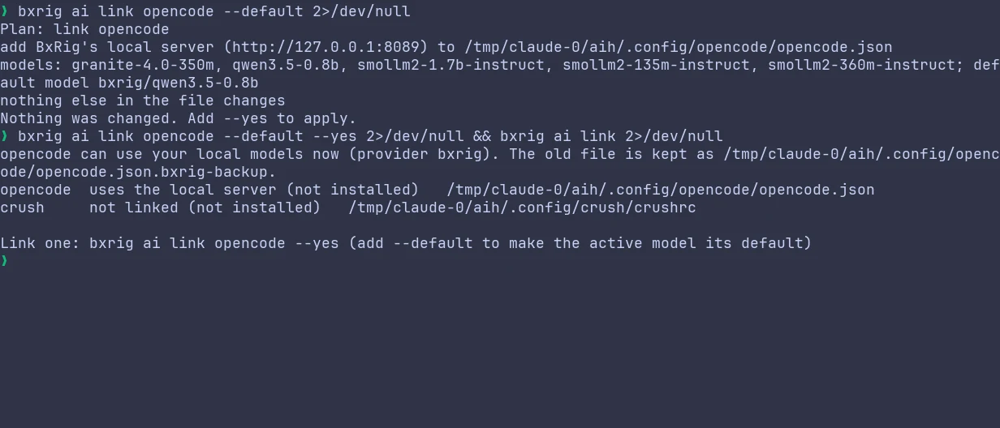
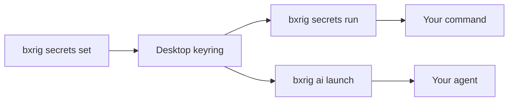

# AI agents and skills

Use this page to install and launch coding agents, keep their API keys safe and share skills between them.

## Try it

```bash
bxrig ai list
bxrig ai default claude-code --yes
bxrig ai launch                   # the default agent, with its keys loaded
```



## Install and launch agents

BxRig installs and launches coding agents (Pi, Claude Code, Codex, Gemini CLI, OpenCode, Kilo Code, GitHub Copilot CLI, Cursor Agent, Amp, Crush, Goose, Kiro, Qwen Code, Grok Build) and orchestrators.

```bash
bxrig ai list
bxrig ai default claude-code --yes
bxrig ai launch                   # the default agent, with its keys loaded
bxrig ai shell                    # a pull-down terminal (Super+`)
bxrig ai session start            # a persistent tmux session
```

Give any of them BxRig's own tools, and see what leaves your machine: [MCP and privacy](mcp-and-privacy.md).

## Keep API keys safe



The diagram shows how a key goes from you into the keyring and only then into the program that needs it.

Keys are stored in your desktop keyring (BxRig installs one if you have none), never in files or shell history.

```bash
bxrig secrets set ANTHROPIC_API_KEY     # typed hidden
bxrig secrets list
bxrig secrets run ANTHROPIC_API_KEY -- some-command
```

Each key is marked as an AI key or another kind, and agents declare which providers they accept (OpenCode can use several). Exporting keys globally is opt-in. Move keys between machines with `bxrig secrets export` (encrypted with age).

## Use skills with every agent

**Skills** are small `SKILL.md` files that teach an agent how to do one thing well. BxRig stores them once in `~/.agents/skills` and links each one into the skills folder of every agent you have (Claude Code, Codex, Gemini CLI, OpenCode). A folder of your own with the same name is never replaced.

```bash
bxrig skills install bxrig boxlang matchbox --yes
bxrig skills status
bxrig skills search matchbox            # the skills.boxlang.io hub
bxrig skills update --yes
```

The hub ([skills.boxlang.io](https://skills.boxlang.io)) audits every skill. A skill that failed its audit is refused. Skills are optional in the wizard (AI page).

## Go local

BxRig runs models on your machine with llama.cpp, picked for your hardware, with OpenAI and Anthropic compatible APIs on `127.0.0.1:8089`. Start with `bxrig ai setup`. See [Local AI](local-ai.md).

Your own agents, built with bx-agents (Boxy and the rest), run in the background with `bxrig ai agents`. See [BoxLang agents](boxlang-agents.md).

## Advanced

### Skills BxRig knows

| Name | What it is |
|---|---|
| `bxrig` | Five skills about BxRig itself, shipped inside the program |
| `boxlang` | BoxLang language fundamentals, from the hub |
| `matchbox` | The MatchBox runtime, from the hub |

Install one from the hub by its path:

```bash
bxrig skills install ortus-boxlang/skills/boxlang-developer~language-fundamentals --yes
```

Next: [Local AI](local-ai.md) · [BoxLang agents](boxlang-agents.md) · [MCP and privacy](mcp-and-privacy.md)
