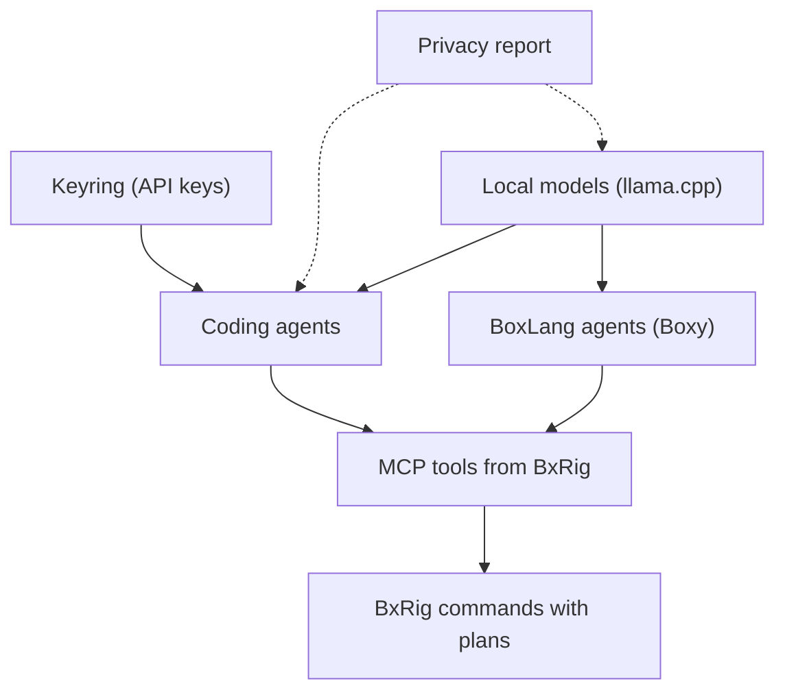

# AI on your machine

BxRig installs the AI tools you use, runs models on your own hardware, and shows what each tool sends out. Keys stay in your keyring.



The diagram is a map of the pieces: agents use your keys or your local models, both can use BxRig's tools over MCP, and the privacy report looks at all of it.

::: card title="Agents and skills" href="agents.md"
Install and launch coding agents, keep API keys safe, share skills.
:::

::: card title="Local AI" href="local-ai.md"
Models picked for your hardware, served on 127.0.0.1 with OpenAI and Anthropic APIs.
:::

::: card title="BoxLang agents" href="boxlang-agents.md"
Boxy and your own bx-agents, running in the background.
:::

::: card title="MCP and privacy" href="mcp-and-privacy.md"
BxRig's tools for every agent, and what leaves your machine.
:::

## Start here

```bash
bxrig ai setup --yes             # a local model that fits your machine
bxrig ai agents setup --yes      # Boxy, your desktop assistant
bxrig privacy                    # what leaves this machine
```
