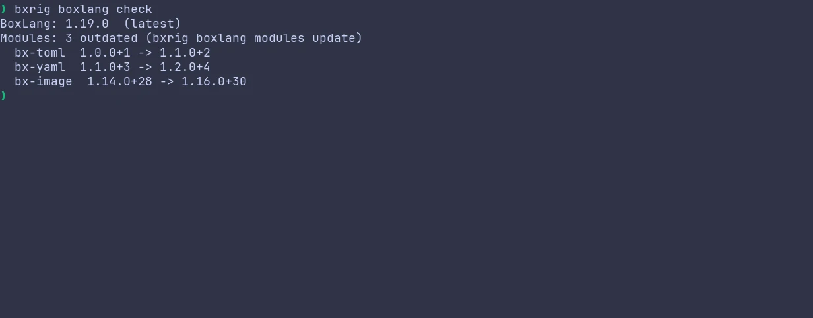
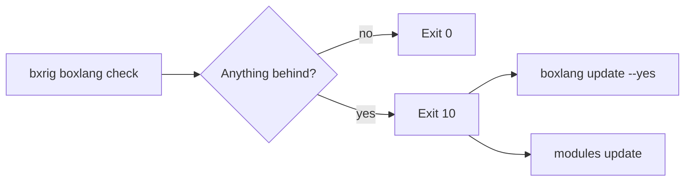
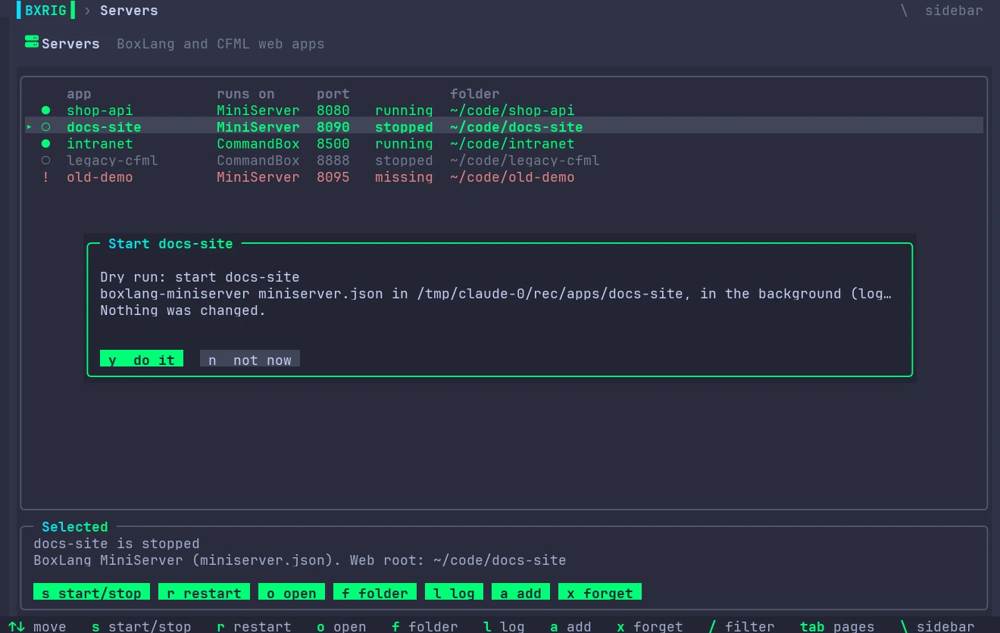

# BoxLang and MatchBox

Use this page to keep BoxLang and MatchBox current, manage modules and run your web apps.

The installer puts in Java 21, **bvm** (BoxLang Version Manager), **mvm** (MatchBox Version Manager), BoxLang and MatchBox. `bxrig boxlang` sits on top of them.

## Try it

```bash
bxrig boxlang status
bxrig boxlang check                   # your BoxLang and modules against the latest
bxrig boxlang update --yes
```



## Pick a version

```bash
bxrig boxlang use latest              # bvm: install if missing, then use
bxrig boxlang use snapshot
bxrig boxlang matchbox use latest     # mvm
bxrig boxlang run hello.bxs           # the real boxlang, in this terminal
bxrig boxlang repl
```

## Keep it up to date



The diagram shows how a check leads to an update.

```bash
bxrig boxlang check                   # BoxLang against the latest release, and every module against ForgeBox
bxrig boxlang update --yes            # bvm install latest + bvm use latest (or the quick installer when there is no bvm)
bxrig boxlang modules outdated        # the bx-module table
bxrig boxlang modules update          # every outdated module (bx-module update --force)
bxrig boxlang modules remove bx-ftp --yes
bxrig boxlang home --open             # ~/.boxlang (or BOXLANG_HOME): modules, config, logs
```

`check` reads the version from the jar next to `boxlang`, so the runtime is never started for it, and the latest from `version-latest.properties` on downloads.ortussolutions.com. It exits 10 when anything is behind, like `bxrig update check`. A build number does not count: 1.19.0 and 1.19.0+67 are the same release.

## Install modules

Modules come from [ForgeBox](https://forgebox.io) and install with `bx-module`.

```bash
bxrig boxlang modules list            # the live ForgeBox list
bxrig boxlang modules search ai
bxrig boxlang modules install bx-ai bx-sites
bxrig boxlang vscode                  # the BoxLang extension and developer pack
```

VS Code is a default app; the wizard offers to add the BoxLang extension (`ortus-solutions.vscode-boxlang`) and the developer pack.

<video src="../assets/clips/boxlang-modules-page.webm" poster="../assets/screenshots/modules-page.webp" autoplay loop muted playsinline width="100%"></video>

The **Control Center** has a Modules page (`bxrig tui modules`): `u` updates a module (or all outdated, on the first row), `x` removes one, `i` installs one. The **System panel** has a BoxLang tab: the version you run and the latest, an Update button, the modules with the ForgeBox version of each outdated one, Update modules, Open home folder and the Modules page. It asks ForgeBox at most every 10 minutes.

## Run your web apps

Register your BoxLang and CFML web apps once, then start, stop and open them from anywhere: the command line, the Control Center's Servers page (`bxrig tui servers`) or the BoxLang tab of the Developer panel.

```bash
bxrig boxlang servers scan ~/code --yes     # every folder with a miniserver.json or server.json (3 levels deep; --depth=N)
bxrig boxlang servers add ~/code/shop-api   # or one folder
bxrig boxlang servers start shop-api
bxrig boxlang servers open shop-api         # in the browser
```

<video src="../assets/clips/servers-cli.webm" poster="../assets/screenshots/servers-cli.webp" autoplay loop muted playsinline width="100%"></video>



More verbs:

```bash
bxrig boxlang servers                       # what is registered, and what runs
bxrig boxlang servers log shop-api --follow
bxrig boxlang servers folder shop-api       # in the file manager
bxrig boxlang servers stop shop-api
bxrig boxlang servers remove shop-api       # forgets it; the folder stays
```

The Developer panel also has a **Ports** tab: what listens on this machine (your dev servers, databases and apps, not the system's own), with a button to open a web port.

## Compile to a native binary

```bash
matchbox script.bxs
```

[MatchBox](https://matchbox.boxlang.io) compiles BoxLang to bytecode on a Rust runtime and can build standalone native binaries. BxRig itself is built this way.

## Advanced

### How BxRig drives a web app

| The folder has | It runs on | How BxRig drives it |
|---|---|---|
| `miniserver.json` | BoxLang MiniServer | `boxlang-miniserver miniserver.json` in the folder, detached; its output in `~/.local/state/bxrig/servers/NAME.log` |
| `server.json` | CommandBox | `box server start`, `stop` and `log` with `directory=` the folder |

The port, host and web root are read from that file every time, so editing it is enough. An app runs when its port is listening. A CommandBox app without `web.http.port` gets a port from CommandBox, so BxRig cannot tell it runs or open it: set the port in `server.json`. The registry is `~/.config/bxrig/servers.json`.

### The MatchBox home, `.env` files and logs

MatchBox follows the BoxLang CLI. On its first run it creates `~/.matchbox` (move it with `MATCHBOX_HOME`) holding `config/boxlang.json` and `logs/`. Every run also reads two `.env` files: `~/.matchbox.env` (yours) and `.env` in the directory you run from, where the project file wins. Scripts read the values with `getSystemSetting()`. BxRig is a MatchBox program, so it reads them too.

```bash
bxrig boxlang matchbox status         # the MatchBox home, config, .env files and logs
bxrig boxlang matchbox log-level info --yes
bxrig boxlang matchbox env list       # the names in ~/.matchbox.env, never the values
bxrig boxlang matchbox env set OPENAI_API_KEY sk-... --yes
bxrig boxlang matchbox log-level debug --yes
```

`log-level` changes `logging.rootLevel` in the home config and leaves its comments alone. `env set` writes one line to `~/.matchbox.env` (mode 600) and `env unset` removes it. The first command to change something prints a plan, and `--yes` applies it. Values are never printed.

BxRig writes the result of every command to its own MatchBox log, `~/.matchbox/logs/bxrig.log`, as `[bxrig] boxlang exit 4`. MatchBox keeps warnings and errors by default, so a normal run writes nothing and a failed precondition (exit 4) or a failure (exit 5 or 6) is recorded. To see every command, set the level of the `bxrig` logger in `~/.matchbox/config/boxlang.json`:

```json
{ "logging": { "loggers": { "bxrig": { "level": "INFO" } } } }
```

Exit 0 is written at `INFO`, a usage error or plan (2) and an update notice (10) at `DEBUG`, and exits 1, 3 and 4 as warnings. Nothing is written with an older MatchBox that has no runtime home.

These files and folders belong to MatchBox releases that have a runtime home. With an older MatchBox the commands still work on the files, but nothing reads them.

### Other commands

```bash
bxrig boxlang links                   # docs and sites
bxrig boxlang welcome                 # a getting-started page
```

[Try BoxLang](https://try.boxlang.io) · [Docs](https://boxlang.ortusbooks.com) · [BoxLang AI](https://ai.boxlang.io) · [BoxLang Agents](https://bxagents.ai) · [BoxLang Sites](https://bxsites.io) · [ForgeBox](https://forgebox.io) · [Skills](https://skills.boxlang.io)

Next: [Developer tools](developer-tools.md) · [Databases and virtual machines](databases-and-vms.md) · [Scheduler](../data/scheduler.md)
