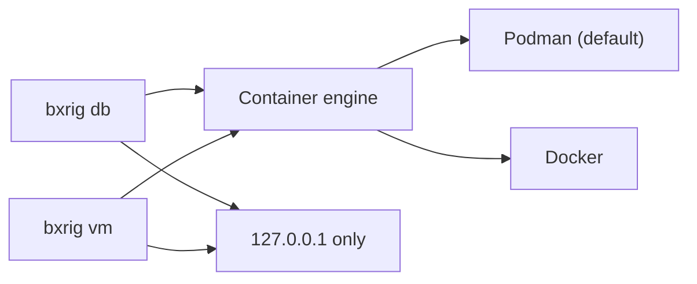

# Databases and virtual machines

Use this page to start a database for your app in one command, or to run a Windows or Linux desktop next to your own. Both run in containers: Podman by default, or Docker if you chose it with `bxrig db engine docker`.



The diagram shows that databases and virtual machines share one container engine and listen on this machine only.

## Databases

### Try it

```bash
bxrig db engines                 # what you can run
bxrig db start postgres --yes    # plan first without --yes
bxrig db info postgres           # host, port and how to connect (password hidden)
```

`start` creates a container with a pinned image, publishes its port on `127.0.0.1` only, and keeps the data in a named volume. A container that already exists is never replaced: a stopped one is started again. A password is generated for the engines that need one and kept in `~/.local/share/bxrig/databases/<container>/password` (mode 600), never on a command line.

### Run, look at, stop

```bash
bxrig db list                    # your database containers, running or not
bxrig db status postgres
bxrig db logs postgres           # the last 200 lines
bxrig db stop postgres
bxrig db remove postgres --yes   # the container AND its data
bxrig db remove postgres --keep-data --yes
bxrig db info postgres --show-password
```

`remove` deletes the container, its data volume and the password file. With `--keep-data` they stay, and starting the same name again reuses them.

Need two of the same engine? Give each a name:

```bash
bxrig db start postgres --name=shop --port=5433 --yes
```

Without `--name` the instance is called `default`. A name may contain letters, digits and hyphens (up to 40 characters), and a port is a whole number from 1024 to 65535. Choose your own password with `--ask-password` or `--password-file FILE`. `bxrig db menu` is a pick-from-a-list version of the same actions.

### Engines

| Kind | Engines |
|---|---|
| SQL | PostgreSQL 17 (`postgres`), MySQL 8.4 (`mysql`), MariaDB 11.8 (`mariadb`) |
| Cache | Redis 7.4 (`redis`) |
| Document | MongoDB 8.0 (`mongodb`), Couchbase community 8.0.2 (`couchbase`) |
| Vector | PostgreSQL with pgvector (`pgvector`), Chroma (`chroma`), Qdrant (`qdrant`), Weaviate (`weaviate`) |
| Search | Meilisearch (`meilisearch`), OpenSearch (`opensearch`), Elasticsearch (`elasticsearch`) |

`bxrig db engines` shows the exact image and default port of each. Milvus is listed but not supported yet: it needs several services, so one container would not work.

### Advanced

- Images are pinned to a major or minor version, never `latest`.
- `bxrig db engine docker` switches the container engine; `bxrig db engine` shows which one is in use.
- Couchbase publishes fixed extra ports, so `--port` is not accepted for it and only one instance can run. Finish its setup in the web console at `http://127.0.0.1:8091`, where you set the administrator name and password yourself.
- OpenSearch and Elasticsearch need the host setting `vm.max_map_count` of at least 262144; `start` stops with exit 4 when it is too low. Both use HTTPS with a self-signed certificate (use `curl -k`) and can take a minute to start. Elasticsearch uses about 1 GB of memory.
- pgvector: run `CREATE EXTENSION vector;` in the database to turn it on.
- Redis, Chroma and Qdrant have no password and Weaviate allows anonymous access: they are safe only because they listen on `127.0.0.1`. Never publish those ports.
- A kept data volume still has the password it was created with, so `start` refuses a different password for it. Remove it with `bxrig db remove ENGINE --yes` to start fresh.
- Exit codes: 0 done, 2 usage or plan printed without `--yes`, 4 a precondition failed (no container engine, unknown or unsupported engine, bad name or port), 6 the container command failed.

## Virtual machines

`bxrig vm` runs full desktops in containers: Windows (the dockur/windows image) and Linux desktops (LinuxServer's webtop, a desktop in your browser).

### Try it

```bash
bxrig vm doctor                          # is this machine ready? (KVM, groups, GPU, disk)
bxrig vm create linux dev                # a Ubuntu XFCE desktop called dev
bxrig vm list                            # all of them: state, ports, disk used
bxrig vm open dev                        # starts it if needed and opens it
```

`create` shows a plan first; add `--yes` to do it. `--dry-run` never changes anything.

### Linux desktops

```bash
bxrig vm versions linux                  # the tags
bxrig vm create linux arch --tag=arch-kde --gpu=auto
```

`versions linux` lists Ubuntu, Debian, Fedora and Arch with XFCE, KDE Plasma, MATE or i3 (plus LXQt on Ubuntu), and a small Alpine. The default is `ubuntu-xfce`. Make as many as you want; each gets its own port, data folder and password.

`vm open NAME` opens `https://127.0.0.1:PORT/` in your browser. The certificate is self-signed, so accept it once. The user is `bxrig`; show the password with `bxrig vm info NAME --show-password`.

**GPU** (optional): `--gpu=intel` or `--gpu=amd` passes `/dev/dri` in. `--gpu=nvidia` is supported too; it needs the NVIDIA driver 580 or newer and the NVIDIA container toolkit, and it is not available on the Alpine tags. `--gpu=auto` uses `/dev/dri` when the machine has it. `vm doctor` shows what your machine has.

### Windows

```bash
bxrig vm create windows                  # asks which Windows
bxrig vm open NAME --web                 # watch it install
bxrig vm open NAME                       # when ready: opens with FreeRDP
```

Windows installs itself the first time it starts: it downloads the ISO inside the container (3 to 8 GB) and takes a while. When it is ready, `vm open` opens it with FreeRDP, with the clipboard shared and the window resizable.

> **Warning:** You need your own Windows license. The install uses generic trial keys that do not activate Windows.

Windows needs `/dev/kvm`: turn on virtualization in the firmware and put yourself in the `kvm` group. `vm doctor` tells you what is missing. Defaults: half your RAM (4 to 8 GB), half your cores, a 64 GB disk. Change them with `--ram`, `--cpus` and `--disk`.

### Stop and remove

```bash
bxrig vm stop dev
bxrig vm remove dev            # the container, its data, password and menu entry (it asks first)
bxrig vm remove dev --keep-data
bxrig vm size                  # how much disk each VM uses
```

Your shared folder is never deleted. Everything listens on `127.0.0.1` only.

### Advanced

Windows versions (pass `--version=VALUE` in a script):

| Choice | Size | Note |
|---|---|---|
| `11` Windows 11 Pro | 7.9 GB | the usual choice |
| `11l` Windows 11 LTSC | 4.7 GB | long-term servicing edition, fewer bundled apps |
| `11e` Windows 11 Enterprise | 6.6 GB | business edition |
| `10` Windows 10 Pro | 5.7 GB | older, for legacy needs |
| `10l` Windows 10 LTSC | 4.6 GB | long-term servicing edition |
| `tiny11` Tiny11 | 5.3 GB | **unofficial** stripped-down build from the community |
| `core11` Tiny11 Core | 3.0 GB | **unofficial**, the most stripped-down |
| `tiny10` Tiny10 | 3.6 GB | **unofficial** stripped-down Windows 10 |
| `2025`, `2022` Windows Server | 7.6, 6.0 GB | server editions |

`bxrig vm versions windows` shows all 25 (down to Windows 95 and ReactOS).

Where everything is:

| What | Where |
|---|---|
| Disk and files of each VM | `~/.local/share/bxrig/vms/NAME` (`storage` for Windows, `config` for Linux) |
| The VM's record | `~/.config/bxrig/vms/NAME.json` |
| Its password | your keyring, as `BXRIG_VM_NAME_PASSWORD` (see `bxrig secrets`) |
| Shared folder | `~/Windows` (drive Z: in Windows) or `~/Shared` (inside the Linux desktop); `--share=PATH` or `--share=none` |
| App menu entry | `~/.local/share/applications/bxrig-vm-NAME.desktop` |
| The container images | in Podman or Docker (`podman image ls`) |

Next: [Mail catcher](mail.md) · [Developer tools](developer-tools.md) · [Backups](../data/backups.md)
