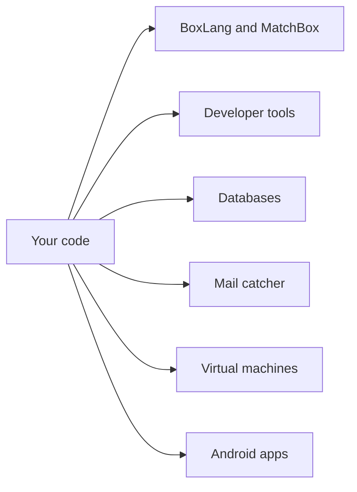

# Build software

Everything you need to write and test software, set up with one command each. Every command that changes something shows a plan first and needs `--yes`.

The diagram shows what you can run next to your code. Pick a page:

::: card title="BoxLang and MatchBox" href="boxlang.md"
Versions, modules, your web apps and a native binary.
:::

::: card title="Developer tools" href="developer-tools.md"
API clients, cloud CLIs, signed commits and a check of your setup.
:::

::: card title="Databases and virtual machines" href="databases-and-vms.md"
PostgreSQL, Redis and more in containers, plus Windows and Linux desktops.
:::

::: card title="Mail catcher" href="mail.md"
A local inbox for the mail your app sends while you develop.
:::

::: card title="Android apps" href="android.md"
Android apps in their own windows with Waydroid. Off until you turn it on.
:::
