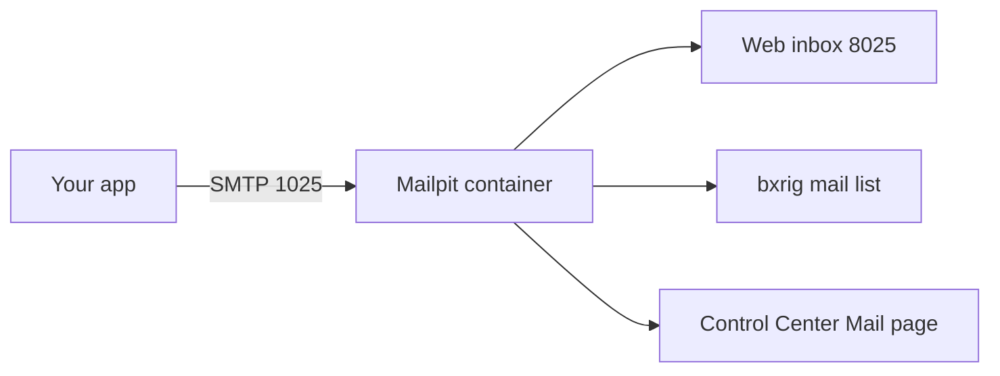

# Mail catcher

When you build an app that sends email, you want to see the mail without sending it to anyone. `bxrig mail` runs a catcher in a container ([Mailpit](https://mailpit.axllent.org)): your app sends to `127.0.0.1:1025` and the mail shows up in an inbox. Nothing leaves your machine.

## Try it

```bash
bxrig mail start --yes        # plan first without --yes
bxrig mail test               # send one sample message
bxrig mail open               # the web inbox in your browser
```

It needs a container engine: Podman by default, or Docker (`bxrig db engine docker`).



The diagram shows where your app's mail goes.

## Point your app at it

`bxrig mail env` prints the settings for BoxLang and ColdBox apps, Laravel, Spring Boot, Node and plain environment variables. In short: host `127.0.0.1`, port `1025`, no encryption, no username or password.

## Read the mail

```bash
bxrig mail list               # what arrived
bxrig mail show ID            # headers, text body and attachments
bxrig mail clear --yes        # delete every message
bxrig mail stop
```

`bxrig tui` has a Mail page. It lists the messages (newest first), shows the headers and text of the highlighted one, and refreshes itself every few seconds so you can watch mail arrive. `d` deletes a message, `c` clears the inbox, `o` opens it rendered in your browser and `t` sends a test message. Deleting and clearing show a plan first.

The setup wizard has a yes or no question for the mail catcher (off by default). The task menu has Develop > Mail catcher.

## Keep the mail between runs

Without `--keep`, stopping the catcher deletes it and its mail. That is what you want while developing: every run starts with an empty inbox. If you want the mail to survive, start it with `bxrig mail start --keep --yes`; it is then stored in `~/.local/share/bxrig/mail`. `bxrig mail remove --yes` deletes the container and any stored mail (`--keep-data` keeps the folder).

## Advanced

The catcher listens on `127.0.0.1` only: SMTP on port 1025 (no TLS, any login is accepted) and the web inbox on port 8025. Change the ports with `--smtp-port=2525` and `--ui-port=9025`.

Next: [Databases and virtual machines](databases-and-vms.md) · [Developer tools](developer-tools.md)
