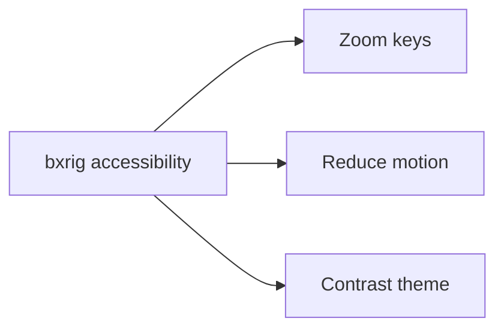
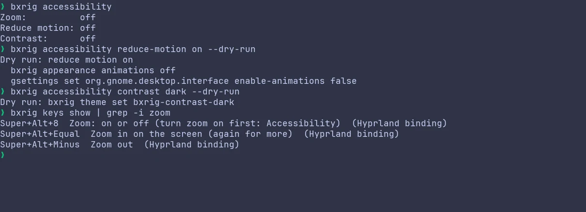
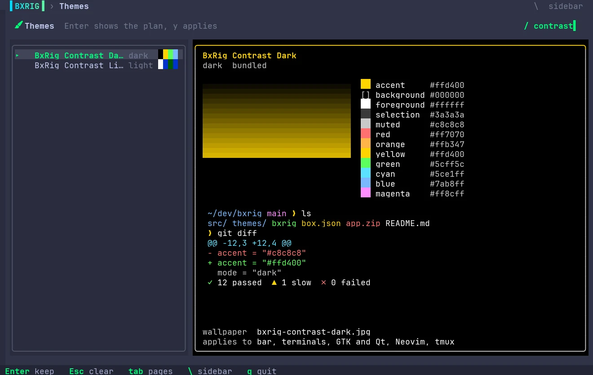
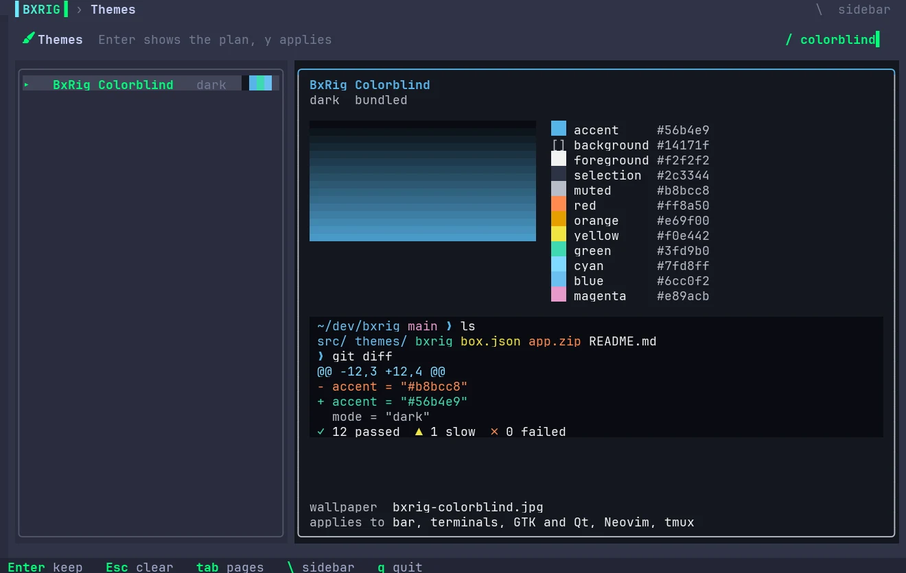

# Accessibility

Zoom, reduce motion and three high-contrast themes, all off until you turn them on.

## Try it

Turn them on from the Control Center (`bxrig tui accessibility`), the menu (Appearance > Accessibility), the Quick panel (Zoom) or the command line.

```bash
bxrig accessibility                       # what is on
bxrig accessibility zoom on               # the zoom keys start working
bxrig accessibility reduce-motion on      # no window, bar or app animations
bxrig accessibility contrast dark         # dark, light, colorblind, or off to go back to your theme
```

They are settings: they act at once, and `--dry-run` shows the commands first.

The three settings and what they switch:



<video src="../assets/clips/accessibility-page.webm" poster="../assets/screenshots/accessibility-page.webp" autoplay loop muted playsinline width="100%"></video>



## Zoom

The same keys as on a Mac (Option is `Alt`, Cmd is `Super`):

| Keys | What it does |
|---|---|
| `Super+Alt+8` | Zoom on or off (back to the last zoom you used) |
| `Super+Alt+Equal` | Zoom in, half a step each time (up to 10x) |
| `Super+Alt+Minus` | Zoom out |

While zoom is off the keys only say how to turn it on, so they never surprise you. On Hyprland the screen zooms around the pointer (`cursor:zoom_factor`). On Plasma BxRig loads KWin's Zoom effect and uses its shortcuts; Plasma's own keys, `Meta+=` and `Meta+-`, work too.

## Reduce motion

Turns off the animations of windows and workspaces (Hyprland), of the bar and panels (Noctalia), of GTK apps (`enable-animations`) and of Plasma (its animation speed). `bxrig accessibility reduce-motion off` brings them back.

## Contrast themes

| Theme | Look |
|---|---|
| `bxrig-contrast-dark` | white on black, a yellow accent |
| `bxrig-contrast-light` | black on white, a blue accent |
| `bxrig-colorblind` | blue and orange instead of red and green (Okabe-Ito hues), on a dark slate |





Every text colour in them is at least 7:1 against the background (WCAG AAA); a test checks it. Their wallpapers are plain, and Neovim gets the matching high-contrast or colour-blind GitHub colorscheme. `bxrig accessibility contrast off` goes back to the theme you had before. They are ordinary themes too: `bxrig theme set bxrig-colorblind` works.

Next: [Themes](themes.md), [Shortcuts](../desktop/shortcuts.md), [Boxy's look and voice](boxy-look.md).
