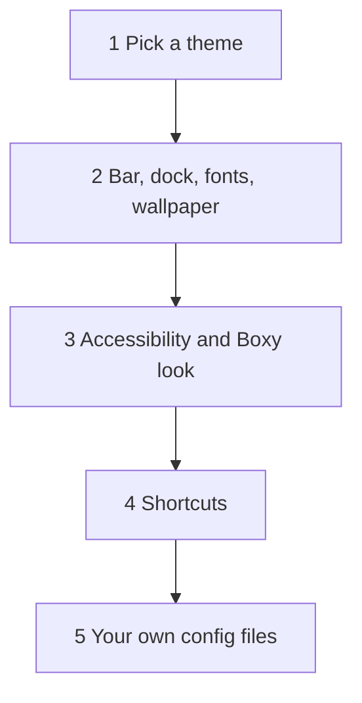

# Customize

Start with the first step and stop whenever it looks right. Each step goes a little deeper than the one before.



| Step | What you do | Page |
|---|---|---|
| 1 | Pick a theme: 24 color themes, each with a wallpaper | [Themes](themes.md) |
| 2 | Change the bar, dock, windows, fonts, icons and wallpaper | [Appearance](appearance.md) |
| 3 | Zoom, reduce motion and contrast themes; give Boxy a name, a colour and a voice | [Accessibility](accessibility.md), [Boxy's look and voice](boxy-look.md) |
| 4 | Rebind keys or switch to the Mac style | [Shortcuts](../desktop/shortcuts.md) |
| 5 | Edit the config files yourself and keep BxRig's generated ones | [Your own config](your-own-config.md) |

```bash
bxrig theme next               # the quickest tweak: another theme
bxrig appearance status        # what you have chosen so far
bxrig config list              # which files are BxRig's and which are yours
```

> **Note:** Settings act at once and are remembered. Add `--dry-run` to see what a command would do first.
