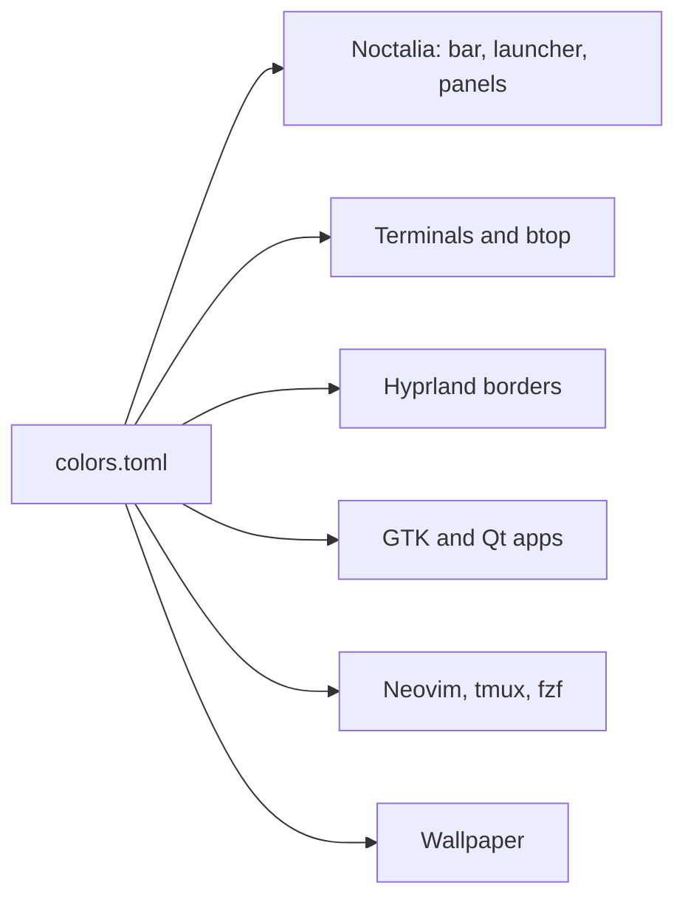
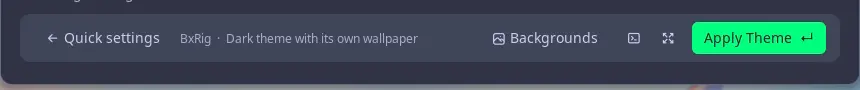
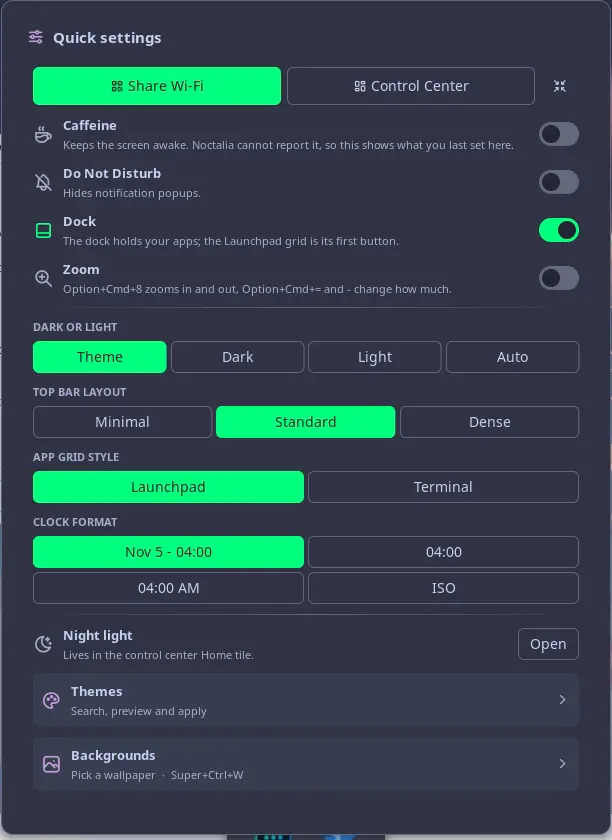

# Themes

Pick one of 24 color themes, each with its own wallpaper, and it follows you into the shell, terminals, btop, window borders and Neovim.

## Try it

```bash
bxrig theme list                  # all themes, the current one marked
bxrig theme set tokyo-night       # apply one now
bxrig theme next                  # or random
```


Setting a theme acts at once. `--dry-run` shows what would be written without changing anything.

## One theme, many places

A theme is one `colors.toml`. Setting it writes the files below.



## Light, dark or automatic

```bash
bxrig theme mode auto             # theme, dark, light or auto
bxrig theme status
```

## Pick from the switcher

On Hyprland the Themes row of the bar's quick settings popover (the sliders button), or <kbd>Super</kbd>+<kbd>Ctrl</kbd>+<kbd>Shift</kbd>+<kbd>Space</kbd>, opens the theme switcher: type to filter, see the theme's wallpaper, <kbd>Enter</kbd> applies it everywhere at once.

<video src="../assets/clips/theme-switcher.webm" poster="../assets/screenshots/panel-theme-switcher.webp" autoplay loop muted playsinline width="100%"></video>


## Pick a wallpaper

A theme brings its own wallpaper, but you can pick another one any time. <kbd>Super</kbd>+<kbd>Ctrl</kbd>+<kbd>W</kbd> opens the wallpaper panel, and so does the **Backgrounds** button in the theme switcher footer and the **Backgrounds** row in quick settings. It is Noctalia's own panel: tabs for Built-In, Wallpaper, Community and Custom (our `~/Pictures/BxRig` collection is the BxRig folder), a filter, favourites, and Dark, Light or Auto. Without Noctalia the key runs `bxrig theme wallpaper next`.

<video src="../assets/clips/wallpaper-backgrounds.webm" poster="../assets/screenshots/wallpaper-panel.webp" autoplay loop muted playsinline width="100%"></video>





The Themes page of the Control Center (`bxrig tui themes`) is the selector: every theme with a color swatch, a filter (type to search, `d` for dark and `l` for light), a preview of the highlighted one (palette roles, a sample terminal and its wallpaper), `r` to preview it live (the whole Control Center is recoloured, nothing is applied; `r` again stops), and `Enter` for the plan and `y` to apply.

Setting a theme acts at once. `--dry-run` shows what would be written without changing anything.

## The 24 themes

BxRig ships 24 themes in the `colors.toml` format: fourteen of ours (six dark, five light, among them the neon 80s `bxrig-retro`, and three accessible ones: `bxrig-contrast-dark`, `bxrig-contrast-light` and `bxrig-colorblind`, see [Accessibility](accessibility.md)) and ten community themes.

Ours: BxRig, BxRig Cyan, BxRig Forest, BxRig Midnight and BxRig Ember (dark), BxRig Light, BxRig Dawn, BxRig Paper, BxRig Mint and BxRig Sky (light). Community themes: catppuccin, catppuccin-latte, tokyo-night, gruvbox, nord, rose-pine, kanagawa, everforest, matte-black and flexoki-light (MIT, credited in `themes/NOTICE.md`). Each one below is shown with its wallpaper and `btop` in a themed terminal.

| | |
| --- | --- |
| <br>**BxRig** · `bxrig` · dark | <br>**BxRig Cyan** · `bxrig-cyan` · dark |
| <br>**BxRig Forest** · `bxrig-forest` · dark | <br>**BxRig Midnight** · `bxrig-midnight` · dark |
| <br>**BxRig Ember** · `bxrig-ember` · dark | <br>**BxRig Light** · `bxrig-light` · light |
| <br>**BxRig Dawn** · `bxrig-dawn` · light | <br>**BxRig Paper** · `bxrig-paper` · light |
| <br>**BxRig Mint** · `bxrig-mint` · light | <br>**BxRig Sky** · `bxrig-sky` · light |
| <br>**Catppuccin** · `catppuccin` · dark | <br>**Catppuccin Latte** · `catppuccin-latte` · light |
| <br>**Tokyo Night** · `tokyo-night` · dark | <br>**Gruvbox** · `gruvbox` · dark |
| <br>**Nord** · `nord` · dark | <br>**Rosé Pine** · `rose-pine` · light |
| <br>**Kanagawa** · `kanagawa` · dark | <br>**Everforest** · `everforest` · dark |
| <br>**Matte Black** · `matte-black` · dark | <br>**Flexoki Light** · `flexoki-light` · light |


## Your own themes

`bxrig theme install https://github.com/someone/name-theme` installs a theme repository in the same format (https only). Theme folders you already have from other setups are found automatically. A theme is a folder with `colors.toml`, an optional `neovim.lua` and an optional `backgrounds/` folder:

```bash
bxrig theme import ~/my-theme --name=mine
bxrig theme remove mine
```

Every bundled theme, BxRig's own included, uses the standard `colors.toml`: `mode`, `accent`, `selection`, `muted`, the background shades (`background`, `dark_background`, `darker_background`, `lighter_background`), the foreground shades (`foreground`, `dark_foreground`, `light_foreground`, `bright_foreground`) and the named colours (`red` to `brown`, then `bright_red` to `bright_magenta`). The terminal palette comes from them: black is `background`, white is `foreground`, bright black is `muted`, bright white is `bright_foreground`, and the cursor is `bright_foreground`. The older `color0` to `color15` list is still read, for themes you install from elsewhere.


## Neovim and the prompt

`bxrig editor lazyvim --yes` installs the LazyVim starter plus the BxRig layer: transparent background, BoxLang syntax highlighting ([vim-boxlang](https://github.com/ortus-boxlang/vim-boxlang)), no news popups, the neo-tree extra, and live theme following. An existing `~/.config/nvim` is never touched. To add only BoxLang syntax to a LazyVim config you already have: `bxrig editor boxlang --yes`.


The starter Starship prompt shows your BoxLang version, like Java, in folders with `.bx`, `.bxs`, `.bxm`, `.cfc`, `.cfm` or `.cfs` files, `box.json` or `Application.bx`. The starter file is written once, so an existing prompt keeps what you have; `bxrig config diff starship` shows what is new.

## Advanced

### What changes, by app

| Where | How |
|---|---|
| Noctalia (bar, launcher, panels, notifications) | a generated palette and the light or dark mode |
| Ghostty, kitty, alacritty, foot | generated files that the starter configs include |
| btop | a generated theme file |
| Hyprland window borders | the accent color, read by the managed `bxrig.lua` |
| Neovim (LazyVim setup) | the matching colorscheme, applied live without a restart |
| KDE Plasma | switches between Breeze Light and Breeze Dark |
| GTK 3 and 4 apps | `~/.config/gtk-4.0/gtk.css` and `gtk-3.0/gtk.css` (libadwaita colors; adw-gtk3 for GTK 3), plus the dark or light preference through gsettings |
| Qt apps | qt6ct and qt5ct color schemes (set the style to qt6ct in your environment) |
| tmux, fzf | `theme/tmux.conf` and `theme/fzf.sh`, with a one-line hint to source them |
| rofi, fuzzel, wofi | a rofi theme (and a `config.rasi` stub when you have none), `fuzzel.ini`, wofi `style.css` |
| Wallpaper | a theme brings its own wallpaper (3840x2400, drawn by code so it is sharp on a high-density screen); use `--keep-wallpaper` to skip it. BxRig also ships a collection of extra wallpapers in `~/Pictures/BxRig` (`bxrig-tron`, `bxrig-neon`, `bxrig-city`, `bxrig-aurora`, `bxrig-orbit`, `bxrig-circuit`, `bxrig-rain`, `bxrig-waves`) to pick by hand |


A theme can name a font with a `font = "ID"` line in its `colors.toml` (an id of `bxrig appearance font list`; other tools ignore the line). `bxrig-retro` names `sharetech`, Share Tech Mono Nerd (Arch package `ttf-sharetech-mono-nerd`): once it is installed (`bxrig appearance font install sharetech --yes`) `theme set` makes it the shell and terminal font, and until then the plan says so. Other themes leave your font alone.

`bxrig banner` prints the BXRIG wordmark in the colors of the current theme (`--json` gives the lines); the retro theme uses it as a terminal greeting.

VS Code is opt-in: `bxrig theme vscode` shows a plan, `--yes` merges the colors into `workbench.colorCustomizations` of Code, Code - OSS, VSCodium or Cursor (a backup is kept; a settings file with comments is left alone). Not themed: the Starship prompt, browsers and icons. Your own config files are never edited. Terminal configs you wrote yourself need one include line, which `bxrig theme set` prints.

Bar, dock, windows, fonts and backgrounds are in [Appearance](appearance.md).

Next: [Appearance](appearance.md), [Accessibility](accessibility.md), [Your own config](your-own-config.md).
