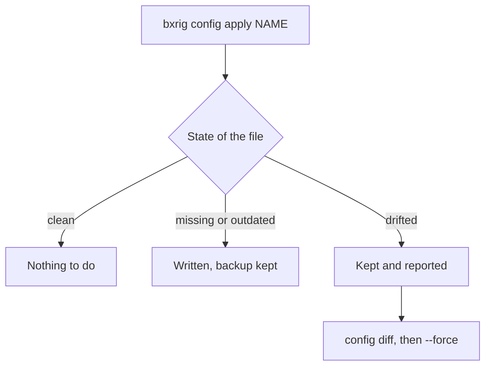

# Your own config

BxRig writes starter config files once and generated files again and again. It never overwrites a file you edited, and every change it does make can be undone.

## Try it

```bash
bxrig config list                  # every managed file and its state
bxrig config diff hypr/bxrig.lua   # how it differs from what BxRig would write
bxrig config history               # every change BxRig made, with an id
```

`config list` prints one line per file, such as `hypr/bxrig.lua: clean (/home/you/.config/hypr/bxrig.lua)`.

## What is yours and what is BxRig's

| Kind | Example | Rule |
|---|---|---|
| **Starter**, written once | `~/.config/hypr/hyprland.lua`, `~/.config/noctalia/config.toml`, terminal and Starship configs | Yours from the moment it is written. Edit freely. |
| **Generated**, rewritten on change | `~/.config/hypr/bxrig.lua`, `~/.config/bxrig/theme/look.lua`, `hypr.lua`, `monitors.lua`, `~/.config/xremap/config.yml` | BxRig's. Never edit; change the setting instead. |
| **Settings** BxRig reads | `~/.config/bxrig/shortcuts.json`, `appearance.json`, `menu.json` | Yours, through the commands (`bxrig keys set`, `bxrig appearance`) or by hand where noted. |

Every path is listed in [Files and folders](../reference/config-files.md).

> **Note:** Moving `XDG_CONFIG_HOME` moves all of these. `BXRIG_CONFIG_HOME` wins over it.

## Edit a starter file

Open it and change it. BxRig will not touch it again. If you want BxRig's current starter back, `bxrig refresh hyprland --starter --yes` (or `noctalia`) rewrites it after a backup.

## Use BxRig's generated files from your own config

The starter Hyprland file already loads the generated shortcuts with `require("bxrig")` at the bottom. For anything else, add one include line to your own file:

Replace `/home/you` with your home folder.

| Tool | Line to add |
|---|---|
| Ghostty | `config-file = ?/home/you/.config/bxrig/theme/ghostty` |
| kitty | `include /home/you/.config/bxrig/theme/kitty.conf` |
| alacritty | `import = ["/home/you/.config/bxrig/theme/alacritty.toml"]` under `[general]` |
| foot | `include=/home/you/.config/bxrig/theme/foot.ini` |
| tmux | `source-file /home/you/.config/bxrig/theme/tmux.conf` |
| rofi | `@theme "/home/you/.config/bxrig/theme/rofi.rasi"` |

`bxrig theme set` prints the exact line, with your real path, for each config of yours that does not follow the theme yet.

## How a change is applied

Every file BxRig writes goes through one safe writer.


- **Plan:** without `--yes` you see what would happen and nothing changes (exit 2).
- **Backup:** the old file is copied to `~/.local/state/bxrig/backups/NAME/` (mode 600).
- **Atomic write:** the new text goes to a temporary file, then replaces the target in one step.
- **Journal:** one record per change in `~/.local/state/bxrig/journal/`, with the file's hash before and after and the backup path. BxRig keeps the last 20 per file.

A single lock file (`~/.local/state/bxrig/lock`) stops two BxRig runs from writing at once. A symlink or special file at the target is refused.

## Drift: when you edited a file



| State | Meaning |
|---|---|
| `clean` | the file is exactly what BxRig would write |
| `missing` | the file does not exist yet |
| `outdated` | the file is what BxRig last wrote, but BxRig would now write something newer |
| `drifted` | you changed it. BxRig keeps it and says so |
| `blocked` | the target is not a regular file (for example a symlink) |

To see what differs run `bxrig config diff NAME`. To replace your version anyway, `bxrig config apply NAME --force --yes`; your version is kept in the backup.

## Undo

```bash
bxrig config history hypr/bxrig.lua            # find the journal id
bxrig config restore hypr/bxrig.lua ID --yes   # put that backup back
```

A restore puts the backup back byte for byte and records itself in the journal. It refuses when there is no backup (the file did not exist before, or the backup was pruned) or when the backup no longer matches its recorded hash.

## Advanced

- `bxrig config list|diff|apply|restore|history` take `--dry-run`, `--force` and `--json`.
- `bxrig refresh hyprland|noctalia|terminals|shell|nvim|theme|all` puts a whole component's files back to what BxRig ships, with a backup first and without installing anything. `--force` overwrites a file you edited, `bxrig refresh list` shows what each component owns.
- `bxrig config apply NAME` takes the name shown by `config list`.
- Config snapshots of your whole BxRig setup are a different tool: see [Backups](../data/backups.md).

Next: [Files and folders](../reference/config-files.md), [Themes](themes.md), [Shortcuts](../desktop/shortcuts.md).
