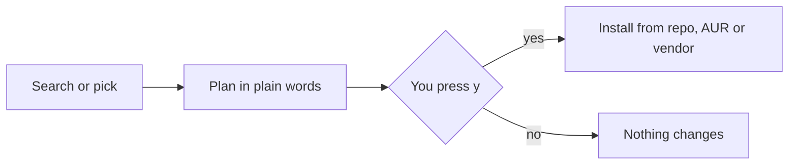

# Apps and web apps

Use this page to find, install, remove and update software without knowing what a package is.

## Try it

```bash
bxrig tui apps                  # the Apps manager
bxrig install vlc heidisql --yes
bxrig web install google --yes  # Docs, Drive, Gmail, Calendar... as app windows
```




The diagram shows that every change in the Apps manager shows its plan first and waits for you.

## Use the Apps manager

`bxrig tui apps` (or the **Apps** page, second in the Control Center, or `bxrig launchers on` for a menu entry) is where you find, install, remove and update software.

```
 Installed (24)   Discover   Updates (3)
 › Search your apps
 ╭──────────────────────────────╮ ╭────────────────────────────╮
 │▸ Firefox     extra   272 MB  │ │ [icon]  Firefox            │
 │  Obsidian    AUR     200 MB  │ │         extra   133.0-1    │
 │  ...                         │ │ Fast, private web browser  │
 ╰──────────────────────────────╯ │  o open   x remove   n info│
                                  ╰────────────────────────────╯
```

**Three tabs.** Left and Right (or `1`, `2`, `3` from the list) switch between them.

- **Installed** lists the apps that have a launcher, one row per package, with where each came from in plain words (a repository like `extra`, `AUR` for community build scripts, `Flatpak`, or `built here` for anything installed from outside the repositories), its size, and the date. `s` sorts by name, size or source, `f` filters by source.
- **Discover** shows the catalog by category when the search box is empty (`Enter` opens a category, `Escape` goes back). Type to search: catalog apps show at once (so `email` finds Thunderbird, Gmail, HEY and friends, also by what an app does), then the repositories and the AUR follow in the background after you pause typing. A check mark shows what you already have.
- **Updates** counts what is waiting (from `checkupdates`, plus `yay` or `paru` for the AUR) and has one button, **Update all**, which runs `bxrig system update`. Arch is updated all together on purpose; updating one package alone can break the others.

**The search box is always there.** Typing searches, so there is nothing to learn. `Down` or `Enter` moves into the list, where the keys are actions: `i` install, `x` remove, `o` open, `n` info, `u` update all, `/` or `Escape` back to the search box, `q` quit. A click works everywhere.

**Every change shows a plan first**, in plain words, and waits for `y`. Removing an app says what else goes with it (unused dependencies) or that something else needs it, and that your files and settings in your home folder stay. Installing from the AUR says so before anything runs.

## Install from the catalog

BxRig knows about 290 apps and web apps in groups (development, terminal, AI, infrastructure, network, system, desktop, everyday, web apps, media, gaming). Each is **default** (installed by the wizard's Basic mode) or **optional**. Sources: official packages first (`pacman`), then the AUR (`yay`), PKGBUILDs pinned to a commit, vendor installers and web apps.

```bash
bxrig catalog list --group media
bxrig catalog show strata
bxrig install vlc heidisql --yes
bxrig profile-install jvm --yes        # a ready-made set
```

In the wizard, **Basic** installs the recommended set; **Customize** lets you tick apps per category. Some entries only apply to one desktop (they say so).

## Add web apps

A web app is a frameless window with its own launcher entry.

```bash
bxrig web add Notion https://notion.so --yes
bxrig web list
bxrig web install google --yes         # Docs, Drive, Gmail, Calendar, Maps, Photos, YouTube...
bxrig web install microsoft --yes      # Word, Excel, PowerPoint, Outlook, Teams, OneDrive
bxrig web install apple --yes          # iCloud, Pages, Numbers, Keynote, Apple Music, Apple TV
```

The same three are in the wizard (Apps page) and the control center (Web apps).

## Set your defaults

```bash
bxrig default show
bxrig default browser brave --yes
bxrig default terminal ghostty --yes
bxrig default filemanager strata --yes
```

## View images and PDFs

A plain install gives you one app for each job, the way Preview does on a Mac.

| You want to | Use | Mac |
|---|---|---|
| View, crop, rotate and annotate an image | **Gwenview** (the default for image files; HEIC and AVIF open through the image format plugins that are installed with it) | Preview |
| Read a PDF | **Okular** (the default for PDF files) | Preview |
| Sign a PDF or fill it in | **Signed** (from the AUR) | Preview (sign PDF) |
| Annotate a screenshot | **Satty** | Preview markup, Screenshot |

The wizard sets Gwenview and Okular as the default apps for those file types after it installs them (Basic mode, or when you tick them in Customize). To change it later, use your desktop's file type settings or `xdg-mime default`. imv stays in the catalog as an optional lightweight viewer. Quick Look (the space bar preview) is still Kiview.

## Files and sharing

The default file manager is **Strata**; Dolphin is the alternative (`bxrig dolphin doctor` checks it works outside Plasma). `bxrig strata integrations` adds LocalSend and KDE Connect to Strata's *Send to* menu. `bxrig quicklook PATH` previews a file with Kiview.

## More tools

| Area | Command |
|---|---|
| Dictation | `bxrig dictation setup superwhisper\|voxtype --yes` |
| Databases | `bxrig db list\|start ENGINE\|stop\|status\|logs` (see [Databases and virtual machines](../build/databases-and-vms.md); HeidiSQL and DBeaver are in the catalog) |
| Cloud storage as folders | `bxrig cloud remotes\|configure\|mount NAME\|status` (rclone 1.74 and later has its own web GUI: `rclone gui`) |
| VPN | `bxrig vpn list\|connect NAME\|disconnect\|locations NAME` (one list: saved network profiles, NordVPN, NordLayer, Tailscale, Mullvad), `bxrig vpn nordvpn setup` |
| Containers | `bxrig containers doctor\|socket enable\|docker-compat\|list\|start\|stop\|restart\|logs` |
| Editor | `bxrig editor lazyvim` |
| GPU drivers | `bxrig gpu doctor` |

## Advanced

### Password managers

The Security category of the catalog has these, and the wizard's "Password manager" question offers the same list (Bitwarden stays the default):

| App | Source | Notes |
|---|---|---|
| Bitwarden, KeePassXC | official repo (`extra`) | desktop apps |
| 1Password, Proton Pass, Enpass, NordPass, Keeper | AUR | desktop apps; NordPass is a repack of the vendor's Snap release |
| Bitwarden CLI, pass, gopass | official repo (`extra`) | terminal tools, no window |

Web only: use the browser extension. Dashlane has no Linux desktop app (only a browser extension) and LastPass has only its browser extension and an unofficial command line tool, so neither is in the catalog. Install their extension from your browser's add-on store.

Checked on 2026-11-15 against the Arch package search and the AUR (package exists and is not flagged out of date), not by installing each one. Proton Pass and Enpass also exist on Flathub, but the catalog has no Flatpak source, so they use the AUR packages.

### Manager details

The text you typed stays when you move between Installed and Discover; Updates has its own filter.

**Pictures.** The preview shows the app's icon and, for installed apps that have them, screenshots, through the same cache as the other pages ([Pictures in the terminal](../maintain/images.md)). With no picture you get a coloured tile with the app's first letter. Nothing waits for a picture.

**On a small terminal** (80 columns by 24 rows) the preview moves under the list. Below about 90 columns the Control Center also collapses its sidebar by itself.

```bash
bxrig tui apps --demo           # made-up data, nothing is read or run
bxrig tui apps --json           # the installed list and the update count, no terminal needed
```

Settings for tests and unusual machines: `BXRIG_DESKTOP_DIRS` (folders with `.desktop` files, colon separated, instead of `/usr/share/applications` and your own) and `BXRIG_CACHE_HOME`. Every outside command is optional: no `pacman`, `checkupdates` or `flatpak` gives an empty list and a sentence on screen, never an error.

Next: [Updates and channels](../maintain/updates.md) · [Backups](backups.md) · [Export and import](export-import.md)
