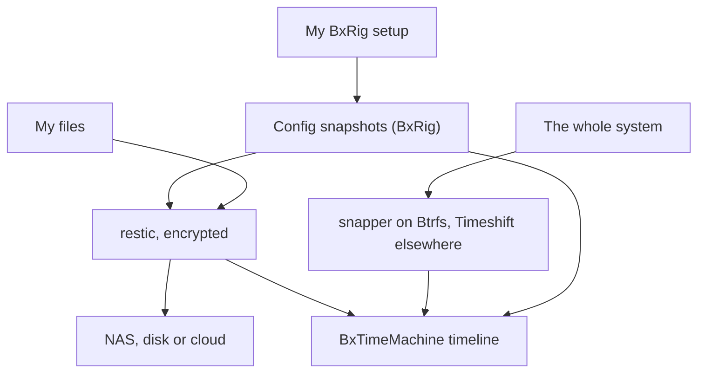

# Backups and BxTimeMachine

Use this page to protect your setup, your system and your files, and to browse every backup on one timeline.

## Try it

```bash
bxrig backup status          # one line per kind: health, last run, next run, size
bxrig timemachine            # every backup on one timeline
bxrig backup config now      # a snapshot of your BxRig setup, right now
```



The diagram shows the three layers and that BxTimeMachine shows them together. Config snapshots also travel with your files, so any place protects them too.

| Layer | What it keeps | Tool |
|---|---|---|
| **My BxRig setup** | Your settings, config files and package list, a small snapshot you can restore in one command | BxRig itself |
| **The whole system** | Snapshots of the system before and after every update | snapper on Btrfs, Timeshift on other filesystems |
| **My files** | Projects, Documents and your SSH config, encrypted | restic, to a NAS, a disk or the cloud |

Everything shows a plan first and needs `--yes`. The setup wizard has a **NAS** page, a **Remote backups** page and a **Backups** page, in that order.

## See the status

```bash
bxrig backup status
bxrig backup status --json   # the same as data (the System panel in the bar reads it)
```

There is one row for each kind of backup: **config** snapshots, **system** snapshots (snapper) and **files** (restic). Each shows when it last ran, when it runs next (from its timer, or "before the next update" for config snapshots), its size (known for config snapshots only) and a health:

| Health | Meaning |
|---|---|
| `ok` | The newest backup is within the limit and the last run did not fail. |
| `warn` | It is older than the limit, the last run failed, or restic is missing. |
| `none` | Nothing to judge yet: not set up, or never run. |

There is no separate "back up now" command: the row's own command does it, `backup config now`, `backup snapshots create --yes` or `backup data run --all --yes` (the JSON says which in `action`).

## Browse the timeline

```bash
bxrig timemachine          # every backup on one timeline
bxrig timemachine --local  # skip the network places so it opens at once
bxrig timemachine --demo   # made-up data, nothing runs
```

Places are rows (system, config, each place your files go to, plain NAS copies) and time runs left to right, newest on the right. Points are coloured by how old they are (hourly, daily, weekly, monthly, yearly). The backup you choose is a card with older ones stacked behind it. Open one to browse its files, filter them, restore, export or send it to another place. Every change shows its plan first and runs only when you press `y`. Press `?` for the keys.

## Back up and restore your BxRig setup

```bash
bxrig backup config now
bxrig backup config list
bxrig backup config diff 20261113T153000
bxrig backup config restore 20261113T153000 --dry-run
bxrig backup config restore 20261113T153000 --only=.config/hypr --yes
```

A snapshot is taken by itself before `update apply`, `system update`, `init`, `reinstall` and `refresh` (turn it off with `backup config auto off`). Restoring takes a safety snapshot of the present first. Secrets and SSH keys are never in a snapshot unless you add `--with-secrets`, which stores your secrets export, encrypted with a passphrase you type. `backup export config ID --to=FILE` writes a snapshot as one file to carry to another machine.

## Snapshot the whole system

```bash
bxrig backup snapshots setup --yes     # snapper, 5 hourly, 7 daily, 2 weekly, 1 monthly; one before and after every pacman update
bxrig backup snapshots list
bxrig backup snapshots restore 12 /home/me/projects/app --dry-run
```

There is no automatic whole-system rollback: how to roll back a Btrfs root depends on how your subvolumes are laid out. Boot the snapshot from the boot menu and follow the Arch wiki's snapper page, or restore folders with `restore`.

## Back up your files

A **place** is where a restic repository lives. Add one, create it, back up, and schedule it:

```bash
bxrig backup data target add spaces --type=s3 --endpoint=https://nyc3.digitaloceanspaces.com --bucket=mybackups --ask-keys
bxrig backup data init spaces --yes
bxrig backup data run --all --yes
bxrig backup data schedule daily --yes
```

Access keys are typed hidden and go to your keyring; the repository password is made for you and kept there too, so keep a copy (`bxrig secrets get BXRIG_BACKUP_SPACES_PASSWORD --show`).

> **Warning:** Losing the repository password loses the backups. Keep a copy somewhere safe.

The schedule is a user timer: it skips on battery power, catches up after the computer was off, and tells you when a backup fails. `backup data restore ID --to=DIR` restores into a folder you name, never over your files by itself. `backup send ID --from=PLACE --to=PLACE` copies a snapshot to a second place (a NAS and the cloud, for a 3-2-1 setup), and `backup export data ID --to=FILE.zip` writes one as an archive.

To keep files on a NAS, see [Your NAS](nas.md).

## Advanced

### Place types

`local` (a disk or folder), a NAS (see [Your NAS](nas.md)), `sftp`, `rest`, `s3` (AWS, DigitalOcean Spaces, Wasabi, MinIO), `b2` (Backblaze), `azure`, `gs` (Google Cloud Storage) and `rclone` (FTP, WebDAV and anything rclone speaks, set up with `bxrig cloud configure`).

### Health limits

The limits are 30 days for config snapshots; 2 days for system snapshots while the snapper timeline timer is on (14 without it); and for files 6 hours with an hourly schedule, 2 days with a daily one and 14 days with none. The time of the last files backup is the one `backup data run` records for each place, so the status makes no network call. Timeshift keeps its own schedule and its last run is not read.

Next: [Your NAS](nas.md) · [Scheduler](scheduler.md) · [Move to another machine](export-import.md)
