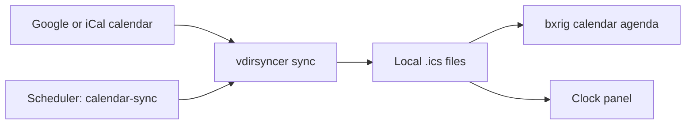
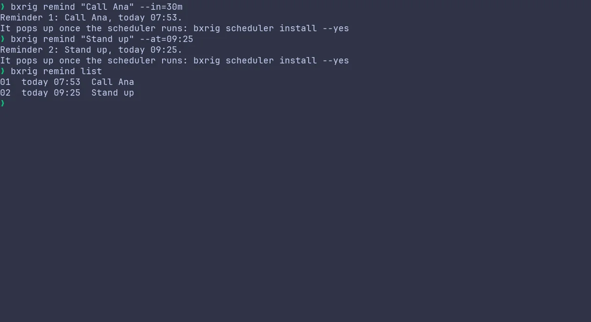

# Calendar and reminders

Use this page to see what is coming up without opening a browser, and to set reminders. BxRig keeps a copy of your calendars on this machine with [vdirsyncer](https://github.com/pimutils/vdirsyncer), shows what is coming up in the terminal and in the Clock panel, and pops up reminders you set.

## Try it

```bash
bxrig pkg install vdirsyncer
bxrig calendar add ical holidays webcal://example.org/holidays.ics
bxrig calendar sync
bxrig calendar agenda --days=3
```

<video src="../assets/clips/calendar-cli.webm" poster="../assets/screenshots/calendar-agenda.webp" autoplay loop muted playsinline width="100%"></video>



The diagram shows how calendars are copied to your machine and where you read them.

## Add a calendar

| Kind | Add it with | Notes |
|---|---|---|
| An iCal address | `bxrig calendar add ical NAME URL` | Any published `.ics` or `webcal://` address. Read only. |
| Google Calendar | `bxrig calendar add google NAME --client-id=ID --client-secret-file=FILE` | Every calendar of the account. The first `bxrig calendar sync`, in a terminal, opens Google's sign-in. |

For Google, create a project in the Google Cloud console, turn on the **CalDAV API**, and create an **OAuth client** of type **Desktop app**. Pass its client ID, and save its client secret in a file for `--client-secret-file`.

`bxrig calendar` lists the calendars and how many events each has. `bxrig calendar remove NAME --yes` forgets one and deletes its local copy; the calendar itself stays where it is.

## Set reminders

```bash
bxrig remind "Call Ana" --in=30m
bxrig remind "Stand up" --at=09:25              # today, or tomorrow when 09:25 has passed
bxrig remind "Renew the domain" --at="2026-12-01 10:00"
bxrig remind list
bxrig remind done 3
```

`--in` takes minutes, hours and days: `45`, `30m`, `2h`, `1d`, `1h30m`.



## See it in the Clock panel

Under the world clocks, the Clock panel shows today's and tomorrow's events and the reminders still to come. A reminder whose time has come is highlighted; its check button marks it done.

## Keep it up to date

With the [scheduler](scheduler.md) installed, adding a calendar adds the task **calendar-sync** (every 15 minutes) and adding a reminder adds the task **reminders** (every minute), which pops up each reminder once, as a notice that stays until you close it. Installing the scheduler later adds both when you already have calendars or reminders.

## Advanced

BxRig writes its own vdirsyncer configuration (`~/.config/bxrig/vdirsyncer/config`, readable only by you), so a vdirsyncer setup of your own is not touched. The events are kept as `.ics` files in `~/.local/share/bxrig/calendars`.

Next: [Scheduler](scheduler.md) · [AI agents](../ai/boxlang-agents.md)
