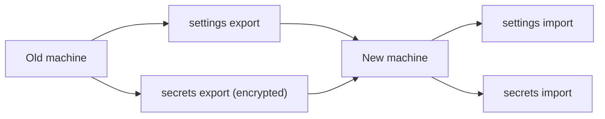

# Move to another machine

Use this page to carry your BxRig settings, wizard answers and keys to a new machine.

## Try it

```bash
bxrig settings export my-settings.tar.gz
bxrig settings import my-settings.tar.gz --yes
```



The diagram shows that settings and keys travel as two separate files.

## Move your settings

Export bundles `~/.config/bxrig` (answers, shortcuts, runner and update settings) **without secrets, backups or state**. Import backs up each existing file as `NAME.bak-STAMP` first and refuses archives with paths outside `bxrig/`.

## Move your keys

Keys travel separately and encrypted:

```bash
bxrig secrets export
bxrig secrets import
```

## Set up a new machine from answers only

To set up a new machine without touching the old one, export only the wizard answers, then use them there:

```bash
bxrig init --export answers.json
bxrig init --from answers.json                  # on the new machine
bxrig init --answers answers.json --yes         # or unattended
```

## Advanced

Your files are not part of an export. To move those, use [Backups](backups.md): `bxrig backup export config ID --to=FILE` writes a config snapshot as one file, and `bxrig backup data restore ID --to=DIR` restores your files from a place.

Next: [Backups](backups.md) · [AI agents and skills](../ai/agents.md)
