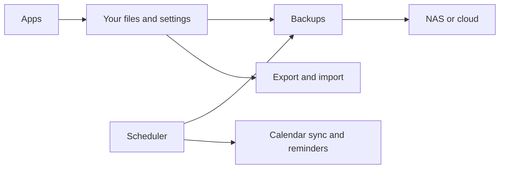

# Apps and your data

Everything about the software you run and the data you keep: where apps come from, how your files are protected, and how timed work runs.

The diagram shows how the pages fit: the scheduler runs your backups and calendar sync, backups can go to a NAS or the cloud, and export moves your settings to another machine.

::: card title="Apps and web apps" href="apps.md"
The catalog, web apps, defaults and the Apps manager.
:::

::: card title="Backups and BxTimeMachine" href="backups.md"
Three backup layers and one timeline to browse them all.
:::

::: card title="Your NAS" href="nas.md"
Connect a Synology or any SMB or NFS share and mount it by itself.
:::

::: card title="Scheduler" href="scheduler.md"
One scheduler for updates, backups and your own tasks, with a history.
:::

::: card title="Calendar and reminders" href="calendar.md"
Your calendars offline, an agenda in the terminal and reminders that pop up.
:::

::: card title="Move to another machine" href="export-import.md"
Export your settings and keys, import them elsewhere.
:::
