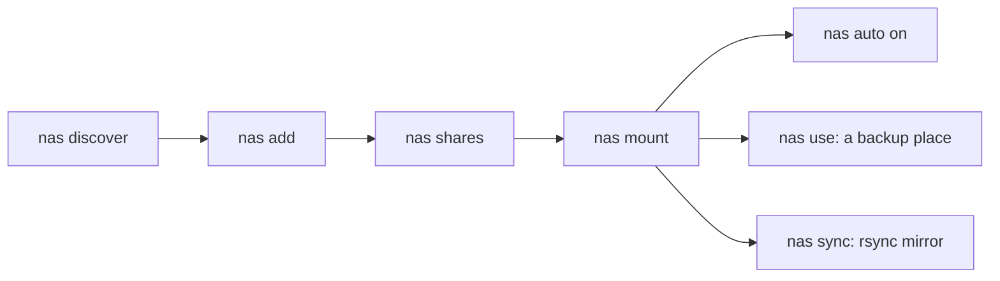

# Your NAS

Use this page to connect a Synology or any SMB or NFS share, mount it automatically and use it as a place for backups. `bxrig nas` keeps every NAS you use: its address, the share, how to reach it, and the mount.

## Try it

```bash
bxrig nas setup --yes                   # cifs-utils, nfs-utils, smbclient, avahi, rsync
bxrig nas discover                      # find NAS boxes on the network
bxrig nas add synology --host=ds920.local --user=luis --ask-password
bxrig nas mount synology backups --yes  # ~/NAS/synology/backups
```



The diagram shows the path from finding a NAS to using it for mounts, backups and copies.

## Connect and mount

```bash
bxrig nas shares synology
bxrig nas mount synology backups --yes  # ~/NAS/synology/backups
bxrig nas auto on synology backups --yes
bxrig nas test synology
```

- **`nas auto on`** makes systemd `.mount` and `.automount` units: the share mounts the first time something opens it and lets go after ten idle minutes, so a sleeping NAS never blocks your login.
- **`nas test`** checks that the NAS answers, that your password works, that the share is mounted and writable, and how much space is free.

## Back up to it

```bash
bxrig nas use synology backups          # a place for bxrig backup data
```

Then continue with [Backups](backups.md).

## Copy files to it

`nas sync NAME SRC --to=SHARE/PATH` is a plain `rsync` mirror (photos, media). Nothing on the NAS is deleted unless you add `--delete`.

## Advanced

- **Passwords** are typed hidden and kept in your keyring. SMB mounts are made by root (also at boot), so the password is also kept in `/etc/bxrig/nas/NAME.cred`, readable by root only; the plan tells you before it writes it. NFS needs no password.
- **The SMB version** is negotiated: the highest one the NAS and your kernel both support. Give `--vers=3.1.1` to choose.

> **Note:** Not yet tried on a real Synology: share permissions in DSM, SMB signing and NFS export options. If a mount fails, `bxrig nas test NAME` says which step.

Next: [Backups](backups.md) · [Scheduler](scheduler.md)
