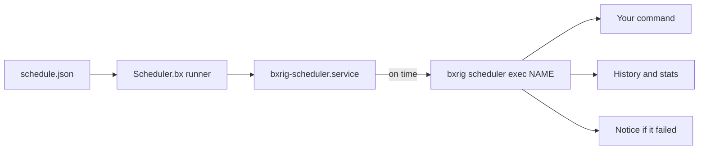

# Scheduler

Use this page to see what runs on a timer and to add your own tasks. BxRig runs its timed work on one scheduler: a BoxLang scheduler class on the BoxLang JVM, kept running by a user service. It runs the daily update check, your file backups, the BoxLang and module checks, and any task you add. Every run is recorded, so you can see what ran, how long it took and what failed.

## Try it

```bash
bxrig scheduler install --yes        # once: the service, the built-in tasks, and the old timers turned off
bxrig scheduler                      # every task: group, schedule, next run, how the last run went
bxrig scheduler run backup-data      # run it now (recorded like a scheduled run)
```

<video src="../assets/clips/scheduler-cli.webm" poster="../assets/screenshots/scheduler-show.webp" autoplay loop muted playsinline width="100%"></video>



The diagram shows how a task goes from the list to a recorded run.

## Look at a task

```bash
bxrig scheduler show backup-data     # its command, stats (runs, failures, success rate, average time) and recent runs
```

## Use the task manager

`bxrig tui tasks` (or Control Center > Tasks, or System > Scheduler > Task manager in the menu) lists every task with how its last run went, when it runs next and a sparkline of its recent runs.

<video src="../assets/clips/tasks-page.webm" poster="../assets/screenshots/tasks-detail.webp" autoplay loop muted playsinline width="100%"></video>

| Mark | Means |
|---|---|
| ✓ | the last run went well |
| ! | it needs your attention (an update is waiting) |
| ✗ | it failed or timed out |
| · | it has not run yet |
| ‖ | paused |

`Enter` shows the task: its command, runs, failures, success rate, average time, the trend of its last 30 runs, recent runs and the last output. `r` runs it now, `p` pauses or resumes it, `g` pauses or resumes its group, `a` adds a task (name, when, command), `x` removes one of yours (the built-in ones can be paused, not removed).

The **System panel** has a Tasks tab: whether the scheduler runs (with Install when it does not), a card for each failing task with its last output, Run again, Show and Pause, and the next runs. While a task is failing, the System icon in the bar has a red dot.

`bxrig doctor --dev` has a scheduler row, and the setup wizard offers to install the scheduler.

## Add your own tasks

```bash
bxrig scheduler add photos-to-nas --when="daily 23:00" --group=sync -- rsync -a ~/Pictures/ nas:/photos/
bxrig scheduler add tidy-downloads --when="weekly sun 10:00" -- bxrig files tidy
bxrig scheduler pause sync           # every task in a group
bxrig scheduler resume sync
bxrig scheduler disable tidy-downloads
bxrig scheduler remove tidy-downloads
```

| `--when` | Runs |
|---|---|
| `every 15 minutes`, `every 2 hours` | from the time the scheduler starts |
| `hourly` | every hour |
| `daily 02:30` | every day at 02:30 |
| `weekdays 09:00` | Monday to Friday at 09:00 |
| `weekly mon 09:00` | every Monday at 09:00 |
| `cron 0 2 * * *` | a 5-field cron (needs BoxLang 1.20 or newer) |

A command after `--` that starts with `bxrig` runs with your BxRig; anything else runs as it is. `--notify` is `failure` (the default: a notice when a run fails or times out), `attention` (also when it exits 10, "something needs you"), `always` or `never`. `--timeout` is in seconds (one hour by default).

## See what it replaces

| Before | Now |
|---|---|
| `bxrig-update-check.timer` | the task `update-check` (daily, group `system`) |
| `bxrig-backup.timer` | the task `backup-data` (hourly or daily 02:30, group `backups`) |
| nothing | the task `boxlang-check` (daily, group `boxlang`): a notice when BoxLang or a module has an update |

Once the scheduler is installed, `bxrig update notifications on|off` and `bxrig backup data schedule hourly|daily|off` change those tasks instead of writing timers.

## Advanced

### How it works

- `~/.config/bxrig/schedule.json` holds the tasks. Change them with `bxrig scheduler`, not by hand.
- `~/.local/share/bxrig/scheduler/Scheduler.bx` is the runner, written by BxRig: one BoxLang scheduled task per enabled task. It is written again on every change and the service restarts.
- `bxrig-scheduler.service` runs `boxlang schedule` on it and restarts it if it stops.
- Each run calls `bxrig scheduler exec NAME`, which runs the command, adds a line to `~/.local/state/bxrig/scheduler/history/NAME.jsonl` (the last 500 runs) and sends the notice. After each run the runner writes the task's BoxLang `getStats()` (next run, last run, totals) to `stats/NAME.json`.

`bxrig scheduler uninstall --yes` stops the service and keeps your tasks and their history.

Next: [Backups](backups.md) · [Updates and channels](../maintain/updates.md) · [Calendar and reminders](calendar.md)
