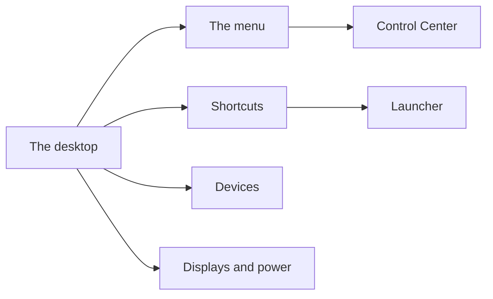

# Daily desktop

Everything you touch after the first login: how the desktop is laid out, how to open things fast, and how to tune screens, power and devices. Read the pages in this order, or jump to the one you need.

::: card title="The desktop" href="desktop.md"
Hyprland with Noctalia, KDE Plasma, the bar's panels and the everyday tools.
:::

::: card title="The menu" href="menu.md"
One menu for everything BxRig does, on your launcher, with search.
:::

::: card title="Control Center" href="control-center.md"
One terminal screen for your whole machine. Run `bxrig tui`.
:::

::: card title="Shortcuts and Mac keys" href="shortcuts.md"
One table, two key styles, rendered for xremap, Hyprland and Plasma.
:::

::: card title="Launcher" href="launcher.md"
Vicinae in your theme's colours, with BxRig's actions and file search.
:::

::: card title="Mice, trackpads and keyboards" href="input.md"
Apple Magic and Logitech devices, and the helpers BxRig installs for them.
:::

::: card title="Displays, power and time" href="system.md"
Monitors, laptop power, time zone, DNS, kernels and what to do when something is stuck.
:::

> **Tip:** Press `Super+Space` for the menu and `Super+K` for the shortcut cheat sheet. Looking for colors, fonts or the bar layout? That is [Customize](../customize/index.md).
