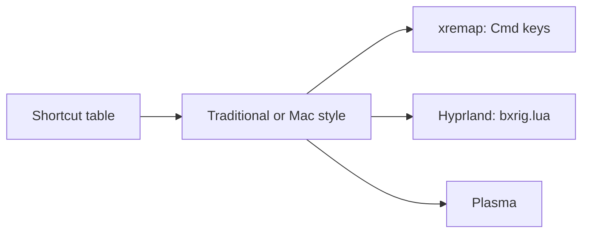

# Shortcuts and Mac keys

One shortcut table drives every key BxRig binds, in two styles: Traditional (classic Super-key tiling) or Mac (Cmd-style keys).

## Try it

```bash
bxrig keys sheet                   # the shortcuts browser (Super+K)
bxrig tui shortcuts                # the same page in the Control Center
bxrig keys search screenshot       # find a shortcut by words, keys or id
bxrig keys style mac --yes         # switch to the Mac style
```

## The shortcuts browser

`Super+K` (or `bxrig keys sheet`) opens the Shortcuts page: every shortcut grouped under tabs (Editing, Apps, Windows and so on), the keys drawn as keycaps, and a detail pane that says how the shortcut is bound.

| Key | What it does |
| --- | --- |
| `Left` `Right`, or `1` to `9` | Switch group |
| `/` then type | Filter by action, keys, group or how it is bound (Enter keeps it, Esc clears it) |
| `u` | Show the shortcuts that have no keys too (they are hidden at first) |
| `y` | Only your own shortcuts, marked with a star |
| `a` | Back to everything |
| `e`, `r`, `c` | Rebind the highlighted one, reset it to the default, list conflicts |

From a key binding it opens in its own terminal window. Without a terminal program it falls back to your menu program, grouped, with the keys written as `Super + Shift + T`.



The table is `src/bxrig/Shortcuts.bx`. Every key BxRig binds is a row, including the window, workspace, arrow, mouse, volume and brightness keys, and each row has a key for each style. xremap is always installed: copy, paste, cut and select all (`Super+C V X A`) are remaps in both styles. Press `Super+K` to see every shortcut in your menu program.

## Change a shortcut

```bash
bxrig keys show                         # the table, in the style that is on
bxrig keys search screenshot           # find a shortcut by words, keys or id
bxrig keys run color-picker             # run the command a shortcut stands for
bxrig keys set ai-shell Super+Alt+A --yes
bxrig keys reset ai-shell --yes
bxrig keys conflicts                    # the table, the remaps of the style that is on, and your own hl.bind lines
```

Your changes live in `~/.config/bxrig/shortcuts.json` and apply to both styles. Remaps (the Cmd keys) are xremap's and cannot be changed this way. `keys set` refuses a key another binding uses or xremap rewrites.

## From the runner

`Super+Alt+Space` opens the menu; its Shortcuts section lists every shortcut, searches them (`bxrig keys search TEXT`), rebinds one (it asks which one and for the new keys, then runs `keys set`), runs the command a shortcut stands for (`bxrig keys run ID`), writes the keys to Hyprland and Plasma, and switches the style. `Super+Escape`, `Super+Ctrl+C`, `Super+Ctrl+O`, `Super+Ctrl+H` and `Super+Shift+Ctrl+A` open the System, Capture, Toggle, Hardware and Agent menus on their own (`bxrig menu open system`).

## Two styles

| | Traditional | Mac |
|---|---|---|
| Idea | Classic Super-key tiling keys | Cmd-style keys for apps |
| `Super+C V X A` | copy, paste, cut, select all (terminal aware) | same |
| `Super+Z S F T N O P R W L B I U` and `Super+,` | plain Super keys | send the Ctrl version (Undo, Save, Find, ...) |
| Browser | `Super+B`, `Super+Shift+Return` | `Super+Shift+Return` |
| Private browser window | `Super+Alt+Shift+B` | `Super+Shift+N` |
| File manager | `Super+Shift+F` | `Super+E` |
| Full screen | `Super+F` | `Super+Ctrl+F` |
| Float or tile | `Super+T` | `Super+Alt+T` |
| Window to workspace 3, 4, 5 | `Super+Shift+3/4/5` | `Super+Alt+Shift+3/4/5` |
| Close window | `Super+Q`, `Super+W` | `Super+Q` (`Super+W` is Close tab) |
| Input language | `Super+I`, `Super+Shift+I` | `Super+Alt+I`, `Super+Alt+Shift+I` |


## The main ones

The keys you will use most, in the Traditional style unless noted:

| Keys | Does |
|---|---|
| `Super+Space` | Launcher: search apps, menu actions, themes and answers |
| `Super+Alt+Space` | BxRig menu (browse by section) |
| `Super+K` | Shortcut cheat sheet |
| `Print` (Mac style also `Super+Shift+3` / `4` / `5`) | Screenshot: region (Mac style: screen / region / menu) |
| `Super+Print` | Color picker |
| `Super+Shift+R` | Screen recording (`Super+Alt+Shift+R`: a region, `Alt+Print`: with desktop audio; the microphone variant is in the Capture menu) |
| `Super+Ctrl+Alt+V` | Webcam preview on or off (needs `mpv`) |
| `Super+Ctrl+H` | Hardware menu |
| `Super+Ctrl+V` | Clipboard history |
| `Super+Ctrl+E` | Emoji |
| `Alt+Space` | Dictation on or off (the logical Alt key: with the Mac swap on a PC keyboard it is the Win key, where Option sits on a Mac) |
| `Super+Alt+D` | Show or hide the dock |
| `Super+Period` / `Super+Shift+Period` | Chat with your default agent (Boxy) in a terminal / its web page (see [BoxLang agents](../ai/boxlang-agents.md)) |
| `Super+Ctrl+Alt+F`, `Super+Shift+Space` | Hide or show the bar (Toggle top bar) |
| `Super+Ctrl+A` `B` `N` `P` `D` | The control center panel |
| `Super+Ctrl+Alt+Comma` | Do Not Disturb |
| `Super+Ctrl+Alt+T` / `B` / `W` | Show the time / battery / weather |
| `Super+Ctrl+L` | Lock |
| `Super+Q` | Close window |
| `Super+H` / `Super+Shift+H` | Minimize / show minimized |
| `Super+M` | Maximize or restore the window (the bar stays) |
| `Super+Alt+Left` / `Right` / `Up` / `Down` | Snap the window to the left / right / top / bottom half of the screen |
| `Super+Alt+Shift+C` | Center the floating window |
| `Super+Ctrl+Up` | Overview of all windows (Mission Control) |
| `Super+Alt+Escape` | Force quit a window |
| `Super+Alt+E` | AI on the selected text: a menu to summarize, rewrite, fix, explain, translate or draft a reply (see [Local AI](../ai/local-ai.md#ai-on-the-selected-text)) |
| `Super+Shift+J` | Next layout on this workspace: dwindle, master, columns, scrolling, monocle |
| `Super+Minus` / `Super+Equal` | Narrower / wider: the split (dwindle), the main column (master, columns), or the column through 1/3, 1/2, 2/3 and full (scrolling) |
| `Super+Ctrl+Left` / `Right` | Previous / next workspace |
| `Super+Ctrl+Alt+Left` / `Right` | Take the window to the previous / next workspace |
| `Super+Ctrl+Tab` | Back to the last workspace |
| `Super+Ctrl+Shift+` arrows | Move the window to the monitor in that direction |
| `Super+Alt+Shift+` arrows | Move the whole workspace to the monitor in that direction |
| `Ctrl+Alt+Tab` / `Ctrl+Alt+Shift+Tab` | Focus the next / previous monitor |
| `Super+Alt+C` | Noctalia control center panel |
| `Super+Ctrl+Comma` | Noctalia settings |
| `Super+Grave` | Pull-down AI shell |
| `Super+Shift+Grave` / `Super+Ctrl+Grave` | Quake console: show or hide / send the focused window there |
| `Super+Alt+Shift+B` (Mac: `Super+Shift+N`) | Private window of your default browser |
| `Super+Alt+Shift+F` | File manager in the folder of the focused window |
| `Super+Ctrl+F` (Mac: `Super+Ctrl+Shift+F`) | Tiled full screen: the app goes full screen inside its tile |
| `Super+Ctrl+Alt+Minus` / `Equal` (`Super+Alt+Shift+Minus` / `Equal`: height) | Floating window narrower / wider (shorter / taller) |
| `Super+G` / `Super+Alt+G` | Group windows into tabs / take the window out of its group |
| `Super+Alt+Tab` / `Super+Alt+Shift+Tab` | Next / previous window in the group |
| `Super+Ctrl+S` / `Super+Ctrl+Alt+S` | Scratchpad: show or hide / send the window there |
| `Super+Alt+8` / `Super+Alt+Equal` / `Super+Alt+Minus` | Zoom on or off / in / out, as Option+Cmd+8, = and - on a Mac. Off until `bxrig accessibility zoom on` |
| `Ctrl+Alt+Delete` | Close every window |
| `Super+Ctrl+Shift+Comma` | Dismiss all notifications |
| Play, Pause, Next, Previous keys | Media control (playerctl) |
| Keyboard backlight keys | Keyboard backlight up / down |

## Advanced

On a PC keyboard the Mac style swaps Alt and Win (Alt acts as Cmd, Win as Option; the left keys only, Right Alt stays AltGr). An Apple keyboard never swaps. The choice is saved in `~/.config/bxrig/keystyle.json` (`bxrig keys style mac --keyboard=pc|apple --swap=on|off --yes`; the wizard asks the same). Keys in the table are what Hyprland sees after the swap, so with the swap on a PC keyboard `Super+Alt+D` is the Win and Alt keys in the places where Option and Cmd sit on a Mac. See `docs/architecture/SHORTCUTS-DECISIONS.md` for every decision.


Next: [The desktop](desktop.md), [The menu](menu.md), [Your own config](../customize/your-own-config.md).
