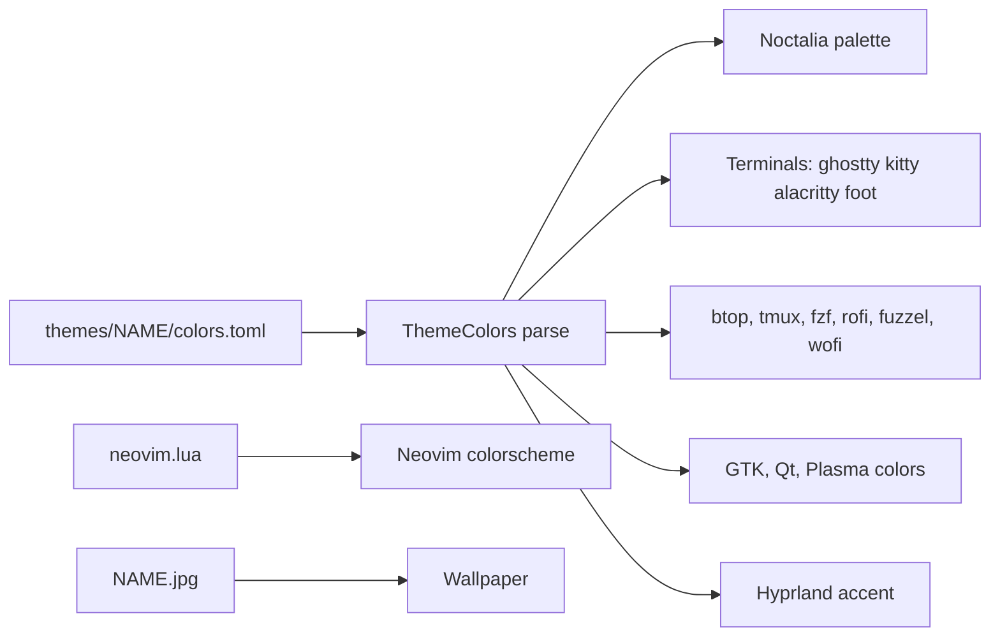

# Add a theme

You will add a new bundled theme called `sunset`. One folder with a `colors.toml` is enough to make it appear in `bxrig theme list`, the Themes page and the theme switcher.

## Files you touch

| File | What for |
|---|---|
| `themes/sunset/colors.toml` | The palette (required). |
| `themes/sunset/neovim.lua` | The Neovim colorscheme plugin spec (optional but expected). |
| `assets/wallpapers/sunset.jpg` | The wallpaper, 2560x1440 JPEG (optional). |
| `src/bxrig/WallpaperData.bx` | Generated: the wallpaper names and SHA-256. Never edit by hand. |
| `tests/theme-test.sh` | The theme counts the test checks. |
| `docs/customize/themes.md` | The theme table and the count. |

## What happens to your file

This diagram shows how one `colors.toml` becomes the files each tool reads.



`bxrig theme set NAME` writes these files through the config service (atomic, backed up) and then tells the running desktop.

## Steps

1. Copy a theme that is close to what you want.

   ```bash
   cp -r themes/nord themes/sunset
   ```

2. Edit `themes/sunset/colors.toml`. Every color is `#rrggbb`.

   ```toml
   mode = "dark"

   accent = "#ff7a59"
   selection = "#4a2f3a"
   muted = "#7a5f6a"

   background = "#2a1b24"
   dark_background = "#201219"
   darker_background = "#180d13"
   lighter_background = "#38242f"

   foreground = "#f3e3dc"
   dark_foreground = "#8a7078"
   light_foreground = "#d9c3bb"
   bright_foreground = "#fff1ea"

   red = "#e5566d"
   yellow = "#f0c36d"
   orange = "#f08a5d"
   green = "#9ccc8a"
   cyan = "#7fcfd0"
   blue = "#6f9bd8"
   magenta = "#c78ad0"
   brown = "#6a4b3d"

   bright_red = "#f0788a"
   bright_yellow = "#f7d58f"
   bright_green = "#b4dca4"
   bright_cyan = "#a0e0e0"
   bright_blue = "#8fb4e8"
   bright_magenta = "#d9a6e0"
   ```

   Only `accent`, `background`, `foreground`, `red`, `green`, `yellow`, `blue`, `magenta` and `cyan` are required. A missing one, or a value that is not `#rrggbb`, rejects the whole theme (it is never half applied). `mode` is `"dark"` or `"light"`.

3. Optional: name a font. The id comes from `bxrig appearance font list`. Once that font is installed, `theme set` makes it the shell and terminal font.

   ```toml
   font = "sharetech"
   ```

4. Add `themes/sunset/neovim.lua`: a LazyVim plugin spec that installs a colorscheme and selects it. Copy the one from the theme you started from and change the plugin and the `colorscheme` name.

5. Optional: add a wallpaper as `assets/wallpapers/sunset.jpg` (2560x1440), then regenerate the hashes.

   ```bash
   bootstrap/gen-assets.sh
   ```

   Wallpapers are not packed into the binary. `bxrig.Wallpapers` finds a copy, checks its SHA-256 and copies it to `~/Pictures/BxRig/sunset.jpg`, or downloads it from the release site when missing. A theme without a wallpaper leaves the user's own.

6. Update `tests/theme-test.sh`: the theme count (`length == 24`, twice in the `list` check) goes up by one, and a light theme must be added to the list of light names. The `22` generated files per theme do not change.

## See it working

```bash
scripts/dev-build.sh
dist/bxrig theme list              # sunset appears, valid
dist/bxrig theme show sunset
dist/bxrig theme set sunset --dry-run
dist/bxrig tui themes              # the swatch, preview and wallpaper
```

The theme list, the Themes page and the theme switcher all read the same list, so there is nothing to register.

## Test it

```bash
tests/theme-test.sh dist/bxrig
```

The test sets themes against fake desktop tools and checks the generated files. Also see `tests/theme_colors_test.bxs` for the color maths.

## Document it

In `docs/customize/themes.md` update the count, the list of names and the gallery table. If you have a desktop, capture a screenshot with the wallpaper and `btop` in a themed terminal.

> **Screenshot wanted:** the new theme applied, wallpaper plus `btop` in a themed terminal, saved as `docs/assets/screenshots/themes/sunset.webp`.

## Common mistakes

- A color without the leading `#`, or in short `#abc` form: the theme is rejected as invalid.
- Forgetting `bootstrap/gen-assets.sh` after adding a wallpaper: the SHA-256 is unknown and the wallpaper is never used.
- Editing a generated file by hand: `theme set` rewrites them all on every change.
- A name with capitals or spaces: names are lower case letters, digits and dashes. Names that start with `bxrig` count as BxRig's own, the rest as community themes (credit them in `themes/NOTICE.md`).

## Advanced

- Two `colors.toml` shapes are read: the named one above, and the older one with `color0` to `color15`, `cursor` and `selection_*`. In the named shape the terminal palette comes from the roles: black is `background`, white is `foreground`, bright black is `muted`, bright white is `bright_foreground`.
- Where a theme is found, first match wins: `~/.config/bxrig/themes`, then Omarchy folders, then the bundled ones. A user folder with the same name beats yours.
- Users can add themes without a rebuild: `bxrig theme import DIR --name=NAME`.
- Next: [Add a command](add-a-command.md), [Tests](tests.md).
