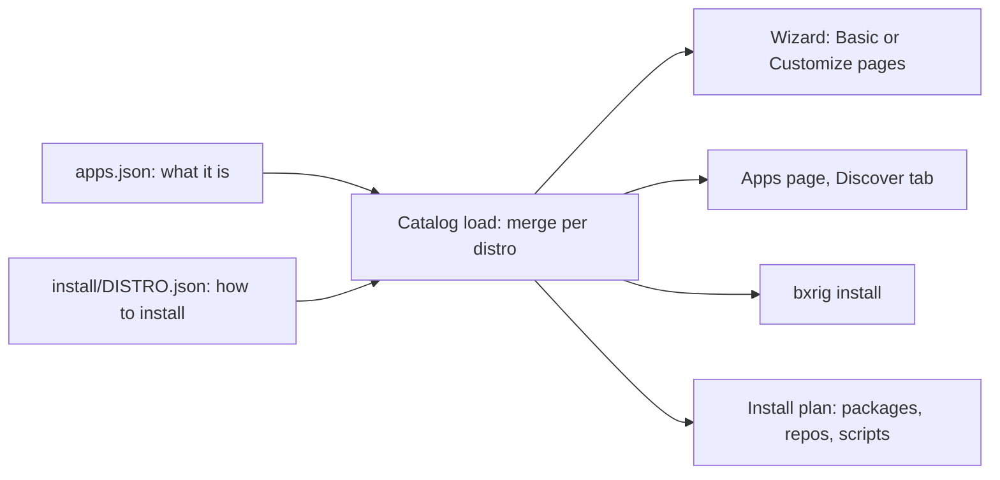

# Add an app

You will add one app, `lazydocker`, to the catalog. The catalog says what the app is. A small file per distribution says how to install it there.

## Files you touch

| File | What for |
|---|---|
| `catalog/apps.json` | What the app is: name, group, category, tier, profiles. One entry. |
| `catalog/install/arch.json` | How Arch and CachyOS install it. |
| `catalog/install/suse.json`, `debian.json` | Same for the other distributions (Ubuntu extends Debian). Skip a file and the app is simply not offered there. |
| `catalog/README.md` | The schema notes. Read it first, update it only if you add a field. |
| `tests/catalog-test.sh`, `tests/catalog_check.bxs` | Run them. They fail when the catalog is inconsistent. |

## How an app reaches the user

This diagram shows how the two catalog files are merged and where the result is used.



The Basic wizard choice installs every app with `tier: default`. The Customize choice shows one page per group, one list per category, with the default apps ticked. These pages are generated from the catalog, so a new app appears there with no wizard change.

## Steps

1. Add the entry to `apps` in `catalog/apps.json`. Pick an existing `group` and a `category` that belongs to that group.

   ```json
   {
     "id": "lazydocker",
     "name": "lazydocker",
     "description": "Terminal UI for Docker and Podman containers",
     "description_source": "curated",
     "kind": "tui",
     "group": "infra",
     "category": "Containers",
     "tier": "optional",
     "homepage": "https://github.com/jesseduffield/lazydocker",
     "macos": "lazydocker via Homebrew",
     "origin": ["owner-request"],
     "profiles": { "containers": "optional" }
   }
   ```

   - `kind` is `desktop`, `tui` or `web`.
   - `tier` is `default` (a plain install and the Basic wizard choice) or `optional` (offered in pickers).
   - `profiles` maps a profile id to `default` or `optional`. `bxrig profile-install containers` installs the `default` members, `--optional` adds the optional ones.
   - `shells: ["hyprland"]` limits the app to one desktop. Leave it out for both.

2. Add the install entry for each distribution that has it. For Arch, in `catalog/install/arch.json` under `apps`:

   ```json
   "lazydocker": {
     "source": "pacman",
     "targets": ["lazydocker"],
     "repo": "extra",
     "verified_on": "2026-11-27"
   }
   ```

   Sources on Arch: `pacman`, `aur`, `pkgbuild`, `script`, `flatpak`, `unresolved`. Debian and Ubuntu use `apt`, openSUSE uses `zypper`. `flatpak` and `script` work everywhere. `targets` are package names (or Flathub ids for `flatpak`).

3. A web app is different: `kind: "web"`, `source: "web"` and an `https` `url` in `apps.json`, and no install entry at all.

4. Let BxRig propose the other distributions' entries. Run this on that distribution:

   ```bash
   bxrig catalog map debian
   bxrig catalog map debian --write
   ```

## See it working

```bash
scripts/dev-build.sh
dist/bxrig catalog show lazydocker
dist/bxrig catalog check
dist/bxrig catalog coverage
dist/bxrig install lazydocker --dry-run
dist/bxrig tui apps            # Discover tab
```

`catalog check` prints every problem it finds and exits non-zero. `--distro=debian` on `show` and `list` shows another distribution's view.

## Test it

```bash
tests/catalog-test.sh dist/bxrig
```

The catalog schema checks (`Catalog.check`) run in the test and in `catalog check`. They reject, among others: an unknown group, a category that is not in the group, a missing description, an unsafe package name, a `pkgbuild` without a full 40 character commit, an unknown profile, a web app that has an install entry, and an install entry for an id that is not in `apps.json`.

## Common mistakes

- A `category` spelled differently from the one in `categories`: it must match the title exactly.
- Package names with spaces or shell characters: only letters, digits and `@ . _ + / : -` are allowed.
- A profile left with no `default` app on Arch: every profile needs at least one.
- An install entry for a web app, or for an id that is not in `apps.json`: both are errors.
- Editing only `arch.json`: the app is then offered on Arch only, which may be what you want.

## Advanced

- Install file keys: `distro`, `title`, `packager`, `extends`, `defaults`, `names` (Arch package name to this distribution's name, `""` when none is needed), `repos` (extra repositories added before a package in their `for` list) and `apps`.
- `provides` names the program a `script` app puts on the PATH, so a re-run is not treated as a new install. `conflicts` lists packages that cannot be installed beside this one: `bxrig install` skips the app and says why.
- `pkgbuild` apps need `repo`, `path` and a pinned `ref` (a full commit). `script` apps need an `https` `url`, optional `shell` (`sh` or `bash`) and `args`.
- Customize pages skip the categories the wizard asks about itself (shell, terminal, launchers, orchestration). See `src/bxrig/AppPages.bx` and `tests/app_pages_test.bxs`.
- Full schema notes: `catalog/README.md`. Next: [Wizard pages](wizard-pages.md), [Tests](tests.md).
