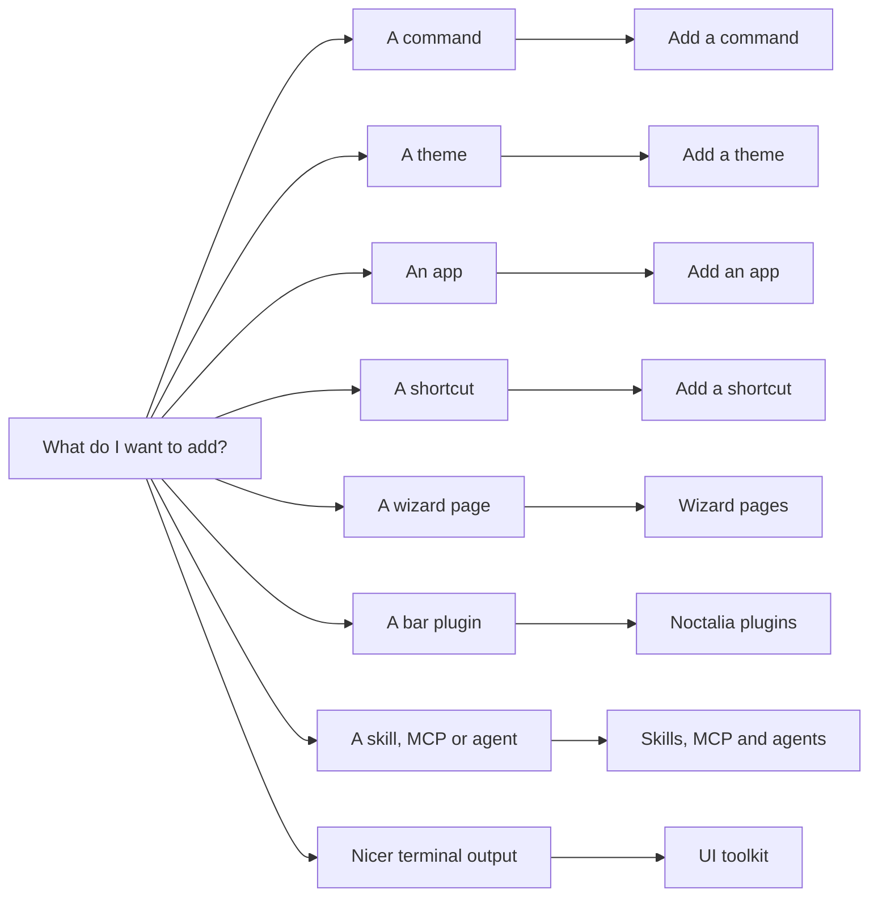

# Extend BxRig

Pick what you want to add, follow the one page for it. Most changes are a data file or one small class, not a rewrite.

New here? Start with [Set up your dev machine](setup.md), then [How it fits together](architecture.md).

## Where does my change go?

The map shows what you want to add and the page that walks you through it.

| I want to add | Go to | You mostly edit |
|---|---|---|
| A `bxrig` command | [Add a command](add-a-command.md) | `docs/reference/cli.json`, `src/Main.bx`, one class in `src/bxrig/` |
| A color theme | [Add a theme](add-a-theme.md) | a folder in `themes/` |
| An app in the catalog | [Add an app](add-an-app.md) | `catalog/apps.json` |
| A keyboard shortcut | [Add a shortcut](add-a-shortcut.md) | one row in `src/bxrig/Shortcuts.bx` |
| A page in the setup wizard | [Wizard pages](wizard-pages.md) | `assets/wizard/` (see the page) |
| A panel or widget in the bar | [Noctalia plugins](noctalia-plugins.md) | a folder in `templates/noctalia-plugins/` |
| An agent skill, MCP server or agent | [Skills, MCP and agents](skills-mcp-agents.md) | `skills/` |
| Tables, badges, progress in terminal output | [The terminal UI toolkit](ui-toolkit.md) | calls to `bxrig.ui` |

## Cards

::: card title="Set up your dev machine" href="setup.md"
Clone, build `dist/bxrig`, run it from source, format and test.
:::

::: card title="How it fits together" href="architecture.md"
Main.bx, one class per feature, shared helpers, and what every change command does.
:::

::: card title="Add a command" href="add-a-command.md"
A worked tutorial: from a registry entry to a passing test.
:::

::: card title="Tests" href="tests.md"
Fake tools, the harness, and how to run one test or all of them.
:::

::: card title="Code rules" href="code-rules.md"
The fifteen rules that keep the code DRY, in one scannable page.
:::

::: card title="Releases and docs" href="release-and-docs.md"
How the docs are built, versioned and translated, and how releases ship.
:::

## Design records

These explain why things are the way they are. Read them before you change a contract.

- [Architecture index](../architecture/index.md): the command contract, the desktop and shortcut decisions, MatchBox parity.
- [Command contract](../architecture/COMMAND-CONTRACT.md): grammar, mutation rules, exit codes, the `--json` envelope.
- [Command reference](../reference/commands.md) and [config files](../reference/config-files.md): the generated command list and every file BxRig writes.
