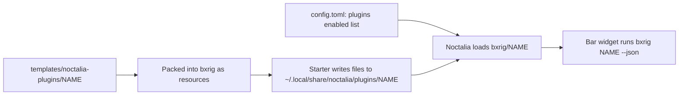

# Noctalia plugins

You will build a small bar widget, `bxrig/acstate`, that shows whether the machine is on mains power or battery. It runs a `bxrig` command, reads its JSON, and draws one label.

> **Note:** Noctalia v5 plugins are written in Luau (`.luau` files) with a `plugin.toml`, not QML. Every BxRig plugin lives in `templates/noctalia-plugins/NAME/`.

## Files you touch

| File | What for |
|---|---|
| `templates/noctalia-plugins/acstate/plugin.toml` | Id, settings, and which widgets and panels exist. |
| `templates/noctalia-plugins/acstate/bar.luau` | The bar widget. |
| `templates/noctalia-plugins/acstate/bxrig.luau` | The shared helper that runs `bxrig`, and the detach and dock helpers. Copy it unchanged from another plugin. |
| `templates/noctalia-plugins/acstate/kit.luau` | The panel kit: the pieces every panel builds the same way. Copy it unchanged from another plugin. |
| `templates/noctalia-plugins/acstate/framework.luau` | The panel framework: state, lifecycle, fetching, keys, popup and window. Copy it unchanged from another plugin. |
| `templates/noctalia-plugins/acstate/translations/en.json` | The labels of the settings. |
| `src/bxrig/NoctaliaConfig.bx` | The `enabled = [...]` list and the bar layout lines. |
| `tests/dev_plugin_test.bxs` | A model for a plugin test. |
| `templates/noctalia-plugins/README.md` | Add a row to the table. |

## How a plugin gets onto the desktop

This diagram shows how a folder in the repository ends up as a widget in the bar.



`TemplateData.pluginEntries()` lists every file under `templates/noctalia-plugins/`, so a new folder is picked up with no code. The enabled list and the bar layout are written by `NoctaliaConfig.bx`.

## Steps

1. Create the folder and copy the helper. The helper runs `bxrig`, unwraps the `{"ok":true,"data":{...}}` envelope and honors the `command` setting. It must be identical in every plugin.

   ```bash
   mkdir -p templates/noctalia-plugins/acstate/translations
   cp templates/noctalia-plugins/clock/bxrig.luau templates/noctalia-plugins/acstate/
   ```

2. Write `plugin.toml`. Keep `plugin_api = 43` like the others.

   ```toml
   id = "bxrig/acstate"
   name = "Power source (BxRig)"
   version = "1.0.0"
   plugin_api = 43
   author = "bxrig"
   license = "MIT"
   dependencies = ["bxrig"]
   tags = ["power", "bxrig"]
   icon = "plug"
   description = "Shows AC or battery in the bar."

   [[setting]]
   key = "command"
   type = "string"
   label_key = "settings.command.label"
   description_key = "settings.command.description"
   default = "bxrig"

   [[widget]]
   id = "bar"
   entry = "bar.luau"
   ```

3. Write `translations/en.json`. Every `label_key` and `description_key` above needs an entry.

   ```json
   {
     "settings": {
       "command": {
         "description": "The bxrig executable (name on PATH, absolute path, or ~/ path)",
         "label": "bxrig command"
       }
     },
     "title": "Power source"
   }
   ```

4. Write `bar.luau`. `update()` runs on the interval you set, `barWidget.render` draws a ui tree.

   ```lua
   --!nonstrict
   -- Power source bar widget: "AC" or "Battery", from `bxrig power status --json` every 30 s.
   local bxrig = require("./bxrig.luau")

   local function draw(text)
   	barWidget.render(ui.label({ text = text }))
   end

   local function fetch()
   	bxrig.json({ "power", "status", "--json" }, function(data, err)
   		if err ~= nil then
   			draw("?")
   			barWidget.setTooltip(err)
   			return
   		end
   		draw(data.on_ac == true and "AC" or "Battery")
   	end)
   end

   function update()
   	fetch()
   end

   noctalia.setUpdateInterval(30000)
   fetch()
   ```

   Draw with palette roles only (`primary`, `on_surface_variant`, `error`, `surface_container`...), never hard-coded colors, so the widget follows the active theme. Do not use the em dash or en dash in plugin files: the plugin tests check for it.

5. For a click, add `function onClick() noctalia.togglePanel("bxrig/acstate:panel") end` and a `[[panel]]` block with an `entry = "panel.luau"` in `plugin.toml`. The clock plugin (`templates/noctalia-plugins/clock/`) is the smallest complete example of a bar widget plus panel.

6. Enable it in BxRig. In `src/bxrig/NoctaliaConfig.bx` add `bxrig/acstate` to the `enabled = [...]` line, add a `[widget.bxrig-acstate]` block with `type = "bxrig/acstate:bar"`, and put `bxrig-acstate` in a bar section. Update the matching list in `tests/noctalia-config-test.sh`.

## The panel framework

A BxRig panel is one object made from a definition. `framework.luau` owns what every panel did by hand (state and re-render, the lifecycle, fetching from `bxrig ... --json` without showing a late answer, the double-Enter guard, popup and window mode), so the panel writes only what is its own. Start from `launcher/emoji.luau` (a grid with tabs and a search) or `launcher/clipboard.luau` (a list with a detail pane).

```lua
local framework = require("./framework.luau")
local kit = require("./kit.luau")

local P = framework.panel({
	plugin = "bxrig/launcher", id = "emoji",        -- the popup entry; its window twin is id .. "-window"
	state = function() return { rows = {}, selected = 1 } end,
	layout = function(self, w, h) end,               -- window mode only: lay out for the screen
	open = function(self, context) end,              -- after the state is reset; start loading
	view = function(self) return framework.stack({ ... }) end,   -- state in, ui tree out
	keys = { Up = function(self) self:move(-1, #self.state.rows) end },
	submit = function(self) end,                     -- Enter, guarded to run once
})

-- the host calls globals by name, so the entry script binds them (and any name an input or button uses):
function onOpen(context) P:open(context) end
function onKey(chord, pressed) P:key(chord, pressed) end
```

| On the panel | What it does |
|---|---|
| `P.state` | the current state; read it in `view` and in handlers, change it with `set` |
| `P:set(patch)` | merge into the state and draw again |
| `P:fetch(args, onData, opts)` | run `bxrig ARGS --json`; sets `state.loading` and `state.error`; `onData(data)` runs only for the latest request. `opts.channel` gives a second, independent stream (a detail pane next to a list) |
| `P:run(args, onDone)` | run a command that has no data to show |
| `P:move(delta, count)` | move `state.selected` inside `1..count` |
| `P:submit()` | the definition's `submit`, at most once per 300 ms |
| `P:swap()`, `P:close()`, `P:windowButton()` | popup and window, close, the footer button |

The view never changes state, and the framework reads only `state.loading` and `state.error`. A key is a function, or one of `"swap"`, `"close"`, `"submit"`; F3 swaps popup and window unless `swappable = false`, and Enter runs `submit`. The framework and the kit are copies in every plugin, and the tests keep them identical.

The launcher's emoji picker and clipboard history are on the framework. The other panels use the kit and move over when they are next changed.

## The panel kit and detachable panels

`kit.luau` is the base for panels. Build a panel from it instead of writing the same rows again; each piece takes a table of options and returns what it makes, and the kit keeps no state of its own, so the panel owns its state and its `render()`.

| Piece | What it is |
|---|---|
| `kit.str(v)` | `tostring` that gives `""` for nil |
| `kit.sequence()` | `next()` before an async call and `isCurrent(token)` in its callback, to drop a late answer |
| `kit.once(ms)` | a guard function, true the first time, then false for `ms` (Enter can reach a panel twice) |
| `kit.clamp(index, delta, count)` | move a selection and keep it in range |
| `kit.searchRow{...}` | the glyph, input and count row |
| `kit.tabRow{ tabs, current, onSelect }` | tab chips |
| `kit.footer{ hint, leading, buttons }` | the bar at the bottom |
| `kit.grid{ items, columns }` | items as rows, for a scroll |
| `kit.screenSize()`, `kit.windowButton(plugin, panel)`, `kit.swap(plugin, panel)` | window mode, below |

A bar popup can detach into a window. Noctalia fixes a panel's size in its manifest, so the window is a second `[[panel]]` entry that runs the same script: `panel-window`, floating, centered, `dismiss_on_outside_click = false`, with a panel setting `window = true` (and `window = false` on the popup entry). In the script, `bxrig.isWindow()` says which one it is, and `bxrig.windowButtons{ plugin, panel, tui }` gives the header buttons: Detach or Dock, and a terminal button when `tui` names a `bxrig tui` page.

## See it working

Copy the plugin by hand and enable it, without rebuilding:

```bash
mkdir -p ~/.local/share/noctalia/plugins
rm -rf ~/.local/share/noctalia/plugins/acstate
cp -r templates/noctalia-plugins/acstate ~/.local/share/noctalia/plugins/acstate
noctalia msg plugins enable bxrig/acstate
noctalia msg plugins list | grep bxrig
```

Noctalia hot-reloads edited `.luau` files. After replacing a whole folder, disable and enable the plugin again. Panels open from a key with `noctalia msg panel-toggle bxrig/NAME:panel`.

To see the real thing, rebuild and run the starter: `scripts/dev-build.sh`, then `dist/bxrig setup hyprland --dry-run`.

## Test it

Model a test on `tests/dev_plugin_test.bxs`: every file is there, `plugin.toml` has the right id and `plugin_api = 43`, the shared `bxrig.luau` equals the one in another plugin, the translations are valid JSON, every `require` names a file of the plugin, and the starter installs the files.

```bash
cd src && matchbox ../tests/dev_plugin_test.bxs
tests/noctalia-config-test.sh dist/bxrig
```

`noctalia config validate` warns about unknown `bxrig/...` widget types when no plugin is loaded. That is expected, it still reports the config as valid.

## Common mistakes

- A `label_key` with no entry in `translations/en.json`: the settings show raw keys.
- A copy of `bxrig.luau`, `kit.luau` or `framework.luau` that drifted from the others: the tests compare them.
- Plugin enabled in `config.toml` but not installed, or the reverse. Installed does not mean active.
- Hard-coded colors: the widget looks wrong in other themes.
- Running a bxrig command without `--json` in a data call: the helper expects the envelope.

## Advanced

- Plugin-level settings are read with `noctalia.getConfig("key")`, and set under `[plugin_settings."bxrig/NAME"]` in `config.toml`.
- Pin the executable with `command = "~/.local/bin/bxrig"` when Noctalia starts without `~/.local/bin` on its PATH.
- Panels declare `width`, `height`, `placement` and `position` in `plugin.toml`. Use `panel.render`, `onOpen` and `update` for live data, and keep polling to while the panel is open.
- Secrets never go on a command line: copy through `noctalia.copyToClipboard`.
- The JSON contract of each BxRig command a plugin reads is in `templates/noctalia-plugins/README.md`.
- Next: [Add a command](add-a-command.md), [Tests](tests.md).
