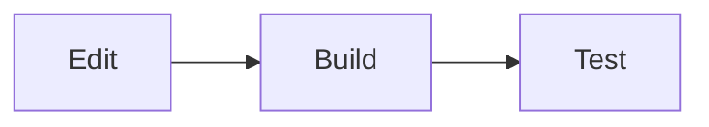

# Releases and docs

This page covers the docs site and the release flow. For code rules see [Code rules](code-rules.md).

The docs are built with [bxSites](https://bxsites.io) from `docs/` and `bxsites.yaml`, and published to GitHub Pages at <https://bxrig.boxlang.io> by `.github/workflows/docs.yml` on every push to `development`. A pull request builds and audits the site without publishing it.

## Preview the docs

```bash
bx-module install bx-sites
boxlang bxSites serve           # build and serve with live reload
boxlang bxSites build           # build to site/
boxlang bxSites audit           # check the built site, links included
```

Run `audit` before you open a pull request: CI runs it too.

## Add or edit a page

1. Put the Markdown file in the section folder where readers will look for it.
2. Start it with frontmatter:

   ```yaml
   ---
   title: Add a command
   order: 83
   summary: One sentence that says what the page helps you do.
   ---
   ```

3. Link to other pages with relative paths (`../build/boxlang.md`), never absolute URLs.
4. Run `boxlang bxSites serve` and look at it.

| Section | Folder | Order |
|---|---|---|
| Home | `docs/index.md` | 1 |
| Start | `docs/start/` | 10 |
| Desktop | `docs/desktop/` | 20 |
| Customize | `docs/customize/` | 30 |
| Build | `docs/build/` | 40 |
| AI | `docs/ai/` | 50 |
| Data | `docs/data/` | 60 |
| Maintain | `docs/maintain/` | 70 |
| Developer | `docs/developer/` | 80 |
| Reference | `docs/reference/` | 90 |
| Architecture | `docs/architecture/` | 100 |

> **Warning:** `docs/reference/commands.md` and `command-flags.md` are generated from `docs/reference/cli.json` by `bootstrap/gen-docs.sh`. Edit `cli.json` and regenerate; never edit those two by hand. See [Add a command](add-a-command.md).

### Writing style

- Lead with what the reader will do. Show the shortest working example first.
- Short paragraphs, numbered steps for tasks, tables for choices.
- Put edge cases and long option tables under an `## Advanced` heading at the bottom.
- Use blockquotes for callouts: `> **Tip:**`, `> **Note:**`, `> **Warning:**`.
- `{{ version }}` and `{{ installUrl }}` are site variables from `bxsites.yaml`.

### Diagrams

Use a fenced `mermaid` block. Keep it small (about ten nodes), label nodes in double quotes, avoid special characters, and put a one-line sentence before it saying what it shows.

````markdown

````

### Screenshots and clips

Images live in `docs/assets/screenshots/` (`.webp`) and clips in `docs/assets/clips/` (`.webm`, and `.gif` for places that cannot play video). Name them after the feature: `control-center-dashboard.webp`.

```markdown


<video src="../assets/clips/control-center.webm" poster="../assets/screenshots/control-center-dashboard.webp" autoplay loop muted playsinline width="100%"></video>
```

Always write alt text that says what the picture shows. A clip needs a `poster` screenshot. `tools/record-term.py` records a terminal command for docs and pull requests.

### Links

Every relative link must resolve. `boxlang bxSites audit` finds the broken ones. Fix them before you push.

## Versions

`docs/` is the version being written, **{{ version }}**. When it ships, freeze a copy:

```bash
boxlang bxSites version:new --name=1.0.x      # freezes docs/versions/1.0.x
```

Then set `versions.default: "1.0.x"` in `bxsites.yaml`. The release is served at the root and `docs/` becomes `/next/`. Every theme gets a version switcher.

- Patch releases edit `docs/versions/1.0.x/` in place.
- A new minor or major release cuts a new version.

## Languages

English only for now. To add one:

```bash
boxlang bxSites i18n:new --code=es
```

List it under `i18n.locales` in `bxsites.yaml`. `boxlang bxSites i18n:status` reports coverage.

## Releases

| What you do | What ships |
|---|---|
| Push to `development` | The `beta` channel. |
| Push a tag that starts with `v` | The `stable` channel. |

CI builds, signs and publishes the binary and the one-line installer. Users pick a channel with `bxrig update channel`. See [Updates and channels](../maintain/updates.md) and [Security](../maintain/security.md).

## Advanced

- **Who builds what.** `.github/workflows/ci.yml` runs the tests and the S3 publish job (a `v*` tag publishes under `releases/VERSION`, a `development` push under `snapshots/`). `docs.yml` builds the docs and first runs `bootstrap/gen-docs.sh --check`, so a stale command reference fails the docs build.
- **MatchBox builds.** `scripts/get-matchbox.sh` and `.github/workflows/matchbox.yml` build and publish the MatchBox that BxRig is compiled with.
- **Release signing.** The release key is generated with `scripts/gen-signing-key.sh`; the update flow verifies an Ed25519 signature and the SHA-256 of the binary.
