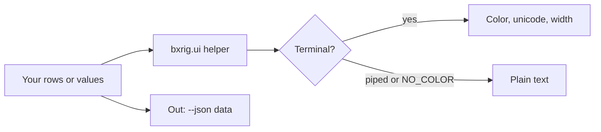

# The terminal UI toolkit (`bxrig.ui`)

New to it? When your command prints something for people, do not join strings by hand. Ask the toolkit for a table, a panel or a status line and print the result. It handles color, width and plain output for you, and the same call gives data for `--json`.

This diagram shows the path from your data to the screen or to a pipe.



Commands that print (not the full-screen TUI) build their output with `bxrig.ui`. One call gives tables, panels, badges, key-value lists, trees, columns, status lines, progress bars, sparklines, bar charts, step checklists, gradients and hyperlinks. Every helper returns text or an array of lines; nothing prints until you call `print`.

```boxlang
ui = new bxrig.ui.Ui();
ui.print( ui.table(
    [ { key: "id", title: "Major", align: "right" }, { key: "name", title: "Name" }, "vendor" ],
    rows, { title: "Java" } ) );
ui.print( ui.panel( "Saved the keys.", { title: "Done", border: "ok" } ) );
```

## Terminal rules

`Term` decides once: colour only on a terminal, never with `NO_COLOR`, `TERM=dumb` or `plain`; truecolor from `COLORTERM`, else the nearest of 256 colours; unicode from the locale (ASCII borders and glyphs otherwise); width from `COLUMNS` or `stty`, else 80, never below 20. With colour off every style call returns the plain text, so piped output is clean. Tests force all of it: `new bxrig.ui.Ui( { color: true, truecolor: true, width: 60, unicode: true } )`.

Widths are measured as the screen shows them: escapes take no room, wide characters (日本語, 😀) two columns, combining marks none.

## Colours

A colour is a role (`accent accent2 ok warn err info text dim border header zebra`), a basic name (`red cyan gray ...`) or a hex like `#00c8ff`. A style is words: `bold dim italic underline inverse strike`, a colour, `bg:COLOUR`.

```boxlang
ui.style( "installed", "bold ok" )
ui.style( " LTS ", "bold black bg:warn" )
ui.colors( { accent: "#ff8800" } )   // change a role, for example to the theme that is on
```

## The helpers

| Call | Result |
|---|---|
| `ui.table( columns, rows, opts )` | A table. Columns: `key title align width min max grow wrap format style`. Options: `border` (`rounded plain heavy double ascii none`), `title`, `footer`, `zebra`, `rowLines`, `width`, `padding`, `empty`, `fill`. A table wider than the terminal shrinks its widest columns first and cuts text with an ellipsis, or wraps a `wrap: true` column. |
| `ui.panel( content, opts )` | A box with `title`, `subtitle`, `border`, `color`, `padding`, `width`, `fill`. |
| `ui.callout( kind, text, opts )` | A coloured bar with wrapped text (`ok warn err info`). |
| `ui.section( title, blurb )`, `ui.rule( title )` | An UPPERCASE heading; a rule with a title in it. |
| `ui.kv( pairs, opts )` | Aligned label and value lines, values wrapped with a hanging indent. |
| `ui.list( items, opts )`, `ui.tree( nodes )` | Bullets or numbers with children; a tree with `├─ └─ │`. |
| `ui.beside( blocks, opts )` | Blocks (arrays of lines) side by side. |
| `ui.columns( items, format, opts )` | A list of simple values in columns filled top to bottom, from the widest item and the terminal width (like `ls`). `format( item, row, column )` returns a format such as `"blue"`. |
| `ui.treeOf( data, format )` | A tree from nested structs (a key with a struct is a branch, `""` or `{}` a leaf). `format( pathString, pathArray )` returns a format. |
| `ui.badge( text, role )`, `ui.pill( text, role )`, `ui.status( kind, text )` | Small marks: `[LTS]`, `✓ installed`. |
| `ui.bar( ratio, width, opts )`, `ui.spark( values )`, `ui.barChart( rows, opts )` | Progress bar, sparkline, horizontal bar chart. |
| `ui.steps( items, opts )`, `ui.spinner().frame( tick )` | A step checklist; a spinner frame. |
| `ui.live()` | A block that redraws itself in place (`update( lines )`, `finish()`). |
| `ui.gradient( text )`, `ui.link( text, url )` | A gradient across the text; an OSC 8 hyperlink. |
| `ui.truncate`, `ui.align`, `ui.wrap`, `ui.textWidth`, `ui.strip` | Text helpers that know about escapes and wide characters. |

## The fluent print helper

`ui.printer()` returns a buffer you chain calls on, after CommandBox's `print`. **Any method name is a format**:

```boxlang
p = ui.printer();
p.boldGreenText( "Installed" ).line()
 .redOnWhiteLine( "ERROR" )
 .indentedLine( "detail" )
 .text( status, status == "running" ? "green" : "red" )   // a format chosen at run time
 .table( rows ).columns( names, ( item, row, col ) => "blue" ).tree( data )
 .toConsole();
```

Rules: a colour name colours the text (`red`, `accent`, `ok`, `color221`, the xterm numbers; also `maroon olive navy silver lime fuchsia aqua`, `orange pink gold ...`), `on` + a colour is the background, decorations are `bold dim italic underscored underline blinking reversed concealed strike`, `indented` puts two spaces before every line, and `line` ends the text with a line break. Other words (`text`, `and`, `background`) are ignored so a name reads well. A second string is added to the name, so `p.text( s, "green" )` is `p.greenText( s )`.

- `toConsole()` prints and clears the buffer; `toString()` and `lines()` return it; `unANSI( s )` strips escapes.
- `table( data, includeHeaders, headerNames, debug, options )` takes what CommandBox's `print.table` takes: arrays of arrays or of structs, a cell can be `{ value, options: "blueOnWhite" }`, columns shrink to fit, and a terminal too narrow for them gets one `...` column in place of the right-hand ones.
- `columns( items, format )` and `tree( data, format )` are CommandBox's `print.columns` and `print.tree`.
- `panel`, `callout`, `section`, `rule`, `kv`, `list`, `beside`, `steps`, `barChart`, `gauge`, `tabs` and `paragraph` add the same blocks as the toolkit.

The toolkit itself speaks the same language and returns a styled string: `ui.boldRed( "failed" )`, `ui.greenOnBlack( "ok" )`, `ui.text( s, "magenta" )`. With colour off they return the text unchanged. (A misspelt method on `Ui` or `Print` is read as a format and does not raise an error.)

`ui.styled()` builds a reusable style by chaining: `warn = ui.styled().boldYellow(); warn.apply( "careful" )`; `copy()` and `patch()` combine styles.

## Progress bars

`ui.bar( ratio, width, opts )` draws a bar; `ui.meter( total )` tracks a task with a rate and an ETA; `ui.multi()` stacks several meters under one display.

```boxlang
ui.bar( 0.62, 40, { style: "smooth", gradient: true } )            // █████████████████████████░░░░░░░░░░░░░░░  62%
ui.indeterminate( tick, 40 )                                        // a bright stretch that moves back and forth
ui.segments( [ { label: "System", value: 41 }, { label: "Free", value: 59 } ], 60, { format: v => v & " GB" } )

m = ui.meter( 480000000 ).label( "Downloading Java 25" ).unit( "bytes" ).gradient();
m.advance( chunk ).draw();                                          // ⠋ Downloading Java 25 ███████▌░░░ 31% 148 MB/458 MB 95 MB/s ETA 3s
m.finish( "Installed" );

mp = ui.multi();  java = mp.add( 480, "Java 25" ).unit( "bytes" );  node = mp.add( 120, "Node 24" ).style( "line" );
java.advance( 60 );  mp.draw();
```

- **Styles** (`style`): `smooth` (partial blocks, an eighth of a cell), `line` (thick and thin line), `blocks`, `thin`, `dots`, `braille`, `arrow` (`[====>----]`) and `ascii`. Without unicode every style is ascii.
- **Colour**: `role` for one colour, or `gradient: true` (accent to accent2) or `gradient: [ "ok", "info" ]`, spread over the whole bar so the colour at a cell never changes as it fills. `track` colours the empty part. `ends: "[]"`, `percent`, `label`.
- **Meter**: `label`, `message`, `unit( "bytes" )` (sizes and speeds as `1.4 MB` and `3.2 MB/s`), `style`, `gradient`, `color`, `width`, `total` (when the size becomes known), `advance`, `set`, `template`, `draw`, `finish`, and `ratio()`, `rate()` (over the last updates), `eta()`, `elapsed()`. The default template follows the unit and fits the terminal: the bar takes what the other tokens leave. A template uses `{spinner} {label} {bar} {bar:30} {pos} {total} {percent} {rate} {eta} {elapsed} {message} {bytes} {total_bytes}`. A task with no total shows the elapsed time and a moving bar.
- **In place or in a log**: on a colour terminal `draw()` redraws one line (a `Live`); elsewhere it prints a line each time the percent moves 10 points, so a log stays short. `Multi` keeps a finished meter's line with a check mark.
- **Spinners**: `ui.spinner().frame( tick, "accent", "arc" )`; sixteen sets (`dots dots2 line arc bounce arrows pulse grow box triangle square hamburger star toggle balloon rain`).
- **Time**: pass `clock: function() { return ms; }` to `meter()` or `multi()` to test without the real clock.

## Ideas taken from ratatui

| Call | Result |
|---|---|
| `ui.spans( [ "Installed ", [ "Java 21", "boldGreen" ], " in ", [ "41 s", "dim" ] ] )` | Styled parts joined into one string (ratatui's `Span` and `Line`). |
| `ui.paragraph( text, { width, align, wrap, indent, style } )` | Text laid out in a width, left, centred or right. |
| `ui.layout( [ "length:10", "fill", "percentage:25", "max:8" ], width, gap )` | The widths of a split: `length`, `percentage`, `ratio:1/3`, `min`, `max`, `fill:2` (a weighted share of what is left). |
| `ui.split( blocks, constraints, opts )` | Blocks placed side by side in those widths. |
| `ui.gauge( ratio, { width, label, role } )` | A full-width bar with the label inside it. |
| `ui.lineGauge( ratio, { width } )` | `50% ━━━━━━━━━━──────────` |
| `ui.tabs( titles, selected )` | A row of titles with the selected one marked. |
| `ui.panel( content, { borders: "top,bottom", titleAlign: "right" } )` | A block with only the borders you list, and titles at the left, centre or right. |
| `ui.list( items, { selected: 2 } )` | A list with a highlighted row and its symbol. |

## One call, two outputs

Commands built on `Out` get a styled block for people and data for `--json` from one call:

```boxlang
out.table( "Java", columns, rows, asJson, { total: rows.len() } )   // text: the table; --json: { rows: [...], total }
out.kv( "Status", { jenv: "ready", global: "21" }, asJson )
out.blocks( data, asJson, ui.panel( "Done" ) )
```

Tests: `tests/ui_test.bxs` (golden output, widths 40, 80 and 120, plain and colour).

## Help pages

`bxrig help`, `bxrig --help` and `bxrig COMMAND --help` are drawn with this toolkit (`bxrig.Help`): the DOS Rebel wordmark in the brand gradient and a version badge on a terminal, an UPPERCASE coloured title per group, a bold command name and one dim line each (the `brief` of the command in `docs/reference/cli.json`, at most 60 characters, checked by `bootstrap/gen-docs.sh`). A command page has USAGE (one form per line, narrowed by the words after the command: `bxrig ai models --help`), FLAGS, EXAMPLES and NOTES. A usage error prints the forms one per line too (`CommandSpec.usage`). Piped output has no colour and no wordmark.
