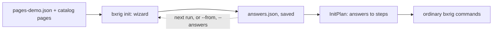

# Wizard pages

You will add one yes/no question to the setup wizard and make it run a command. The wizard only asks and saves answers. `bxrig init` turns the answers into ordinary commands.

## Files you touch

| File | What for |
|---|---|
| `assets/wizard/pages-demo.json` | The built-in pages and questions (JSON). |
| `src/bxrig/InitPlan.bx` | Turns an answer into a step: the command to run. |
| `tests/init_plan_test.bxs` | Checks the step for your answer. |
| `tests/wizard_app_test.bxs`, `tests/wizard_view_test.bxs` | Wizard logic and screens, run when you change page behaviour. |

## How an answer travels

This diagram shows the path from a question to a command, and how the saved answers come back.



The wizard itself (`bxrig wizard`) changes nothing on the machine. Saved answers live in `~/.config/bxrig/answers.json` (mode 600, no secrets).

## Steps

1. Add the question to the page it belongs to in `assets/wizard/pages-demo.json`, in that page's `questions` list. A yes/no question:

   ```json
   {
     "type": "confirm",
     "id": "stay_awake",
     "label": "Stay awake while plugged in",
     "default": false,
     "help": "The screen and the machine stay on while on mains power. Change it later from the BxRig menu."
   }
   ```

   The `id` is the answer key: it must be unique across all pages. Question types:

   | Type | Answer is | Extra keys |
   |---|---|---|
   | `choice` | a string | `options` (`value`, `label`, `description`, optional `group`) |
   | `multi` | an array of strings | `options` |
   | `text` | a string | `placeholder` |
   | `number` | a number | `min`, `max` |
   | `confirm` | true or false | none |
   | `info` | no answer, just text | `label`, `help` |

2. Turn the answer into a step in `src/bxrig/InitPlan.bx`, next to the similar ones. Nothing runs that the user did not choose, so an unanswered question must add no step. Look at `night_shift` there for the pattern:

   ```boxlang
   if ( pick( a, "stay_awake", false ) ) out.steps.append( { id: "stay-awake", title: "stay awake while plugged in", argv: [ "bxrig", "toggle", "stay-awake" ], optional: true } );
   ```

   `argv[1]` of `"bxrig"` means this program. `optional: true` means a failure is skipped instead of stopping the run.

3. Add a test in `tests/init_plan_test.bxs` (it follows the `power_setup` check):

   ```boxlang
   testkit.check( "stay_awake adds its step", cmd( ip.plan( { stay_awake: true } ), "stay-awake" ) == "bxrig toggle stay-awake" );
   testkit.check( "no answer, no step", ip.plan( {} ).steps.len() == 0 );
   ```

## See it working

```bash
scripts/dev-build.sh
dist/bxrig wizard --demo --out /tmp/answers.json     # your question is on its page
dist/bxrig init --print-answers                      # includes stay_awake
echo '{"stay_awake": true}' > /tmp/a.json
dist/bxrig init --answers=/tmp/a.json --dry-run      # the plan has your step
```

## Replay answers

| Command | Does |
|---|---|
| `bxrig init --from=FILE` | Opens the wizard filled with the answers in FILE. |
| `bxrig init --answers=FILE --yes` | Runs the answers without asking (`--dry-run` prints the plan). |
| `bxrig init --export=FILE` | Copies your saved answers to take to another machine. |
| `bxrig init --print-answers` | Prints the saved answers (`--from-system` adds what the machine has). |
| `bxrig wizard --pages=P.json --answers=A.json --out=O.json` | The bare wizard with your own pages. |

An answer for a question this version does not ask is ignored.

## Test it

```bash
(cd src && matchbox ../tests/init_plan_test.bxs)
(cd src && matchbox ../tests/wizard_app_test.bxs)
(cd src && matchbox ../tests/wizard_view_test.bxs)
bash tests/wizard-test.sh dist/bxrig       # end to end in a pseudo-terminal
bash tests/init-test.sh dist/bxrig
```

## Common mistakes

- A duplicate question `id`: the second hides the first in the answers.
- A step that runs when nothing was answered. Use `pick( a, "id", false )` so a missing answer does nothing.
- An answer that is saved but no command uses: add it to `pendingKeys()` in `InitPlan` so the user is told.
- Putting app choices in the JSON by hand: the Customize pages per catalog group are generated from the catalog (`AppPages`). See [Add an app](add-an-app.md).

## Advanced

### Conditions

Any question may carry `"when": { "id": "other_question", "in": ["a", "b"] }` or `"equals": "a"`. It is shown only while that answer matches, and a hidden question is left out of the review and the answers file. `"when": { "any": [ {...}, {...} ] }` lists conditions where one is enough. A question with `"hidden": true` is never shown, it only carries a value (what the system detected) that other `when`s read, like `input_detected` on the Input page.

A whole page may carry `when` too: it is skipped by Next and Back and left out of the sidebar, step count, review and result.

### The wizard program

The wizard is a full-screen terminal form written in BoxLang on MatchBox's terminal canvas. It needs a 76x24 terminal. Exit codes: 0 answers written, 130 cancelled (nothing written), 2 usage, 4 unreadable pages or answers file.

| Class | Does |
|---|---|
| `WizardApp` | State and key handling, no drawing (unit tested). |
| `WizardView` | Draws a frame and records click regions. |
| `Wizard` | The run loop: events in, frames out. |
| `WizardCmd` | The `bxrig wizard` command. |
| `WizardData` | The built-in pages (a resource). |

Keys: Up/Down (or j/k) move, Space selects, Enter finishes the question, Left/Right change a number, Tab or PageDown next page, Esc or Shift-Tab previous, Ctrl-C cancels. Clicks select options and jump to visited steps.

Record the wizard for the docs with `python3 tools/record-wizard.py --bin dist/bxrig --out /tmp/rec` (needs Pillow, pyte and ffmpeg).

Next: [Add a command](add-a-command.md), [Tests](tests.md).
