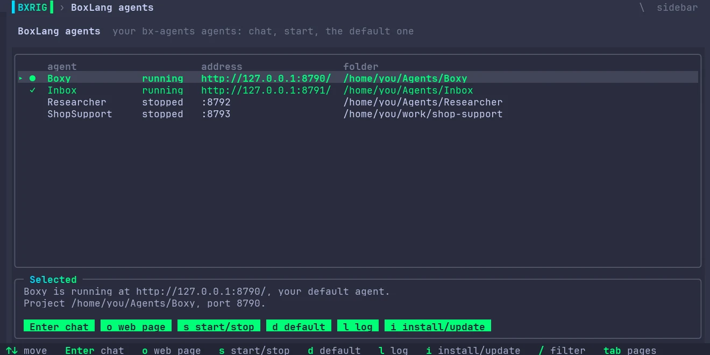

# BoxLang agents

[bx-agents](https://bxagents.ai) builds AI agents in BoxLang: an `Agent.yml`, instructions, tools, skills, routines, a web chat and a terminal chat. It has its own full command line, `bxAgents`. BxRig installs it, keeps your agent projects in one folder, runs each agent in the background, and points them at your [local model](local-ai.md) when you want.



## Boxy, your desktop assistant

Boxy is BxRig's own agent: it knows this machine. Ask it how the battery is doing, what is on your agenda, to switch to a dark theme, add a reminder, install an app, start a database or take a screenshot.

```bash
bxrig ai agents install --yes      # bx-agents, once
bxrig ai agents setup --yes        # makes ~/Agents/Boxy, starts it, makes it your default agent
```

<video src="../assets/clips/boxy-cli.webm" poster="../assets/screenshots/boxy-cli.webp" autoplay loop muted playsinline width="100%"></video>

The setup wizard offers both on its AI page. Then:

| Keys or command | What |
|---|---|
| `Super+Period` | a chat with your default agent (Boxy) in a terminal |
| `Super+Shift+Period` | its web page |
| `bxrig ai agents chat` | the chat in this terminal |
| `bxrig ai agents ask how is my battery` | one question, the answer printed |

**What Boxy can do.** Its tools run BxRig's own commands, so it can do only what BxRig does, through the same plans and checks:

| Area | Tools |
|---|---|
| This machine | status, updates waiting, battery and power profile, Wi-Fi, Bluetooth, sound, displays, backups |
| The look | the themes and switching them, light or dark, night light, do not disturb, staying awake, brightness, the power profile |
| Plans | the agenda from your calendars, reminders, the time zone |
| Apps | searching the catalog, installing and removing apps, finding a shortcut |
| Capture | a screenshot, a screen recording |
| Development | your databases and virtual machines (start and stop them), the local AI models |
| System | updating the system (a snapshot first), locking the screen, backing up your files now |

**It asks first.** Every tool that changes something waits for your OK: Approve, Reject, or approve for the rest of the conversation, in the chat, on the web page or in the bar. From a terminal:

```bash
bxrig ai agents ask switch to the dawn theme
# Boxy wants to run theme_set {"theme":"dawn"}
bxrig ai agents approve bxrig-1f2e3d4c5b6a      # or: reject
```

**A model that fits.** Boxy has 36 tools. A very small model (Qwen3.5 0.8B) handles plain requests (list the themes, turn on the night light, a reminder in 30 minutes) but now and then proposes a change you did not ask for; the approval catches it. A 4B model (Qwen3.5 4B) answered every test request right. Pick a bigger one with `bxrig ai models recommend` and `bxrig ai models use ID`: the `bxrig` profile follows. On a computer without a graphics card the first answer can take a minute or two, so the `bxrig` profile gives the model 300 seconds.

Other agents and editors can use the same tools: `bxrig mcp link --yes` (see [MCP and privacy](mcp-and-privacy.md)).

Boxy is your project in `~/Agents/Boxy`: change its instructions (`instructions.md`), its tools (`tools/BxRig.bx`) or its model (`Agent.bx`), and `bxrig ai agents start Boxy` rebuilds it.

## Skills it saved for itself

After a task that took real steps, Boxy (or any agent) can save a skill, its own notes on how to do it again. bx-agents asks you to approve each save in the chat. BxRig flags the ones you have not reviewed since, and the bar shows how many:

```bash
bxrig ai agents skills                       # Boxy's own skills: new or reviewed
bxrig ai agents skills show morning-check    # read one
bxrig ai agents skills approve morning-check # mark it reviewed (--all for every one)
bxrig ai agents skills remove morning-check --yes
```

A skill stays active while it waits for your review. When the agent saves over one you reviewed, it is flagged again. Another agent: `bxrig ai agents skills NAME ...`.

## Install bx-agents

```bash
bxrig ai agents install             # the plan
bxrig ai agents install --yes       # the latest snapshot (the default for now)
bxrig ai agents install --stable --yes
bxrig ai agents update --yes        # the newest again, and restart the agents that run
```

bx-agents is installed for your whole machine with `bx-module` (into `~/.boxlang/modules`), like any BoxLang module. Install also offers your local model to every agent (see below).

## Make an agent

```bash
bxrig ai agents new Boxy                    # bx-agents' own wizard, in ~/Agents/Boxy
bxrig ai agents new Boxy --model=openai-compatible/qwen3.5-0.8b --no-wizard
bxrig ai agents                             # your agents: running or not, the address, the default one
```

<video src="../assets/clips/ai-agents-cli.webm" poster="../assets/screenshots/ai-agents-cli.webp" autoplay loop muted playsinline width="100%"></video>

`new` runs `bxAgents new` in your projects folder, so every question and flag is bx-agents' own. You can make one anywhere else with `bxAgents new` and tell BxRig about it: `bxrig ai agents add ~/work/shop-support`.

## Everything else is bxAgents

```bash
bxrig ai agents Boxy chat                  # the terminal chat
bxrig ai agents Boxy invoke --message="What is on my calendar today?"
bxrig ai agents Boxy routines list
bxrig ai agents Boxy skills find calendar
bxrig ai agents Boxy logs agent
```

`bxrig ai agents NAME VERB ...` is `bxAgents VERB --projectRoot=PROJECT ...`, with your words passed on exactly as you typed them. Every verb bx-agents has works this way. `bxAgents --help` lists them.

## Your local model

Install writes a `bxrig` profile into your bx-agents settings (`~/.bxagents/Agent.yml`): your active local model at BxRig's server. An agent uses it with one line in its `Agent.yml`:

```yaml
profile: bxrig
```

When you change the active model (`bxrig ai models use ID`), the profile follows. Only BxRig's own marked block in that file is written; your other settings stay. `bxrig ai agents profile --off` removes it.

## In the background

```bash
bxrig ai agents start Boxy      # builds it, then serves it on 127.0.0.1
bxrig ai agents open Boxy       # its web page
bxrig ai agents status Boxy
bxrig ai agents stop Boxy
bxrig ai agents default Boxy    # the agent your keyboard shortcut opens
```

Each agent runs as a user service (`bxrig-agent-boxy.service`) on its own port, from 8790 up, and only on this machine. Routines and gateways run while it does. Its log: `journalctl --user -u bxrig-agent-boxy.service`.

## In the Control Center and the bar

The **BoxLang agents** page (`bxrig tui ai-boxlang`) lists your agents: Enter opens the chat in a new terminal, `o` the web page, `s` starts or stops it, `d` makes it the default, `l` shows its log and `i` installs or updates bx-agents.

The bar's Agents panel has a **Boxy** tab, for your default agent: Start or Stop, Chat, its web page, a box to ask it something with Approve and Reject when it wants to change something, and its new skills to review. The **BoxLang** tab lists every agent with Chat, its web page and Start or Stop.

## Where things are

| What | Where |
|---|---|
| Your agent projects | `~/Agents/NAME` (`bxrig ai agents dir PATH` moves the folder, `BXRIG_AGENTS_DIR` overrides it) |
| Each agent's data: chats, notes, files, skills, logs | `~/.bxagents/NAME`, bx-agents' own place, outside the project, so a build never touches it |
| Your bx-agents settings, for every agent | `~/.bxagents/Agent.yml` |
| BxRig's list: ports, the default, projects added by path, the skills you reviewed | `~/.config/bxrig/agents.json` |
| The service of each agent | `~/.config/systemd/user/bxrig-agent-NAME.service` |

Each agent keeps its data by its name, so two agents can not share a name.

To back up your agents, keep `~/Agents` and `~/.bxagents`. `bxrig ai agents Boxy backup` makes a zip of one agent's data.
