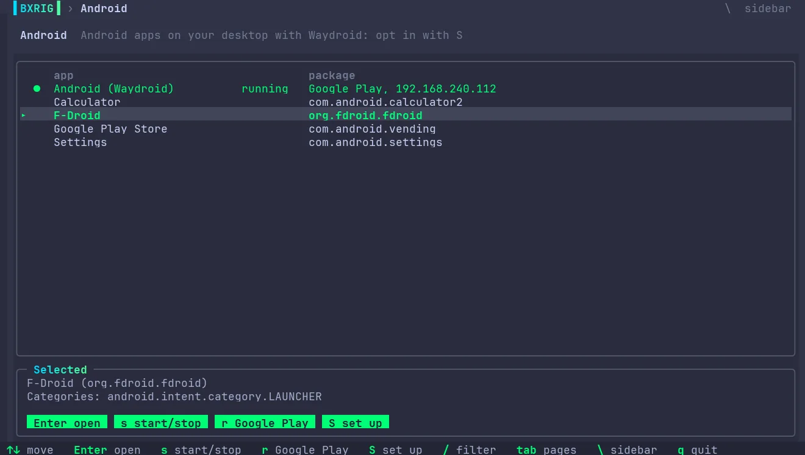

# Android apps

BxRig can run Android apps next to your desktop apps with [Waydroid](https://waydro.id): Android in a container, each app in its own window. **It is off until you turn it on.** A normal install and `bxrig init` do nothing about it (the wizard asks, and the answer is "Not now" unless you change it), and every command that changes something shows its plan first.

```bash
bxrig android                       # is it set up? is it running? does this machine support it?
bxrig android setup                 # the plan: what would be installed and downloaded
bxrig android setup --yes           # do it (Google Play); --vanilla for no Google
```

<video src="../assets/clips/android-cli.webm" poster="../assets/screenshots/android-cli.webp" autoplay loop muted playsinline width="100%"></video>

## What you need

- **A Wayland session.** Hyprland is one, and so is Plasma on Wayland. An X11 session does not work.
- **The kernel's binder driver.** The CachyOS kernels have it. On another kernel, install `binder_linux-dkms` from the AUR and restart; BxRig never changes your kernel itself, and `setup` tells you when it is missing.
- **Arch, CachyOS, Debian or Ubuntu.** openSUSE has no Waydroid package, so BxRig does not offer Android there.
- About 1.2 GB of download for the image, and your password for the install.

## Set it up

`bxrig android setup --yes` runs these steps, each one shown in the plan before anything happens:

1. On Debian and Ubuntu, add Waydroid's package repository (`repo.waydro.id`).
2. Install `waydroid` (from the official repositories on Arch).
3. Download the Android image: `waydroid init -s GAPPS` for Google Play, or `-s VANILLA` with `--vanilla` (LineageOS without Google).
4. Start the `waydroid-container` service now and at every boot.
5. Start your Android session.

Run it again and it does only what is missing. With a different image than the one you have (`--vanilla` over Google Play), it replaces the image and says so in the plan.

## Use it

```bash
bxrig android apps                  # the Android apps installed
bxrig android open                  # Android itself, full screen in a window
bxrig android open Settings         # an app: its name, a part of the name, or its package
bxrig android install ~/Downloads/app.apk --yes
bxrig android stop                  # stop the session (it frees the memory)
bxrig android start
```

Apps also appear in your applications menu once they are installed. An `.apk` has to support x86_64: one built only for arm will not run. [F-Droid](https://f-droid.org) is a good place to get apps without Google.

## Google Play

Google Play shows "device not certified" until you register the device once:

```bash
bxrig android register              # prints this device's Android ID and where to register it
bxrig android register --open       # and opens that page in your browser
```

Open Google Play once first, so the ID exists. Register the ID on your Google account at `google.com/android/uncertified`, give Google a few minutes, then `bxrig android stop` and `bxrig android start`. The vanilla image has no Google Play, so there is nothing to register.

## Take it out again

```bash
bxrig android remove                # the plan: stop it, disable the service, remove the package
bxrig android remove --data --yes   # and delete the images and everything in Android (apps, their data)
```

Without `--data` the images and data stay on disk, so setting it up again is quick.

## In the Control Center

The **Android** page (`bxrig tui android`) shows the state first. While it is off, the page says so and `S` shows the plan to set it up. Once it is on it lists your Android apps: `Enter` opens one, `s` starts or stops Android, `r` registers it for Google Play.



Waydroid is also in the app catalog as an optional app on Arch (`bxrig install waydroid`), but `bxrig android setup` is the way to set it up properly.
