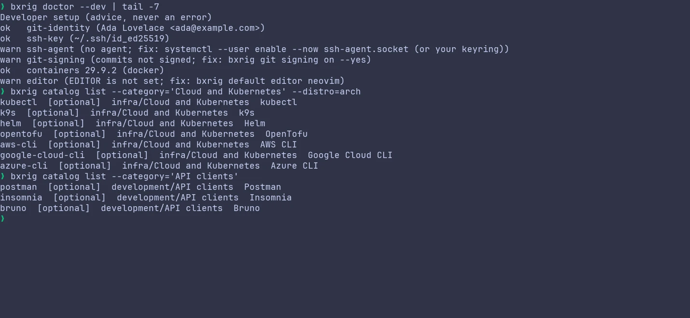
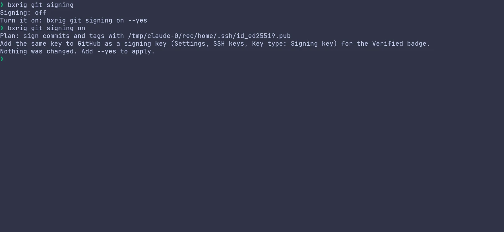

# Developer tools

## API clients

Postman, Insomnia and Bruno are in the app picker under Development > API clients. On Arch they come from the AUR (`postman-bin`, `insomnia-bin`, `bruno-bin`); on Debian, Ubuntu and openSUSE from Flathub.

```bash
bxrig pkg install bruno --yes
```

Bruno keeps its collections as plain files in your project, so they go into git with the code.

## Cloud and Kubernetes

The **Cloud and Kubernetes** profile installs kubectl, k9s, Helm and OpenTofu, and offers the AWS, Google Cloud and Azure CLIs.

| Tool | Arch | Debian | Ubuntu | openSUSE |
|---|---|---|---|---|
| kubectl | extra | apt | not packaged | `kubernetes-client` |
| k9s, Helm, OpenTofu | extra | not packaged | not packaged | zypper |
| AWS CLI | `aws-cli-v2` | `awscli` | `awscli` | `aws-cli` (version 1) |
| Google Cloud CLI | AUR | not packaged | not packaged | not packaged |
| Azure CLI | extra | apt | not packaged | zypper |

A tool that is not packaged on your distribution is not offered there.



## Shell helpers

Two more in the picker, under Development > Shell:

- **atuin**: shell history you can search, with the directory and exit code of every command. It stays on your machine unless you sign in to sync.
- **just**: a `justfile` of project commands (`just test`, `just deploy`), simpler than make.

## Signed commits

```bash
bxrig git signing on --yes      # sign commits and tags with ~/.ssh/id_ed25519
bxrig git signing               # on or off, and with which key
bxrig git signing off --yes     # stop signing; the key stays
```

`on` uses your SSH key (no GPG). It sets `gpg.format ssh`, `user.signingkey`, `commit.gpgsign` and `tag.gpgsign`, and adds your email and key to `~/.config/git/allowed_signers`, so `git log --show-signature` can verify your own commits. It needs the key (`bxrig ssh key --yes`) and `git user.email`. `--key=PATH` picks another key.

For GitHub's Verified badge, add the same public key to GitHub a second time, as a **Signing key** (Settings, SSH and GPG keys).



The setup wizard offers this after the SSH key ("Sign commits with that key").

## Check your setup

```bash
bxrig doctor --dev
```

After the usual tool checks, `--dev` looks at your git name and email, the SSH key, the SSH agent, commit signing, a container engine and `EDITOR`. Each one that is missing prints `warn` with the command that fixes it. They are advice: the exit code stays 0.

<video src="../assets/clips/devtools-cli.webm" poster="../assets/screenshots/devtools-doctor.webp" autoplay loop muted playsinline width="100%"></video>
