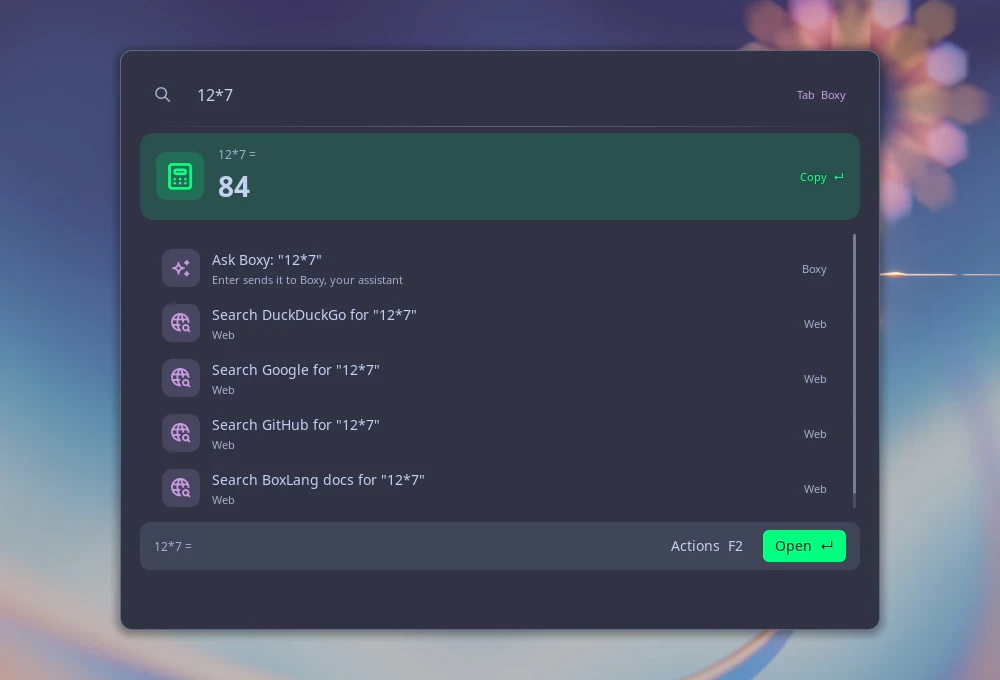
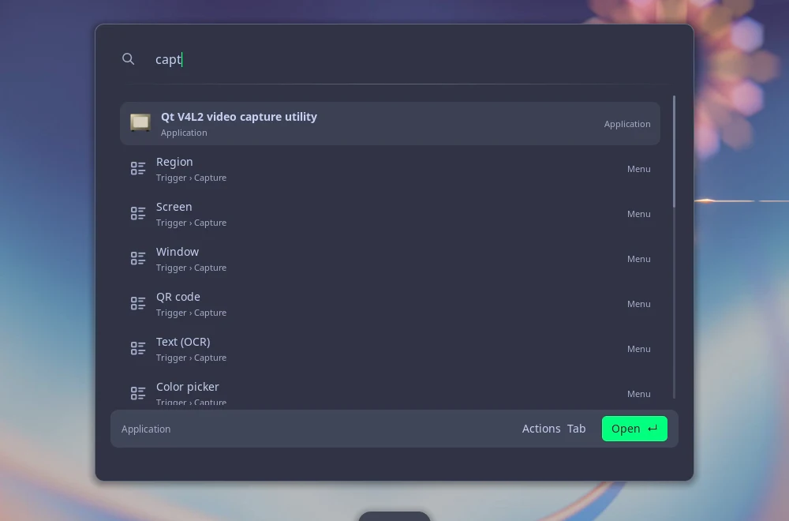
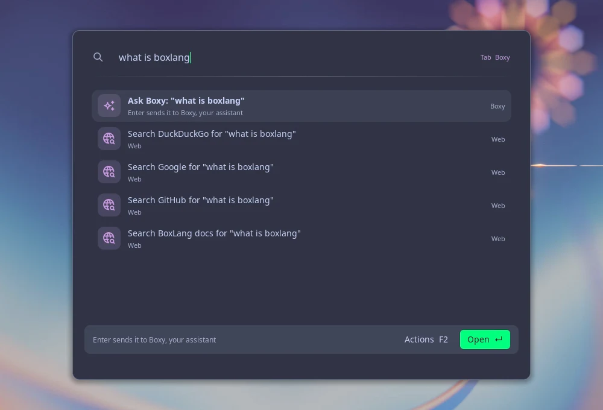
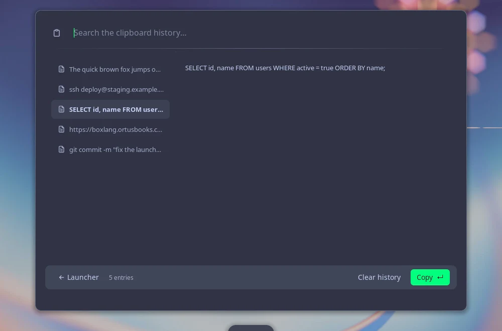
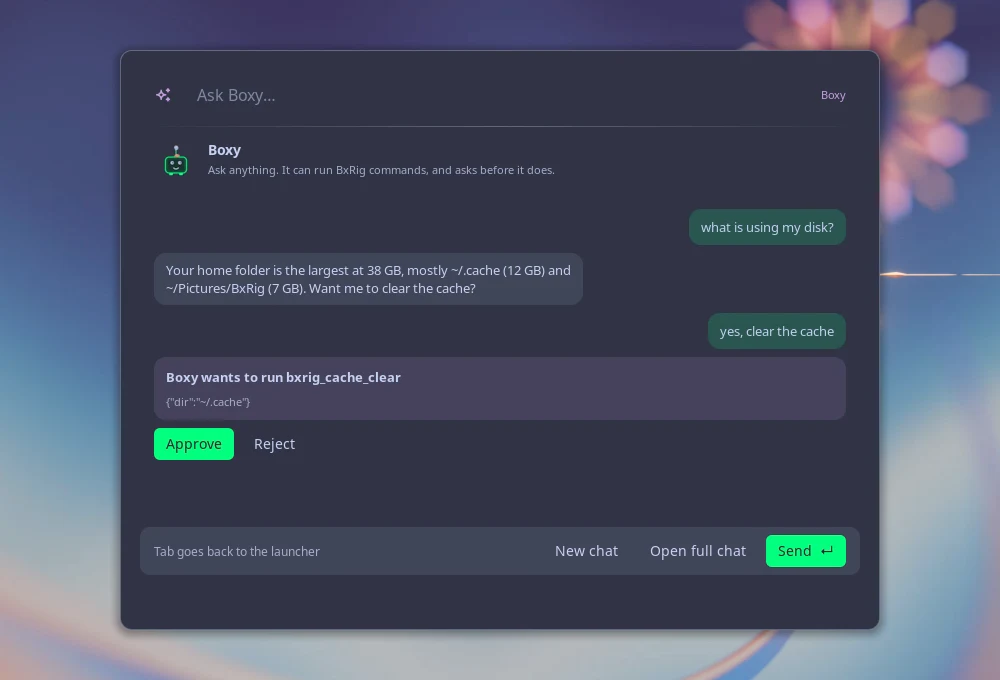
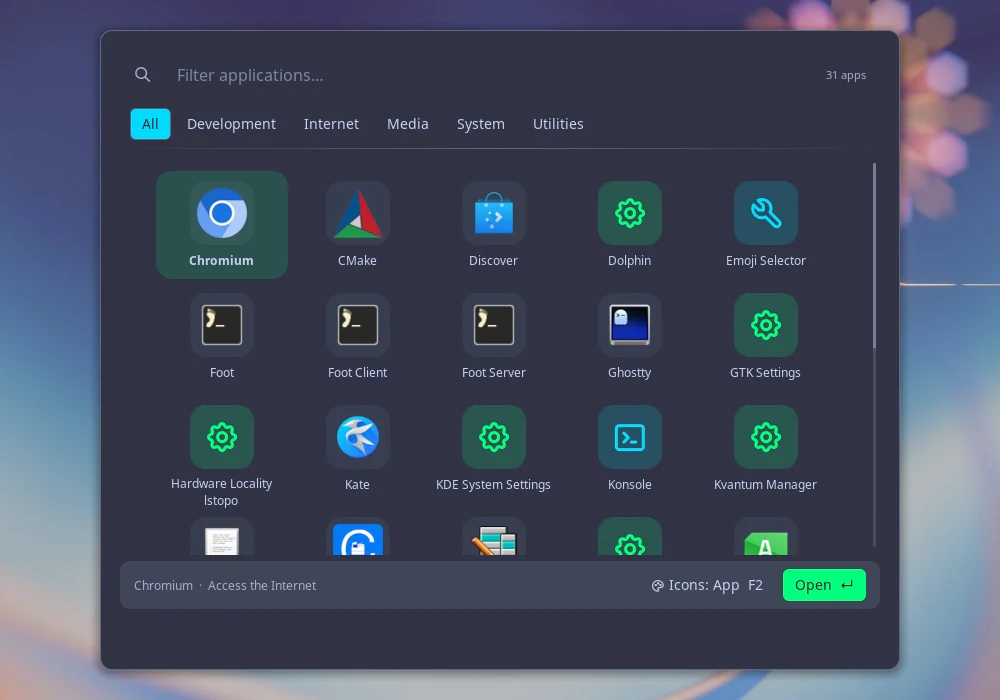
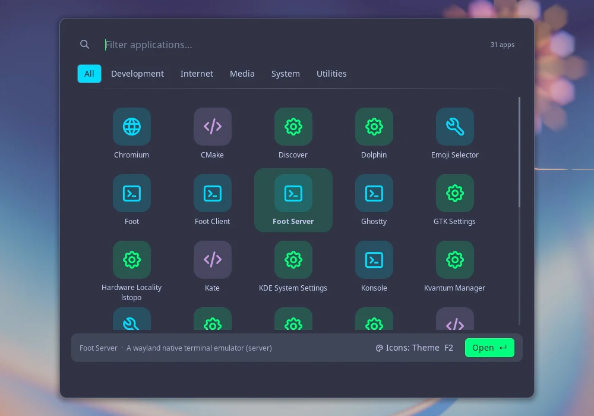
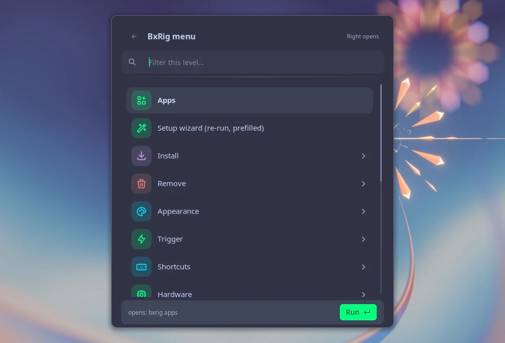
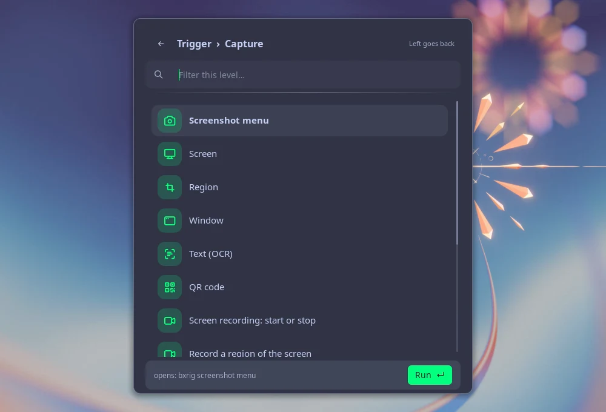
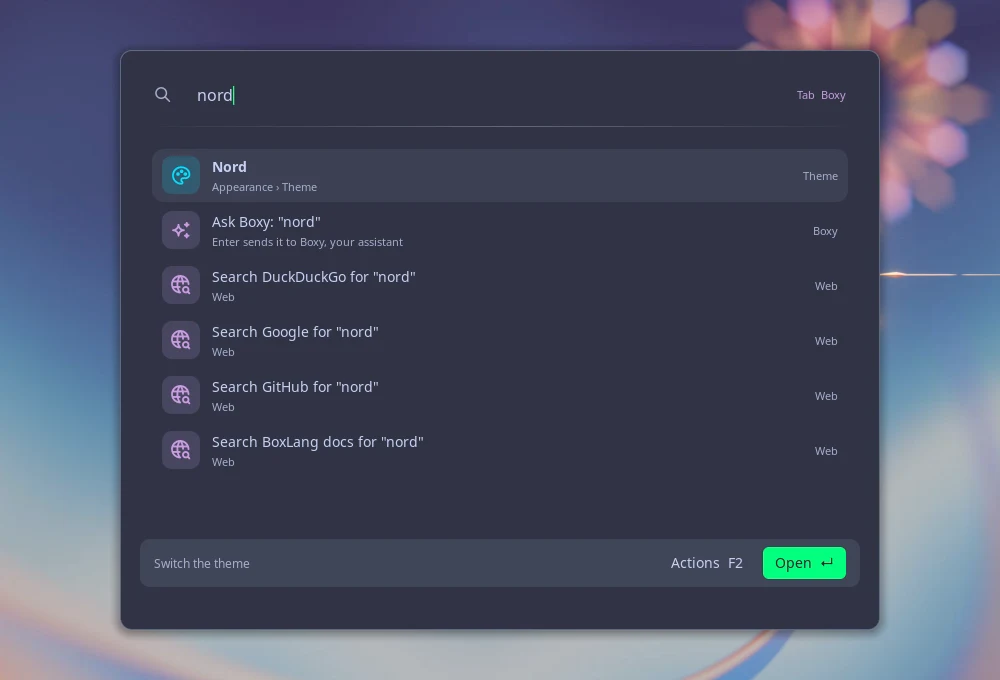

# Launcher

On other desktops, or if you prefer it, search apps, files, your clipboard and BxRig's own actions from one keyboard-first box. [Vicinae](https://github.com/vicinaehq/vicinae) is the launcher and menu BxRig recommends and the wizard's default (Noctalia's own launcher, Walker, Rofi, Fuzzel and Wofi are still choices), drawn in your BxRig theme.

## The BxRig launcher (Noctalia panel)

On the Noctalia desktop, `Super+Space` opens the BxRig launcher: one flat search box, drawn in your theme. Type and it ranks, best first:

- a **calculator answer** (`2*(3+4)` gives `14`; Enter copies it);
- an **Ask Boxy** row, and **Tab** switches the whole panel to a chat with Boxy (see below);
- **menu actions** with their path, such as `Trigger › Capture`, so every action of `bxrig menu` is one search away;
- **applications** with their icons, and **themes** (Enter applies the theme);
- a **Clipboard history** row, which opens the clipboard panel: the history on the left, the full text of the highlighted entry on the right, Enter copies it back (`Super+Ctrl+V` opens it directly);
- **web searches** (DuckDuckGo, Google, GitHub, BoxLang docs) at the end.

<video src="../assets/clips/launcher-panel.webm" poster="../assets/screenshots/launcher-answer.webp" autoplay loop muted playsinline width="100%"></video>









Every row sits on a rounded **icon tile** tinted with the theme's colours: menu actions get a glyph for what they do (a camera for screenshots, a palette for themes), sections keep their colour (Remove and System are red), web searches and Boxy are the tertiary colour, and an application shows its own icon. The tiles follow the Noctalia theme, so a theme change recolours them.

### Boxy mode

Press **Tab** (or Enter on the *Ask Boxy* row, or `Super+Alt+B` to open the launcher already in chat mode) and the launcher becomes a chat with your default agent, Boxy. Type, press Enter, and the answer appears; a tool Boxy wants to run shows **Approve** and **Reject**. **New chat** starts a thread over, **Open full chat** opens the chat window, and Tab goes back to the launcher. If Boxy is not set up or not running, the panel says so and offers **Make Boxy** or **Start**. It uses `bxrig ai agents ask TEXT --thread=ID --json` (not `bxrig ai ask`, which asks the local model directly).



### The app grid

`Super+Alt+A` opens every installed application as a grid of icon tiles: tabs by group, typing filters at once, arrows move, Enter starts the app, and F2 switches between each application's own icon and a themed glyph tile. `bxrig apps list --json` is the data.





<video src="../assets/clips/apps-grid.webm" autoplay loop muted playsinline width="100%"></video>

### The menu

`Super+Alt+Space` opens the BxRig menu as a panel in the same style, like the Omarchy menu: the sections as icon tiles, a header with where you are (`Trigger › Capture`), Enter or Right to go in, Left to go back, type to filter the level. It lists the same entries as `bxrig menu` (`bxrig menu level "Trigger > Capture" --json` is the data), and a leaf runs through `bxrig launcher run`.





<video src="../assets/clips/menu-panel.webm" autoplay loop muted playsinline width="100%"></video>

Things you run often rise to the top (kept in `~/.local/state/bxrig/launcher.json`). F2 opens the Actions list for the highlighted row. The menu panel is on `Super+Alt+Space`, for browsing by section.

The panels are the `bxrig/launcher` plugin. They call the same commands you can run yourself:

```bash
bxrig launcher search capture --json     # the ranked rows
bxrig launcher run theme:nord            # what Enter does for a row
bxrig launcher run web:ddg bash docs     # answer and web rows take the words typed
bxrig clipboard list token --json        # the clipboard history, filtered
bxrig clipboard copy 42                  # put one entry back
```

The clipboard needs `cliphist` and `wl-clipboard` (`bxrig install cliphist wl-clipboard`). The ranking idea follows [oma-cast](https://github.com/typecraft-dev/oma-cast) (MIT).

## Vicinae

### Try it

```bash
bxrig pkg install vicinae
bxrig launcher setup --yes
bxrig launcher                  # what is set up
```

<video src="../assets/clips/launcher-cli.webm" poster="../assets/screenshots/launcher-status.webp" autoplay loop muted playsinline width="100%"></video>

`bxrig launcher setup` shows its plan first. With `--yes` it:

- makes Vicinae BxRig's launcher and menu (the same as `bxrig runner set vicinae` and `bxrig runner menu-set vicinae`), so `bxrig menu` opens in Vicinae;
- writes the **BxRig theme** for Vicinae and selects it;
- adds BxRig's actions to Vicinae's search as **script commands**;
- starts the Vicinae server when it is not running.

Vicinae's own `settings.json` is never edited.

## It follows your theme

Every `bxrig theme set` rewrites `~/.local/share/vicinae/themes/bxrig.toml` from the theme's colours: the background, the text, the accent for selection and focus, and the theme's red, green, yellow, blue, magenta and cyan. Vicinae watches that folder, so the change shows at once. When Vicinae is your launcher, BxRig also selects the theme.



## Run BxRig from the search

| Command | What it does |
|---|---|
| BxRig Control Center | Every BxRig command as one menu |
| Agenda | Your calendars for the next 7 days |
| Next event | Your next event today, shown under the command's name |
| Remind me | A reminder: what, then `30m`, `2h` or `09:25` |
| Reminders | The reminders still to come |
| World clock | The time in your world clock zones |
| Next theme | Switch to the next BxRig theme |
| Check for updates | Whether a BxRig update is waiting |
| Scheduled tasks | The scheduler's tasks and how they ran |
| BoxLang servers | Your BoxLang apps and their ports |
| Lock screen | Lock the screen |

They live in `~/.local/share/vicinae/scripts/bxrig`. Vicinae reads its script folders when it starts, every 15 minutes, and when you run **Reload Script Directories**. `bxrig launcher scripts --yes` writes them again, and `bxrig launcher scripts remove --yes` deletes them. Script commands of your own in other folders are not touched.

## Search your files

Vicinae indexes your home folder in the background and keeps the index up to date.

```bash
bxrig launcher files            # Vicinae's file search
bxrig launcher files invoice    # with "invoice" already typed
```

Next: [The menu](menu.md), [Themes](../customize/themes.md).
