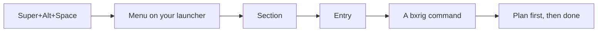

# The menu

`bxrig menu` is one menu for everything BxRig does, shown on your launcher. Press `Super+Alt+Space`, type to search, press Enter. To search everything in one list (apps, menu actions, themes, a calculator and the clipboard) use the launcher on `Super+Space`.

## Try it

```bash
bxrig menu                    # open it (Super+Alt+Space)
bxrig menu search theme       # find an entry by words
bxrig menu open capture       # one submenu on its own
```

> **Screenshot wanted:** the BxRig menu open on the launcher (Super+Alt+Space), showing the section list.

It opens on Rofi, Walker, Wofi, Fuzzel or Vicinae: pick one with `bxrig runner set NAME` (see the [launcher](launcher.md)).

## Every entry is a command



`bxrig menu items` lists the entries with the command each one runs, and `bxrig menu search TEXT` finds one. Entries that print something open in a terminal and wait for Enter; entries that need a choice (a theme, a font, a time zone, a monitor) ask you in the same menu.

## Jump to one submenu

`bxrig menu open capture` opens one submenu on its own. `bxrig menu open` lists the routes; System, Capture, Toggle, Hardware and Agent have keys (`Super+Escape`, `Super+Ctrl+C`, `Super+Ctrl+O`, `Super+Ctrl+H`, `Super+Shift+Ctrl+A`).

## What the menu shows

- **A tick on the current value.** The bar position and style, the dock, the window look, the theme mode, the layout and the power profile show a ✓ on what is set now.
- **Only what applies here.** Laptop entries (laptop panel, lid, power tools) show on a laptop; the touchpad and touchscreen switches when you have one (Hyprland); webcam entries when there is a webcam; GPU mode on a laptop with two GPUs. Install lists only the apps you do not have yet.


## Add your own entries

`~/.config/bxrig/menu.json` adds entries, hides entries and renames them. `bxrig menu file --yes` writes an example; `bxrig menu ids` lists the id of every entry. This file is yours: see [Your own config](../customize/your-own-config.md).

```json
{
	"add": [
		{ "under": "trigger", "label": "Open my notes", "command": [ "xdg-open", "~/Notes" ] },
		{ "under": "system", "label": "Disk usage", "command": [ "ncdu", "~" ], "terminal": true },
		{ "under": "appearance", "label": "Next theme", "bxrig": [ "theme", "next" ] }
	],
	"hide": [ "trigger.share-localsend" ],
	"rename": { "system.lock": "Lock now" }
}
```

`command` runs a program (in a terminal with `"terminal": true`), `bxrig` runs a BxRig command. Leave out `under` to add at the top. A mistake in the file is shown as a warning by `bxrig menu file` and `bxrig menu items`; the menu still opens.

## Advanced

The sections of the menu:

| Section | What is in it |
|---|---|
| Search | Every entry of the menu as one flat list; type to filter, press Enter to run it. |
| Apps | Your installed apps. |
| Install | Any package from the repositories or the AUR, the catalog by group (AI, Development, Terminal, Gaming), web apps, virtual machines, fonts. |
| Remove | Packages, catalog apps, web apps, themes, virtual machines, agent skills. It asks first. |
| Appearance | Theme, Accessibility (zoom, reduce motion, contrast themes), mode, font, background, bar, dock, windows, animations. See [Appearance](../customize/appearance.md) and [Accessibility](../customize/accessibility.md). |
| Trigger | Screenshots, recording (screen, a region, with desktop or microphone audio, with your webcam in a corner), sharing with LocalSend (a file, a folder, the clipboard, receive), the color picker, notices (time, battery, weather), toggles (do not disturb, dictation, dock, stay awake, night light), emoji, clipboard history, force quit, minimize and restore, overview, the quake console, a private browser window, the file manager in the current folder. |
| Shortcuts | List, search, rebind and run a shortcut, check conflicts, write them to Hyprland and Plasma, pick the Traditional or Mac style. See [Shortcuts](shortcuts.md). |
| Hardware | Monitors, laptop panel, mirror, brightness, webcam preview, GPU check, GPU mode (hybrid laptops), touchpad and touchscreen on or off, a Wi-Fi QR code, Network and speed (the System panel's Network tab on Hyprland, the Control Center Network page elsewhere), network and disk speed tests, input devices and gestures, Audio, Bluetooth and Wi-Fi (they open the Noctalia control center panel, like `Super+Alt+C`), the terminal fallbacks `Audio mixer (terminal)` (wiremix) and `Bluetooth devices (terminal)` (bluetui), the status checks for audio, Bluetooth and Wi-Fi, AirPlay. |
| Setup | Power, Display, Defaults (browser, terminal, file manager, editor), Keyboard, Security, Time, DNS (with "Test and pick the fastest", `dns bench`), Kernel, Cloud storage, Backup, NAS. |
| Update | BxRig updates, the system update (a snapshot first), firmware updates, restarting the shell, audio, Wi-Fi or Bluetooth when one is stuck, changing your password, skills, re-apply appearance and display. |
| Develop | BoxLang, databases, virtual machines, containers, the editor. |
| Agent | Open an agent, the pull-down AI shell, sessions, local models, API keys. |
| Learn, About, System | Docs and cheat sheets, the status of this machine, lock, suspend, log out, reboot, shut down. |


Next: [Shortcuts](shortcuts.md), [Control Center](control-center.md), [Appearance](../customize/appearance.md).
