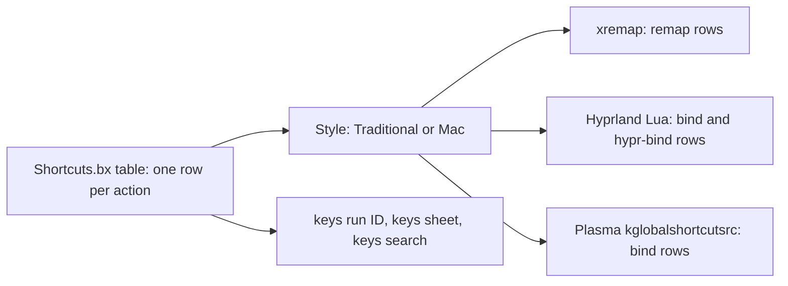

# Add a shortcut

You will bind a key to a BxRig command by adding one row to one table. Hyprland, Plasma and xremap all read that table, so there is nothing else to wire up.

## Files you touch

| File | What for |
|---|---|
| `src/bxrig/Shortcuts.bx` | The table: add one line in `rawRows()`. |
| `src/bxrig/MenuTree.bx` | Optional: a runner (BxRig menu) entry for the same action. |
| `tests/shortcuts_test.bxs` | Add a check for your key. |
| `tests/shortcuts_runner_test.bxs` | Run it when you touch the menu. |

## How one table feeds three targets

This diagram shows which rows go to which output.



## Steps

1. Pick a free key. Look at what is taken, in your style:

   ```bash
   bxrig keys show
   bxrig keys search notify
   ```

2. Add a row with `bx()` in `rawRows()` of `src/bxrig/Shortcuts.bx`, inside the group it belongs to. This one runs `bxrig notify uptime` (assume that command exists, see [Add a command](add-a-command.md)).

   ```boxlang
   bx( "notify-uptime", G.note, "Show the uptime", "Super+Ctrl+Alt+U", "Super+Ctrl+Alt+U", "notify uptime" ),
   ```

   The arguments are, in order: a unique `id`, the group, the text people read, the **Traditional** keys, the **Mac** keys, and the words after `bxrig`.

3. Keys are written `Super+Ctrl+Alt+U`: modifiers `Super`, `Shift`, `Alt`, `Ctrl`, then a letter, a digit, or a named key (`Space`, `Return`, `Comma`, `Print`, `F5`...). An empty string `""` means no key in that style.

4. Check for double use before you commit:

   ```bash
   bxrig keys conflicts
   ```

5. Optional: if people should also find it in the BxRig menu, add an entry in `src/bxrig/MenuTree.bx`, in the section it fits. `spawn` opens the command, `run` shows its output.

   ```boxlang
   spawn( "Show the uptime", [ "notify", "uptime" ] ),
   ```

6. Add a check to `tests/shortcuts_test.bxs`, next to the others:

   ```boxlang
   testkit.check( "Super+Ctrl+Alt+U shows the uptime", keyOf( trad, "notify-uptime" ) == "Super+Ctrl+Alt+U" && keyOf( mac, "notify-uptime" ) == "Super+Ctrl+Alt+U" );
   ```

## See it working

```bash
scripts/dev-build.sh
dist/bxrig keys show | grep uptime
dist/bxrig keys render hyprland | grep uptime
dist/bxrig keys run notify-uptime        # runs the command the key stands for
dist/bxrig keys apply --dry-run          # what would be written
dist/bxrig keys apply --yes              # write it, then press the key
```

## Test it

```bash
cd src && matchbox ../tests/shortcuts_test.bxs
cd src && matchbox ../tests/shortcuts_runner_test.bxs
tests/keys-test.sh dist/bxrig
```

The runner test also checks that every `menu open ROUTE` key points at exactly one menu route.

## Common mistakes

- Two rows on one combo: `keys conflicts` lists them under `within`. A binding on a key that a remap rewrites first (Cmd-style keys in the Mac style) can never fire, and is listed under `remapShadows`.
- A row id used twice: ids must be unique, the test checks it.
- Forgetting that both styles need a value: use `""` on purpose, not by accident.
- Words that are not a real `bxrig` command: `keys run ID` exits 4 or 6.

## Advanced

- Row kinds: `remap` (xremap rewrites the key, with `to` and `termTo` for terminals), `bind` (Hyprland and Plasma), `hypr-bind` (Hyprland only). `bx()` makes a `hypr-bind` that runs a `bxrig` command. Use `row()` directly for a Lua dispatch such as `hl.dsp.exec_cmd(terminal)`, with an options table like `{ release = true }` for key-up binds.
- Users rebind with `bxrig keys set ID KEYS --yes`; overrides live in `~/.config/bxrig/shortcuts.json`. Only bindings can be changed, not remaps.
- `bxrig keys style traditional|mac` picks the style. See [Shortcuts](../desktop/shortcuts.md) for the user view.
- Next: [Tests](tests.md), [Code rules](code-rules.md).
