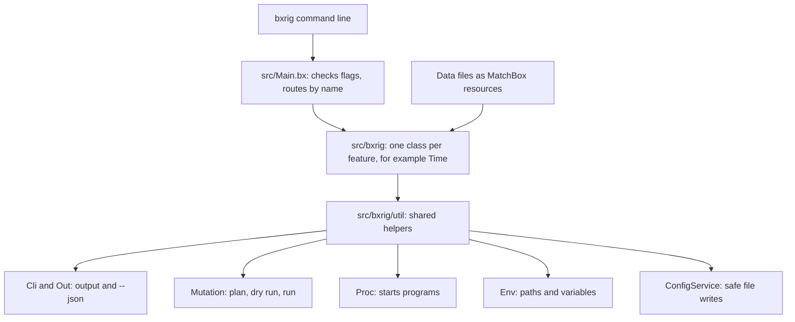
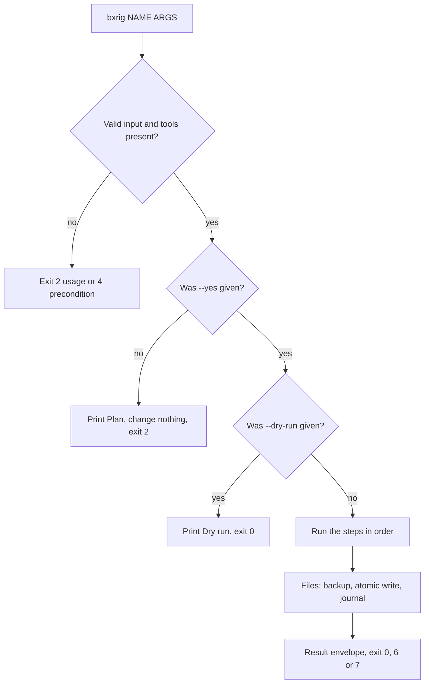

# How it fits together

BxRig is one BoxLang program compiled with MatchBox into a single binary. This page is the map. The full rules are in the [command contract](../architecture/COMMAND-CONTRACT.md).

## The shape of the code

`bxrig time zone Europe/Madrid --yes` travels through three layers. The diagram shows who calls whom.



| Layer | Where | Job |
|---|---|---|
| Router | `src/Main.bx` | One `case` per command. Checks flags against `docs/reference/cli.json`, then hands the words to a class. |
| Features | `src/bxrig/*.bx` | One class per feature (`Time`, `Theme`, `Db`, `Shortcuts`, ...). Holds the logic and returns an exit code. |
| Helpers | `src/bxrig/util/*.bx` | The one home for each concern: output, processes, paths, file writes, parsing. |
| Data | `catalog/`, `templates/`, `themes/`, `skills/`, `assets/`, `cli.json` | Packed into the binary as MatchBox resources and read through `bxrig.util.Res`. From source they are read from disk. |

> **Tip:** Before you write a helper, search `src/bxrig/util/`. If it exists, use it. See [Code rules](code-rules.md).

## The rules every changing command follows

Four promises, the same for every command that installs, writes or removes something.

1. **Plan first.** Without `--yes` the command prints the exact plan, changes nothing and exits 2.
2. **`--dry-run` is safe.** With `--dry-run` it prints the plan or the exact commands and exits 0.
3. **`--json` is one object.** Every command can print a single JSON envelope instead of text.
4. **Exit codes mean something.** Scripts can tell "bad usage" from "tool missing" from "step failed".

Settings that only touch your own config (a theme, the bar) act at once and take `--dry-run`. Anything that installs packages or writes system files always needs `--yes`.

### Life of a changing command

The diagram follows one run from the command line to the exit code.



All of this comes from two helpers, so a command never writes it by hand:

- `Out.plan` and `Mutation.run` print the plan, honour `--dry-run` and run the steps (the first failing step stops the run, exit 6).
- `ConfigService` writes files: it takes a backup, replaces the file atomically, records a journal entry and holds a lock (a file you edited or a symlink target is a conflict, exit 8).

### Exit codes in plain language

| Code | Name in code | Means |
|---|---|---|
| 0 | `ok` | Done, or nothing to do. |
| 2 | `usage` / `plan` | Bad usage, or you only got the plan. |
| 4 | `precondition` | A tool, monitor or name is missing. |
| 6 | `failed` | The step you asked for failed. |
| 7 | `partial` | Some items worked, some did not. |
| 8 | `conflict` | A file you edited, or another run is active. |
| 9 | `internal` | A bug. `Application.bx` prints it and exits 9. |

The full list (1, 3, 5, 10 too) is in `src/bxrig/util/Exit.bx` and the [contract](../architecture/COMMAND-CONTRACT.md). Use the name, never the number: `out.precondition( ... )`, `xit.usage()`.

### The `--json` envelope

Every result has the same outer shape, built by `Cli.envelope`. Only `data` differs per command.

```json
{
  "schema": 1,
  "command": "time zone",
  "version": "0.11.0-dev",
  "ok": false,
  "exit": 2,
  "dry_run": false,
  "data": { "commands": [ "sudo timedatectl set-timezone Europe/Madrid" ] },
  "warnings": []
}
```

`ok` is true only when `exit` is 0. A plan is exit 2 with the plan in `data`. A dry run is exit 0 with `dry_run` true.

## Advanced

- **MatchBox quirks** (no base classes, no postfix operators on indexes, case-insensitive string compare) are listed in [Code rules](code-rules.md).
- **Auto snapshot.** Before `refresh`, `reinstall`, `init` and system updates run with `--yes`, `Main.bx` takes a quiet config snapshot (`bxrig backup config auto off` turns it off).
- **Internal errors.** An uncaught exception reaches `onError` in `src/Application.bx`: it prints `bxrig: internal error: ...` and exits 9.
- **Logging.** `Cli.say` writes one line per result to MatchBox's `bxrig` log (`~/.matchbox/logs/bxrig.log`). Exit 0 is information, 2 and 10 debug, 1, 3 and 4 warning, anything else error.
- **Where files live.** State, journal and backups are under `~/.local/state/bxrig/`, config under `~/.config/bxrig/`, always asked from `Env`. See [config files](../reference/config-files.md).
