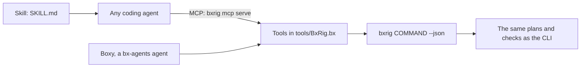

# Skills, MCP and agents

Three ways to let an AI agent work with BxRig. Pick the one you need.

| Recipe | You write | The agent gets |
|---|---|---|
| [A. Skill](#a-write-an-agent-skill) | A `SKILL.md` | Knowledge: which commands exist and when to use them. |
| [B. MCP tool](#b-expose-a-tool-over-mcp) | One BoxLang function | An action it can call, with approval for changes. |
| [C. BoxLang agent](#c-build-a-boxlang-agent) | An agent project | Its own assistant on your machine. |

This diagram shows how they connect: tools are written once and used by Boxy and by any other agent through MCP.



## A. Write an agent skill

A skill is a Markdown file that tells an agent what BxRig can do. BxRig ships its own in `skills/`, one folder each, and `bxrig skills install bxrig` stores them in `~/.agents/skills` and links them into every agent you have.

Files you touch:

| File | What for |
|---|---|
| `skills/NAME/SKILL.md` | The skill. The folder name is the skill name. |
| `tests/skills-test.sh` | Lists the skill names it expects to be stored. |

Steps:

1. Make the folder and file. Start with this frontmatter: `name` equals the folder name, and `description` says when to use the skill, because that is what the agent reads to decide.

   ```markdown
   ---
   name: bxrig-example
   description: "Use this skill when the user asks about example things on a BxRig machine: the example command, its flags and when to run it."
   ---

   # BxRig: example

   - Show it: `bxrig example status [--json]`.
   - Change it: `bxrig example set VALUE --yes` (a plan is printed first without `--yes`).
   ```

2. Keep it to real commands, one bullet each. Check each against `bxrig help` or [the command reference](../reference/commands.md). Say what needs `--yes`, since changes print a plan first.

3. Add the name to the list in `tests/skills-test.sh` (the `for n in bxrig bxrig-ai ...` line).

See it working:

```bash
scripts/dev-build.sh
dist/bxrig skills install bxrig --yes
dist/bxrig skills installed
dist/bxrig skills status
```

Other useful commands: `bxrig skills list`, `search TEXT`, `show OWNER/REPO/SLUG`, `update`, `remove NAME`, `link`. Skills from the hub are checked by an audit, and one that fails it is refused.

Test it: `tests/skills-test.sh dist/bxrig`.

Common mistakes: a `name` that differs from the folder, a vague `description`, and commands that do not exist.

## B. Expose a tool over MCP

`bxrig mcp serve` runs an MCP server whose tools are Boxy's tools. Each tool runs a BxRig command with `--json`, so an agent can do only what BxRig does. Add a tool once and both Boxy and every linked agent get it.

Files you touch:

| File | What for |
|---|---|
| `templates/agents/boxy/tools/BxRig.bx` | One function per tool, marked `@AITool`. |
| `templates/agents/boxy/Agent.bx` | `NEEDS_OK`: the tools that change something and need approval. |
| `tests/mcp_test.bxs` | Counts the tools (36) and the changing ones (19). Update both numbers. |
| `docs/ai/boxlang-agents.md` | The "36 tools" sentence. |

Steps:

1. Add a function to `BxRig.bx`. The `@AITool` text is what the model reads, and the DocBox `@param` lines describe the arguments. The private `bxrig()` helper appends `--json`, runs the command and returns the data.

   ```boxlang
   /**
    * Shows the uptime of this machine.
    *
    * @return The command's answer as JSON text for the model.
    */
   @AITool( "How long this machine has been running." )
   function uptime_status() { return bxrig( [ "system", "uptime" ] ); }
   ```

2. If the tool changes something, add its name to `NEEDS_OK` in `Agent.bx`. Such a tool waits for a person's OK and passes `--yes`, because the plan was the approval. Read-only tools need nothing.

3. Update the counts in `tests/mcp_test.bxs`.

See it working:

```bash
dist/bxrig mcp tools                       # your tool is listed, marked if it changes something
dist/bxrig mcp link claude-code --yes      # read-only; add --write to allow changes
dist/bxrig mcp                             # who is linked
```

`bxrig mcp link [AGENT...]` writes the agent's own config (Claude Code, Codex, Gemini CLI, OpenCode, Cursor, Zed, VS Code and more) and `unlink` takes it out. Without `--write` the changing tools are off. Test it: `(cd src && matchbox ../tests/mcp_test.bxs)` and `tests/mcp-test.sh dist/bxrig`.

Common mistakes: a tool that calls something other than a `bxrig` command, a changing tool missing from `NEEDS_OK` (it would run without asking), and forgetting the counts.

## C. Build a BoxLang agent

[bx-agents](https://bxagents.ai) builds agents in BoxLang. BxRig installs it, keeps your agent projects in `~/Agents`, runs each as a user service and can point it at your local model. Boxy, BxRig's own assistant, is such an agent: its source is `templates/agents/boxy/` (`Agent.bx`, `instructions.md`, `tools/BxRig.bx`).

Steps:

1. Install and create.

   ```bash
   bxrig ai agents install --yes
   bxrig ai agents new Helper --model=openai-compatible/qwen3.5-0.8b --no-wizard
   ```

2. Edit the project in `~/Agents/Helper`: `instructions.md` for behavior, `tools/` for what it can do, `Agent.bx` for the model.

3. A tool is a BoxLang class with `@AITool` functions, like step B. For changes that need approval, use the same pattern as Boxy: a `NEEDS_OK` list and `HumanInTheLoopMiddleware` in `Agent.bx`.

   ```boxlang
   /**
    * Helper: a bx-agents agent that keeps its changing tools behind a person's OK.
    */
   class extends="bxModules.bxai.models.runnables.AiAgent" {
   	variables.NEEDS_OK = [ "my_changing_tool" ];

   	/**
   	 * Builds the agent and puts the approval middleware in front of the changing tools.
   	 *
   	 * @return The agent.
   	 */
   	function init() {
   		super.init( name : "Helper", description : "What it is for" )
   		withCheckpointer( aiMemory( memory : "cache", config : {} ) )
   		withMiddleware( new bxModules.bxai.models.middleware.core.HumanInTheLoopMiddleware(
   			toolsRequiringApproval = variables.NEEDS_OK, mode : "web" ) )
   		return this
   	}
   }
   ```

4. Run it.

   ```bash
   bxrig ai agents start Helper
   bxrig ai agents ask Helper what can you do
   bxrig ai agents open Helper
   ```

See [BoxLang agents](../ai/boxlang-agents.md) for all the commands: stop, default, approve, skills review, and every `bxAgents` verb through `bxrig ai agents NAME VERB`.

> **Note:** The `bxrig` profile in `~/.bxagents/Agent.yml` points agents at your local model. Change `configure()` in `Agent.bx` to use another provider.

## Advanced

- The MCP server is written to `~/.local/share/bxrig/mcp` from `templates/mcp/serve.bxs` and runs on BoxLang with bx-ai (installed by bx-agents). `NEEDS_OK` is read from `Agent.bx` text, so keep its one-array-of-strings shape.
- Tool output is cut at 6000 characters before it goes to the model.
- Skills saved by an agent while it works are listed with `bxrig ai agents skills` and wait for your review.
- Next: [Add a command](add-a-command.md), [Tests](tests.md).
