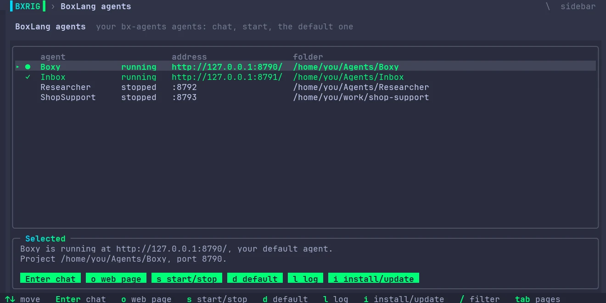

# BoxLang agents

[bx-agents](https://bxagents.ai) builds AI agents in BoxLang: an `Agent.yml`, instructions, tools, skills, routines, a web chat and a terminal chat. It has its own full command line, `bxAgents`. BxRig installs it, keeps your agent projects in one folder, runs each agent in the background, and points them at your [local model](local-ai.md) when you want.



## Install bx-agents

```bash
bxrig ai agents install             # the plan
bxrig ai agents install --yes       # the latest snapshot (the default for now)
bxrig ai agents install --stable --yes
bxrig ai agents update --yes        # the newest again, and restart the agents that run
```

bx-agents is installed for your whole machine with `bx-module` (into `~/.boxlang/modules`), like any BoxLang module. Install also offers your local model to every agent (see below).

## Make an agent

```bash
bxrig ai agents new Boxy                    # bx-agents' own wizard, in ~/Agents/Boxy
bxrig ai agents new Boxy --model=openai-compatible/qwen3.5-0.8b --no-wizard
bxrig ai agents                             # your agents: running or not, the address, the default one
```

<video src="../assets/clips/ai-agents-cli.webm" poster="../assets/screenshots/ai-agents-cli.webp" autoplay loop muted playsinline width="100%"></video>

`new` runs `bxAgents new` in your projects folder, so every question and flag is bx-agents' own. You can make one anywhere else with `bxAgents new` and tell BxRig about it: `bxrig ai agents add ~/work/shop-support`.

## Everything else is bxAgents

```bash
bxrig ai agents Boxy chat                  # the terminal chat
bxrig ai agents Boxy invoke --message="What is on my calendar today?"
bxrig ai agents Boxy routines list
bxrig ai agents Boxy skills find calendar
bxrig ai agents Boxy logs agent
```

`bxrig ai agents NAME VERB ...` is `bxAgents VERB --projectRoot=PROJECT ...`, with your words passed on exactly as you typed them. Every verb bx-agents has works this way. `bxAgents --help` lists them.

## Your local model

Install writes a `bxrig` profile into your bx-agents settings (`~/.bxagents/Agent.yml`): your active local model at BxRig's server. An agent uses it with one line in its `Agent.yml`:

```yaml
profile: bxrig
```

When you change the active model (`bxrig ai models use ID`), the profile follows. Only BxRig's own marked block in that file is written; your other settings stay. `bxrig ai agents profile --off` removes it.

## In the background

```bash
bxrig ai agents start Boxy      # builds it, then serves it on 127.0.0.1
bxrig ai agents open Boxy       # its web page
bxrig ai agents status Boxy
bxrig ai agents stop Boxy
bxrig ai agents default Boxy    # the agent your keyboard shortcut opens
```

Each agent runs as a user service (`bxrig-agent-boxy.service`) on its own port, from 8790 up, and only on this machine. Routines and gateways run while it does. Its log: `journalctl --user -u bxrig-agent-boxy.service`.

## In the Control Center and the bar

The **BoxLang agents** page (`bxrig tui ai-boxlang`) lists your agents: Enter opens the chat in a new terminal, `o` the web page, `s` starts or stops it, `d` makes it the default, `l` shows its log and `i` installs or updates bx-agents.

The bar's Agents panel has a **BoxLang** tab: each agent with Chat, its web page and Start or Stop.

## Where things are

| What | Where |
|---|---|
| Your agent projects | `~/Agents/NAME` (`bxrig ai agents dir PATH` moves the folder, `BXRIG_AGENTS_DIR` overrides it) |
| Each agent's data: chats, notes, files, skills, logs | `~/.bxagents/NAME`, bx-agents' own place, outside the project, so a build never touches it |
| Your bx-agents settings, for every agent | `~/.bxagents/Agent.yml` |
| BxRig's list: ports, the default, projects added by path | `~/.config/bxrig/agents.json` |
| The service of each agent | `~/.config/systemd/user/bxrig-agent-NAME.service` |

Each agent keeps its data by its name, so two agents can not share a name.

To back up your agents, keep `~/Agents` and `~/.bxagents`. `bxrig ai agents Boxy backup` makes a zip of one agent's data.
