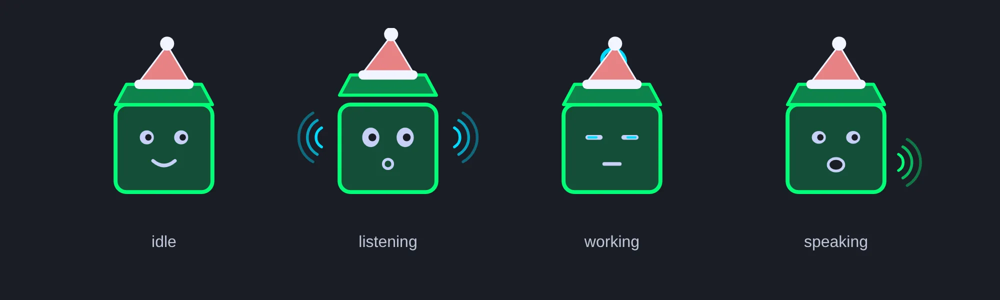
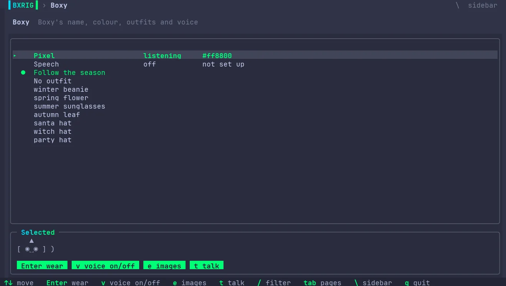

# Boxy's look and voice

Boxy is the desktop assistant `bxrig ai agents setup` makes. This page is about how it looks and sounds. **Nothing here is on until you turn it on:** no microphone, no speech, no outfit other than the season's.

```bash
bxrig boxy                                     # Boxy now, as text
bxrig boxy look --name=Pixel --color='#ff8800' # a name and a colour (the default follows your theme)
bxrig boxy look --holidays=christmas,halloween --birthday=03-09
bxrig boxy export                              # the four pictures
```



<video src="../assets/clips/boxy-look-cli.webm" poster="../assets/screenshots/boxy-look-cli.webp" autoplay loop muted playsinline width="100%"></video>

## Look

- **Colour** follows your theme's accent unless you pick one with `--color`.
- **Outfits** follow the season in `auto`: a beanie in winter, a flower in spring, sunglasses in summer, a leaf in autumn. Holiday outfits (`christmas`, `halloween`, `newyear`) appear only for the holidays you list, and the party hat on your birthday. `--outfit=none` turns it all off, or pick one: `beanie`, `flower`, `sunglasses`, `leaf`, `santa`, `pumpkin`, `party`.
- **Four pictures:** idle, listening, working (a BoxLang swirl above its head) and speaking. The bar shows the one for what Boxy is doing; `bxrig boxy export` writes them as PNG (SVG without `rsvg-convert` or ImageMagick).
- **In a terminal** it is a small text sprite, like `[ •‿• ]`, with the outfit as a hat above.

The Control Center has a Boxy page (`bxrig tui boxy`): Enter on an outfit puts it on.



## Talk to it

Install Voxtype (`bxrig dictation setup voxtype`), then **hold Super+Comma, speak, let go**. The Copilot key (Super+Shift+F23) does the same. In the Mac key style the key is Super+Ctrl+Slash, since Super+Comma is Preferences there. The bar's Boxy tab has a Talk button as well.

Your words go to Boxy like a typed question. The answer comes as a notice. **If Boxy wants to change something, it waits for you on screen: approving is never done by voice.**

## Let it speak

Speech is off. To turn it on, point it at any OpenAI-compatible `/v1/audio/speech` server:

```bash
bxrig secrets set OPENAI_API_KEY
bxrig boxy voice set --url=https://api.openai.com/v1/audio/speech --model=tts-1 --voice=alloy --key=OPENAI_API_KEY
bxrig boxy voice on
bxrig boxy say "hello"
```

With a cloud server, each answer Boxy reads aloud is sent there: `bxrig boxy voice` and `bxrig privacy` both say where. A local speech server works the same way, with a `127.0.0.1` URL. It needs one of `pw-play`, `paplay`, `ffplay` or `mpv`.

## Not tested on real hardware

The commands and the keys are tested with fake tools. The first real run (your microphone, Voxtype's service, the key release, and the picture in the bar) is on your machine.
