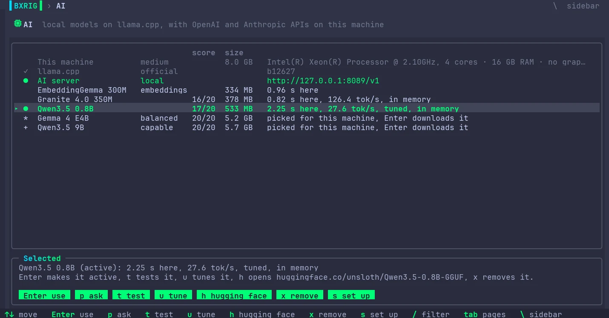

# Local AI

BxRig runs AI models on your own machine with [llama.cpp](https://github.com/ggml-org/llama.cpp). It looks at your hardware, offers the models that fit, downloads them, checks that they answer, and serves them all from one server on `127.0.0.1:8089` with:

| API | Address |
|---|---|
| OpenAI (chat, completions, tools) | `http://127.0.0.1:8089/v1` |
| Anthropic (messages) | `http://127.0.0.1:8089/v1/messages` |
| Embeddings | `http://127.0.0.1:8089/v1/embeddings` |

Any app or agent that speaks one of these APIs can use your models. Nothing leaves your machine.



## Set it up

The wizard asks on its AI page (now or later). Later works the same way:

```bash
bxrig ai setup                    # the plan: engine, models, server
bxrig ai setup --yes              # the balanced pick and the embedding model
bxrig ai setup --picks=all --tune --yes
```

<video src="../assets/clips/ai-cli.webm" poster="../assets/screenshots/ai-pull.webp" autoplay loop muted playsinline width="100%"></video>

`setup` installs llama.cpp when it is missing, downloads the models, starts the server, asks each model a test question and, with `--tune`, tunes them for your machine.

## Your hardware and the picks

```bash
bxrig ai hardware
bxrig ai models recommend          # up to three picks for this machine
bxrig ai models recommend --all    # everything that fits
```

BxRig works out a **budget** for models: the memory of a dedicated graphics card minus 1 GB, or half of your RAM when the graphics share it. From the budget it offers up to three chat models:

| Pick | What it is |
|---|---|
| **balanced** (the default) | the best score among models that answer in about 3 seconds |
| **fastest** | the quickest model that still does well |
| **capable** | the best score that fits |

Each model in BxRig's catalog was tested by BxRig on 20 tasks (following instructions, tool calls, JSON, reasoning); the score is shown next to it. Models BxRig has not tested are listed with `--all` but never picked. A small embedding model (EmbeddingGemma 300M) comes with every setup, for search over your own files.

## The engine

```bash
bxrig ai engine                    # installed? which build?
bxrig ai engine install --yes      # the official installer (llama.app)
bxrig ai engine install --source=aur --yes   # Arch: llama.cpp-vulkan-bin
bxrig ai engine update --yes
```

The official installer checks your machine and installs the matching build: CUDA on NVIDIA, ROCm on AMD cards, Vulkan for other graphics, or the CPU build. It goes to `~/.local/bin/llama`.

## Models

```bash
bxrig ai models                    # what you have, the active one marked
bxrig ai models pull gemma-4-e4b qwen3.5-0.8b --yes
bxrig ai models use qwen3.5-0.8b   # the active chat model
bxrig ai models test               # ask each one a question, timed
bxrig ai models tune --yes         # benchmark threads, batch size, flash attention
bxrig ai models remove qwen3.5-0.8b --yes
bxrig ai ask "What is BoxLang?"
```

Downloads run up to three at a time, continue where they stopped after an interruption, and are checked against the checksum in BxRig's catalog before they are used. A file that does not match is kept as `.part` and never served.

**Tune** runs llama.cpp's benchmark on each model (about a minute) with different thread counts, batch sizes and flash attention, and keeps the fastest settings for your machine. You can skip it at setup and run it any time.

## Discover more models

```bash
bxrig ai discover                  # staff picks for this machine, then the most downloaded GGUF models
bxrig ai discover qwen --fits      # search Hugging Face; only what fits here
bxrig ai models pull hf:bartowski/SmolLM2-1.7B-Instruct-GGUF --yes
bxrig ai models pull hf:OWNER/REPO/FILE.gguf --yes     # a quant of your choice
```

**Staff picks** are the models BxRig tested, picked for your hardware. The rest come from Hugging Face and are marked as not tested by BxRig. For each repository BxRig picks one file (a 4-bit quant first), shows its size and whether it fits, and checks the download against the SHA-256 that Hugging Face publishes. Only language models are listed (text, text with images, embeddings).

<video src="../assets/clips/ai-discover-tui.webm" poster="../assets/screenshots/ai-page-search.webp" autoplay loop muted playsinline width="100%"></video>

## Downloads in the background

```bash
bxrig ai models pull gemma-4-e4b qwen3.5-4b --background --yes
bxrig ai downloads                 # each one's share, queued, checking, done or failed
bxrig ai downloads cancel qwen3.5-4b
bxrig ai downloads clear           # forget the finished ones
```

Three download at a time; the rest wait in the queue. A background pull keeps going when you close the terminal or the Control Center.

## How well a model does here

```bash
bxrig ai bench                     # the active model
bxrig ai bench qwen3.5-0.8b
```

`bench` runs BxRig's 20 tool-calling tasks (setting a theme, a reminder, an agenda, installing an app, two actions at once, and requests that need no tool) against your own server and reports the score, the median reply time and the tasks it missed. These are the same tasks behind the scores in BxRig's catalog, so you can compare a model you found on Hugging Face with the tested ones. The result is kept with the model and shown in `bxrig ai models`.

## Coding agents on local models

```bash
bxrig ai link                              # which agents use the local server
bxrig ai link opencode --yes               # add BxRig's server to OpenCode
bxrig ai link opencode --default --yes     # and make the active model its default
bxrig ai link crush --yes
bxrig ai link opencode --off --yes
```

Only BxRig's own part of each agent's config is written (a provider called `bxrig`); everything else stays, and the old file is kept as `.bxrig-backup`. OpenCode gets a provider in `~/.config/opencode/opencode.json` with your chat models; Crush gets a `llamacpp` provider block in `~/.config/crush/crushrc` and finds the models itself. A config with comments (JSONC) is not rewritten. While the server listens on your network it needs an API key, so agents are linked only while it listens on 127.0.0.1.

## The server

```bash
bxrig ai serve                     # running? where?
bxrig ai serve start
bxrig ai serve stop
bxrig ai serve --listen=0.0.0.0 --yes   # also on your network
```

The server is a user service (`bxrig-ai.service`) running llama.cpp in router mode: every model you downloaded is available by its id, loaded when it is first asked for. Listening on your network (`0.0.0.0`) needs an API key: BxRig makes one, shows it once and keeps it in `~/.config/bxrig/ai-api-key` (only you can read it). Send it as `Authorization: Bearer KEY`.

## In the Control Center and the bar

The **AI** page of the Control Center (`bxrig tui ai`) shows your machine, the engine, the server, your models and the picks you do not have yet. Enter downloads a pick or makes a model active, `t` tests, `u` tunes, `h` opens the model on Hugging Face, `x` removes it, `p` asks a question and `s` sets everything up.

**Discover** (`bxrig tui ai-discover`) shows downloads in progress, the staff picks and Hugging Face: `/` searches, Enter queues a download, `c` cancels one, `h` opens the model on Hugging Face. **Agents** (`bxrig tui ai-agents`) lists your coding agents: the default one, which use the local server (`l` switches), their sessions; Enter starts a session and `d` makes one the default. On the AI page, `b` runs the bench on the model under the cursor.

The bar's Agents panel has a **Local** tab: the server with Start and Stop, your models with Use, downloads in progress, and a box to try a question.

## Files

| File | What it holds |
|---|---|
| `~/.local/share/bxrig/models/` | the model files |
| `~/.config/bxrig/ai.json` | your models, the active one, tuned settings, measured speed, where the server listens |
| `~/.config/bxrig/ai-models.ini` | the server's model list, written from `ai.json` |
| `~/.config/systemd/user/bxrig-ai.service` | the server |
| `~/.local/state/bxrig/ai-downloads/` | the download queue, one record per model |

Other local AI apps (LM Studio, Jan, Ollama and others) are still in the app catalog if you prefer them.
