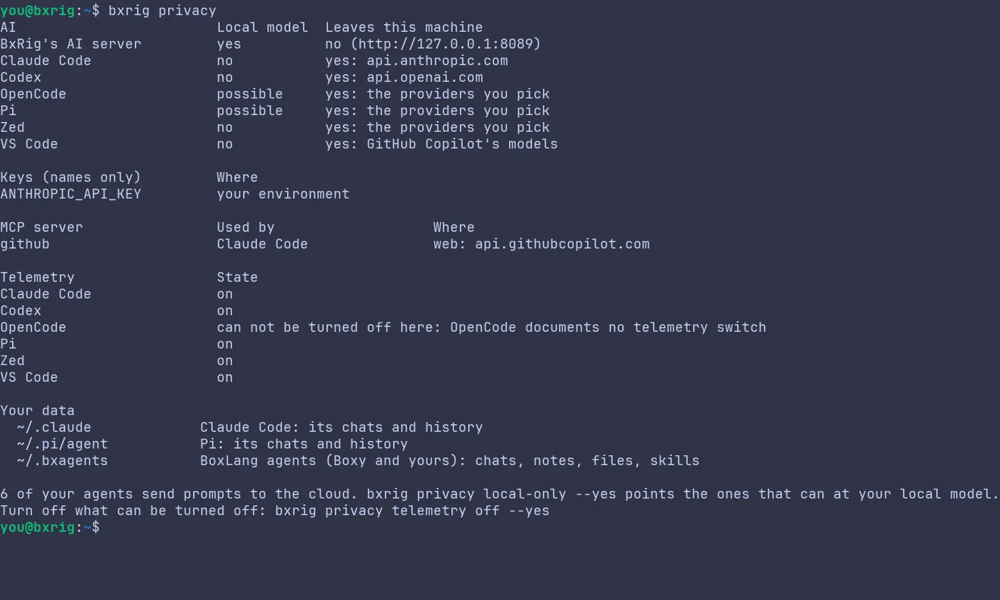
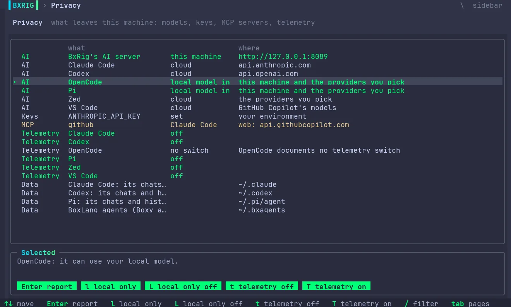

# MCP and privacy

## BxRig's tools in your coding agent

Your coding agent or editor can use BxRig the way Boxy does: ask how the battery is, list the themes, check your agenda, search the app catalog, see your databases. BxRig gives them its tools over MCP (Model Context Protocol), which every major agent speaks.

```bash
bxrig mcp                         # each agent and editor: linked or not
bxrig mcp link --yes              # every one you have installed, read-only
bxrig mcp link pi-agent --write --yes   # one agent, and it may change things too
bxrig mcp tools                   # the tools: what reads and what changes
bxrig mcp unlink --yes
```

<video src="../assets/clips/mcp-cli.webm" poster="../assets/screenshots/mcp-cli.webp" autoplay loop muted playsinline width="100%"></video>

**Read-only unless you say so.** A linked agent gets 17 tools that only read. With `--write` it also gets the 19 that change something (the theme, night light, reminders, installing an app, starting a database, a system update) and, like for its own tools, it asks you before each one.

**The same tools as Boxy.** They are Boxy's own tools, so each one runs a BxRig command: an agent can do only what BxRig does, through the same plans and checks.

**Where it goes.** `link` writes only BxRig's own entry, in each agent's own place, and keeps the old file as `FILE.bxrig-backup`:

| Agent or editor | Where |
|---|---|
| Claude Code, Codex | their own `mcp add` command |
| Pi | `~/.pi/agent/mcp.json` |
| Gemini CLI | `~/.gemini/settings.json` |
| OpenCode | `~/.config/opencode/opencode.json` |
| GitHub Copilot CLI | `~/.copilot/mcp-config.json` |
| Cursor and Cursor Agent | `~/.cursor/mcp.json` |
| Amp | `~/.config/amp/settings.json` |
| Crush | `~/.config/crush/crushrc` |
| Goose | `~/.config/goose/config.yaml` |
| Kiro | `~/.kiro/settings/mcp.json` |
| Qwen Code | `~/.qwen/settings.json` |
| Grok Build | `~/.grok/config.toml` |
| Antigravity | `~/.gemini/config/mcp_config.json` |
| Zed | `~/.config/zed/settings.json` (your comments stay) |
| VS Code | `~/.config/Code/User/mcp.json` |

A file BxRig can not change safely (JSON with comments where the agent does not allow them, or an entry of yours in the way) is left out with the reason; name the agent to see it as an error. Restart an agent that is running to see the tools.

**What it runs on.** The server is BoxLang with bx-ai, which [bx-agents](boxlang-agents.md) installs: `bxrig ai agents install --yes` once. The agent starts `bxrig mcp serve` itself, for its session.

## What leaves this machine

```bash
bxrig privacy
```



For each AI on this machine: where its model runs (here or in the cloud, and whose), whether it could use your local model, the keys you stored (by name, never a value), the MCP servers each agent can reach and where they are, each agent's telemetry, and the folders where agents keep your chats.

**Use your local model.** The agents that can use a local model get BxRig's server, `127.0.0.1:8089` (see [Local AI](local-ai.md)):

```bash
bxrig privacy local-only --yes        # OpenCode, Pi, Copilot CLI, Crush, Goose
bxrig privacy local-only --off --yes
```

OpenCode also makes your active model its default; in the others pick the BxRig provider. The rest can not use a local model, and the report says why: Claude Code, Gemini CLI, Antigravity and Kiro only offer their makers' models, and Cursor and Amp send every request through their own servers. Qwen Code, Grok Build, Zed, VS Code and Codex can be pointed at it by hand; the report says where (Codex needs the Responses API, which only recent llama.cpp builds offer).

**Turn off telemetry.** Where the agent has a documented switch:

```bash
bxrig privacy telemetry off --yes
bxrig privacy telemetry on zed --yes   # one agent back to its own default
```

| Agent | What BxRig sets |
|---|---|
| Claude Code | `DISABLE_TELEMETRY` and `DISABLE_ERROR_REPORTING` in `~/.claude/settings.json` |
| Codex | `[analytics] enabled = false` |
| Gemini CLI, Qwen Code | `privacy.usageStatisticsEnabled: false` |
| Pi | `enableInstallTelemetry: false` |
| Goose | `GOOSE_TELEMETRY_ENABLED: false` |
| Kiro | `kiro-cli settings telemetry.enabled false` |
| Zed | `telemetry.diagnostics` and `telemetry.metrics` off |
| VS Code | `telemetry.telemetryLevel: off` |

For the others the report says how, when there is a way: Crush with `CRUSH_DISABLE_METRICS=1` in your shell, Cursor with Privacy Mode in your account, Antigravity in its settings. OpenCode, Amp and Grok Build document no switch.

## In the Control Center and the bar



The **Privacy** page (`bxrig tui privacy`) shows the same report as rows: a cloud agent that could be local and a web MCP server are flagged. `l` turns local-only on (`L` off), `t` turns telemetry off (`T` back on). The bar's Agents panel has a **Privacy** button that opens it.
