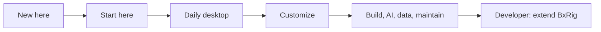

# BxRig

**BxRig** brings an opinionated, beautiful and efficient desktop to Linux, built for developers. It turns a fresh CachyOS or Arch install into a finished developer rig: Hyprland with Noctalia (KDE Plasma stays installed beside it), BoxLang and MatchBox, your apps, your shell, your AI agents, all chosen in one guided setup. It is a single native program written in [BoxLang](https://boxlang.io) and compiled with [MatchBox](https://matchbox.boxlang.io).

**Supported: CachyOS, Arch Linux, openSUSE Tumbleweed and Slowroll, Ubuntu 26.04 LTS and Debian 13.** See [Distributions](start/distributions.md) for what each one offers.

*This is the documentation for version {{ version }}.*


<video src="assets/clips/theme-switcher.webm" poster="assets/screenshots/panel-theme-switcher.webp" autoplay loop muted playsinline width="100%"></video>

Twenty-four themes, each with its own wallpaper: see them all in [Themes](customize/themes.md).

## Pick your path



::: card title="I am new" href="start/index.md"
Install in one command, answer the wizard, take the first-hour tour.
:::

::: card title="Make it mine" href="customize/index.md"
Themes, bar, fonts, shortcuts and your own config files, from the first tweak to deep tweaking.
:::

::: card title="Use it every day" href="desktop/index.md"
The control center, shortcuts, launcher and system settings.
:::

::: card title="Extend BxRig" href="developer/index.md"
Add a command, a theme, an app, a shortcut, a wizard page, a bar plugin or an agent skill.
:::

## Install

```bash title="One line"
curl -fsSL {{ installUrl }} | bash
```

It checks your machine, downloads and verifies the release, installs everything, then starts the setup wizard. See [Install](start/install.md).

## What you get

| Section | What is in it |
|---|---|
| [Start here](start/index.md) | Install, the wizard, your first hour, troubleshooting |
| [Daily desktop](desktop/index.md) | Hyprland and Noctalia, the menu, shortcuts, the launcher, monitors and power |
| [Customize](customize/index.md) | Themes, bar and dock, fonts, accessibility, Boxy's look, your own config |
| [Build software](build/index.md) | BoxLang and MatchBox, developer tools, databases, VMs, the mail catcher, Android |
| [AI](ai/index.md) | Coding agents, local models, your own BoxLang agents, MCP and privacy |
| [Apps and your data](data/index.md) | The app catalog, BxTimeMachine backups, NAS, the scheduler |
| [Keep it healthy](maintain/index.md) | Updates and channels, security, caches |
| [Developer](developer/index.md) | Architecture, tutorials for every extension point, tests, releases |
| [Reference](reference/commands.md) | Every command and flag, config files |

## How it behaves

- Nothing changes until you say so: every command prints a plan and needs `--yes`.
- Files you edit are kept. BxRig only rewrites files it wrote itself.
- Everything is also a command, with `--json` output, so you can script it.
