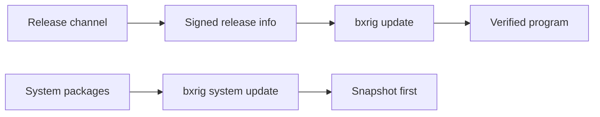

# Keep it healthy

Updates, trust and housekeeping. BxRig checks signatures before it changes anything and takes a snapshot before it updates the system.

The diagram shows the two kinds of updates: BxRig itself, verified by signature, and the system, protected by a snapshot.

::: card title="Updates and channels" href="updates.md"
Stable and beta, update checks, notifications and system updates.
:::

::: card title="Security" href="security.md"
What the installer and updater verify, where secrets live, fingerprint and security keys.
:::

::: card title="Pictures in the terminal" href="images.md"
How icons and screenshots are fetched, cached and kept from breaking a screen.
:::
