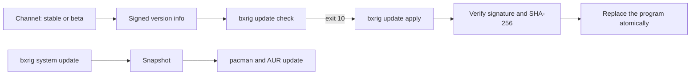

# Updates and channels

Use this page to update BxRig, get told when something is waiting, and update the system safely.

## Try it

```bash
bxrig update check              # exit 10 means an update is available
bxrig update apply --yes        # download, verify, replace atomically
bxrig system update --yes       # snapshot first, then the system packages
```



The diagram shows both flows: BxRig updates itself from its channel after verifying, and the system update takes a snapshot first.

## Pick a channel

| Channel | What it is |
|---|---|
| `stable` | Tagged releases |
| `beta` | The bleeding edge: a build of every push to `development` |

```bash
bxrig update channel            # show
bxrig update channel beta       # switch
```

Both are also in the control center (Settings, Updates).

## Update BxRig

```bash
bxrig update check              # exit 10 means an update is available
bxrig update apply --yes        # download, verify, replace atomically
```

The release information is signed (Ed25519) and the binary's SHA-256 is checked against it; a bad signature or checksum changes nothing.

`bxrig update` replaces only the `bxrig` program. MatchBox (the toolchain) is not touched; move it with `mvm update`, or run the installer again with `--snapshot` or `--matchbox-branch REF` (see [getting started](../start/install.md#which-matchbox)).

## Get told about updates

```bash
bxrig update notifications on     # a daily user timer shows a desktop notification
bxrig update notifications off
```

The notification covers BxRig and pending system packages.

## See what is waiting

```bash
bxrig system updates            # counts, the package list and whether a restart is needed
bxrig system updates --json     # the same as data for scripts and the System panel in the bar
```

It reads only: repository packages from `checkupdates` (the `pacman-contrib` package) and AUR packages from `yay -Qua` or `paru -Qua`. It exits 0 even when updates are waiting, and 4 when `checkupdates` is missing or cannot reach the mirrors.

## Update the system

```bash
bxrig system update             # the plan: the snapshot step, then the update steps (exit 2)
bxrig system update --yes       # snapshot first (snapper or timeshift), then pacman -Syu and yay -Sua
bxrig system update --repo --yes   # the snapshot and the repository packages only
bxrig system update --aur --yes    # the snapshot and the AUR packages only (yay, else paru; exit 4 without one)
```

`--all` is the default. Every scope takes the snapshot first, and says so when snapper and timeshift are both missing. In a terminal each step is named as it starts, and a restart is mentioned at the end when the kernel was replaced.

`bxrig skills update --yes` refreshes the agent skills BxRig installed.

## Advanced

### When a restart is needed

`system updates` sets `needs_reboot` to true for either of two cases:

- **Pending.** An update in the list replaces a kernel (`linux`, `linux-lts`, `linux-zen`, `linux-cachyos` and the other flavours, not their `-headers` or `-docs`), `systemd`, `glibc`, `linux-firmware`, a CPU microcode package (`intel-ucode`, `amd-ucode`) or the NVIDIA driver. `reboot_pending` is true.
- **Stale.** The kernel that runs is gone from `/usr/lib/modules`, which means an update already replaced it. `reboot_stale` is true.

`reboot_reasons` says why in words. The last full system upgrade comes from `/var/log/pacman.log`.

### Unsigned test builds

An install made with `install.sh --source github:...` (an unsigned test build, see [getting started](../start/install.md)) is not tracked: `update check` reports an update because the program differs from the channel's, and `update apply --yes` replaces it with that channel's build.

Next: [Security](security.md) · [Backups](../data/backups.md) · [Scheduler](../data/scheduler.md)
