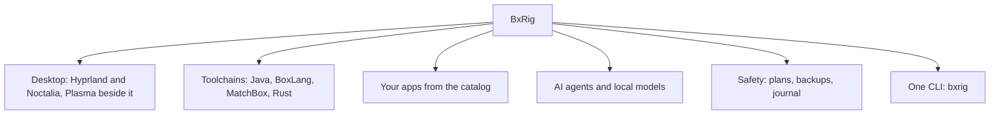
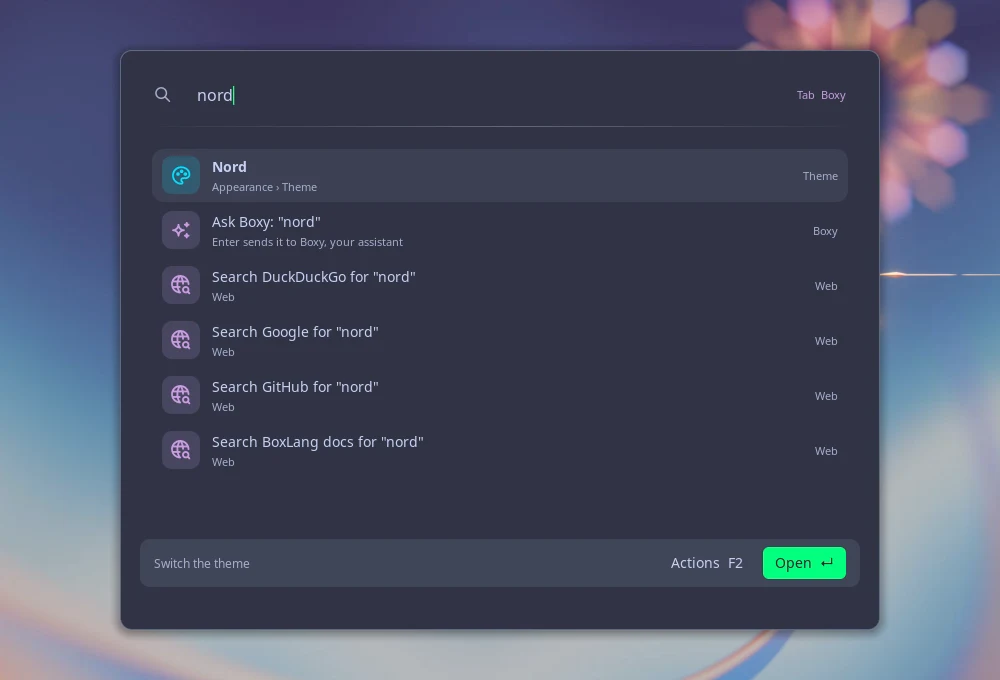

# Your first hour

The wizard is done. This page shows what you have and what to try first. Each step takes a minute.


## What you got



Everything is also a command. `bxrig help` lists them all and every command takes `--json`.

## Try these

### 1. Open the control center

Press `Super+Space`. One search box finds apps, every setting and action, themes and the clipboard. `Super+Alt+Space` opens the same actions as a menu you browse by section.



Read more: [Control center and menu](../desktop/menu.md).

### 2. Find any shortcut

Press `Super+K` for the cheat sheet, or search by words:

```bash
bxrig keys search screenshot
```

Read more: [Shortcuts](../desktop/shortcuts.md).

### 3. Change the look

```bash
bxrig theme set tokyo-night
```

It changes at once: the bar, terminals, window borders and Neovim follow.

<video src="../assets/clips/theme-switcher.webm" poster="../assets/screenshots/panel-theme-switcher.webp" autoplay loop muted playsinline width="100%"></video>

Read more: [Themes](../customize/themes.md), then [Appearance](../customize/appearance.md).

### 4. Look at your machine

```bash
bxrig status
bxrig tui
```

The terminal control center shows what needs attention and what is running.


Read more: [Control Center](../desktop/control-center.md).

### 5. Install an app

```bash
bxrig tui apps
```

A catalog of about 290 apps by category. Read more: [Apps](../data/apps.md).

### 6. Start a BoxLang project

```bash
bxrig boxlang welcome
```

Read more: [BoxLang](../build/boxlang.md).

## If something is off

`bxrig status` shows what is missing, and each doctor prints a fix. See [Troubleshooting](troubleshooting.md).

## Where next

::: card title="Make it yours" href="../customize/index.md"
Themes, bar, fonts, shortcuts and your own config files.
:::

::: card title="Keep it safe" href="../data/backups.md"
BxTimeMachine: setup snapshots, system snapshots and file backups.
:::

::: card title="Add AI" href="../ai/index.md"
Coding agents, local models and the tools they can use.
:::
