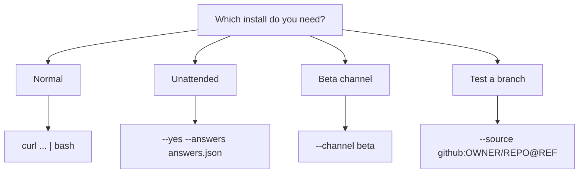

# Install options

The [normal install](install.md) is one command. This page is for when you need more: no one at the keyboard, the beta channel, a specific MatchBox, or a branch you want to test.



## Unattended

```bash
curl -fsSL {{ installUrl }} | bash -s -- --yes --answers answers.json
```

`--yes` never asks (it needs passwordless sudo). Without `--answers`, the wizard's default answers are applied. More options: `--channel stable|beta`, `--no-wizard`, `--dry-run`, `--source`, `--snapshot` and `--matchbox-branch` (below).

### Which MatchBox

The installer installs [MatchBox](https://github.com/ortus-boxlang/matchbox) with `mvm`, which it installs first. You choose which one:

| You pass | MatchBox | How |
|---|---|---|
| nothing | the **stable** release | `mvm install latest`, `mvm use latest` |
| `--snapshot` (or `BXRIG_MATCHBOX_CHANNEL=snapshot`) | the **snapshot** build | `mvm install snapshot`, `mvm use snapshot` (mvm skips a build that has not changed) |
| `--matchbox-branch REF` [`--matchbox-repo OWNER/NAME`] (or `BXRIG_MATCHBOX_BRANCH`, `BXRIG_MATCHBOX_REPO`) | a **branch** of a MatchBox repository, default `ortus-boxlang/matchbox` | shallow clone, `cargo build --release --features bif-tui`, installed under `~/.local/share/bxrig/matchbox/bin` |

```bash
curl -fsSL {{ installUrl }} | bash -s -- --snapshot
curl -fsSL {{ installUrl }} | bash -s -- --matchbox-branch bxrig
curl -fsSL {{ installUrl }} | bash -s -- --matchbox-branch feature/x --matchbox-repo someone/matchbox
```

- **The normal install needs no particular MatchBox.** It installs the prebuilt `bxrig` of your channel, so MatchBox is only part of the toolchain and any version is fine.
- **Compiling BxRig needs a MatchBox with the terminal UI.** The stable and snapshot builds do not have it yet (the `bxrig` branch is ahead of `develop`), so a stage that compiles BxRig (`install.sh` from a checkout, `--source github:...`) first runs a small probe, and stops with `This MatchBox (0.13.2) cannot compile BxRig ... Use the branch build: install.sh toolchains --yes --matchbox-branch bxrig` if the MatchBox lacks it. It never switches MatchBox on its own. `--source github:...` therefore builds the `bxrig` branch by default; give `--matchbox-branch` to use another one, and `--snapshot` makes it stop at the probe. `bxrig doctor` reports such a MatchBox as `miss matchbox ... (cannot compile BxRig; install: install.sh toolchains --yes --matchbox-branch bxrig)` and exits 4.
- **A branch build comes first.** It is installed under `~/.local/share/bxrig/matchbox/bin` and the installer calls it by that path, so the `matchbox` that `mvm` manages is not replaced. Add that directory to your `PATH` if you want `matchbox` to be the branch build. Running the installer again with `--snapshot` removes the branch build so that mvm's MatchBox is the one in use; running it with no option leaves what is installed alone, and rebuilds a branch only when its head moved.
- `REF` and `OWNER/NAME` may contain only letters, digits and `. _ / @ + -` (`. _ -` for the owner and repository), may not start with a dash and are passed to git as arguments, never through a shell. `--matchbox-from-source` is the older spelling of `--matchbox-branch bxrig`.
- `install.sh toolchains --yes [--snapshot | --matchbox-branch REF [--matchbox-repo OWNER/NAME]]` re-runs just this stage. `BXRIG_MATCHBOX_FILE=PATH` installs a MatchBox you built yourself instead.

### Testing a branch

```bash
curl -fsSL https://downloads.ortussolutions.com/ortussolutions/bxrig/install.sh | bash -s -- --source github:ortus-boxlang/BxRig@development --yes
```

`--source SPEC` (or `BXRIG_SOURCE`) says where BxRig comes from:

| SPEC | Meaning |
|---|---|
| `stable` | The default: the signed release |
| `beta` | The same as `--channel beta` |
| `github:OWNER/REPO@REF` | A branch, tag or commit of a GitHub repository. `github:@REF` and `github:REF` mean `ortus-boxlang/BxRig` |

A GitHub source is **unsigned**: no release signature and no checksum from the BxRig downloads. The installer prints a warning, and continues only with `--yes` or after you type the word `unsigned` (without either it stops with exit 2 and changes nothing). It downloads `https://codeload.github.com/OWNER/REPO/tar.gz/REF` (public repositories; for a private one set `GITHUB_TOKEN` or `GH_TOKEN`, which is sent to GitHub only as a request header and never printed or logged), unpacks it, and runs that tree's own `bootstrap/install.sh` stages: packages, toolchains, the program built from the tree's `src/Main.bx` with a MatchBox that has the terminal UI (the `bxrig` branch unless you chose another, see above), the core apps, then the wizard from the freshly built program. `--dry-run` downloads and unpacks the tree, prints the commit and the tree's plan (including the MatchBox build), and installs nothing.

The source (`github:OWNER/REPO@REF`) and the resolved commit are written to `~/.cache/bxrig/install.log` and to `~/.local/share/bxrig/install-source`. `bxrig update` does not read them: it compares the program with the channel's release, so after a GitHub install `bxrig update check` reports an update, and `bxrig update apply --yes` replaces your build with the stable (or beta) one. Skip `update apply` while you test the branch.
