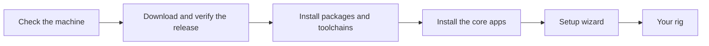

# Install

One command turns a fresh Linux install into your dev rig. It takes a few minutes and asks once.

```bash
curl -fsSL {{ installUrl }} | bash
```


## Before you start

| You need | Notes |
|---|---|
| A supported distribution | CachyOS, Arch Linux, openSUSE Tumbleweed or Slowroll, Ubuntu 26.04 LTS or Debian 13. See [Distributions](distributions.md). |
| x86_64 hardware | Other architectures are not supported. |
| A normal user with `sudo` | The installer refuses to run as root. |
| A network connection | Everything is downloaded and verified on the way. |

## What happens



1. **Check.** It looks at your distribution and shows you the plan, then asks once.
2. **Download and verify.** The program and the install bundle for your [channel](../maintain/updates.md) are checked against a signature and a SHA-256 before anything is installed. See [Security](../maintain/security.md).
3. **Install.** Packages, then the toolchains (Java 21, `bvm`, `mvm`, BoxLang, MatchBox, Rust) and the core apps.
4. **Wizard.** The [setup wizard](wizard.md) asks for your choices and shows exactly what it will run before it does.

> **Tip:** The install log is `~/.cache/bxrig/install.log`. Send it when you ask for help.

## When it is done

You land in the wizard. When it ends, try the [first hour](first-hour.md).

| Do this | With |
|---|---|
| See what is set up | `bxrig status` |
| Change your choices | `bxrig init` |
| Open the control center | `Super+Space` or `bxrig menu` |
| See every shortcut | `Super+K` or `bxrig keys sheet` |
| Check for updates | `bxrig update check` |

## Other ways to install

Unattended installs, the beta channel, a specific MatchBox or a branch you want to test are on [Install options](install-advanced.md). Something went wrong? See [Troubleshooting](troubleshooting.md).

## Next

- [Your first hour](first-hour.md)
- [The setup wizard](wizard.md)
